# GitHub 使用入门：以 AMB82 无人机项目为例

> [!NOTE]
> **先记住这条流程**
> **Issue 说明要做什么 → 分支上修改 → Commit 记录 → Push 上传 → PR 申请合并 → Review 检查 → Merge 汇入主线。**

项目：[Sireinn/AMB82-Mini-Drone-WiFi-Video](https://github.com/Sireinn/AMB82-Mini-Drone-WiFi-Video)  
用途：基于 AMB82-Mini 的无人机 Wi-Fi 图传与飞控串口通信，管理代码、硬件资料、测试数据和阶段成果。

**笔记结构**：参考《Pro Git》的“起步、Git 基础、Git 分支、分布式 Git、GitHub”编排，用自己的话整理；界面功能以 GitHub 官方说明为准。项目目录依据提供的截图，以下任务、编号、分支名和测试条件均为教学示例。

> [!TIP]
> **查看操作配图**
> 笔记已嵌入真实网页操作截图，可点击放大。下载到 Obsidian 时，请保留本文件和 assets 文件夹的相对位置。

## 目录

- [1 起步：Git、GitHub 和仓库](#1-起步gitgithub-和仓库)
- [2 基础：一次修改怎样保存和同步](#2-基础一次修改怎样保存和同步)
- [3 分支：多人怎样一起改](#3-分支多人怎样一起改)
- [4 页面速查：截图里的入口](#4-页面速查截图里的入口)
- [5 Issues：把任务说清楚](#5-issues把任务说清楚)
- [6 Pull Requests：把成果合进来](#6-pull-requests把成果合进来)
- [7 实操：队员从加入到交付](#7-实操队员从加入到交付)
- [8 项目资料怎么放](#8-项目资料怎么放)
- [9 常见困惑速查](#9-常见困惑速查)
- [10 参考书与阅读路线](#10-参考书与阅读路线)

## 1 起步：Git、GitHub 和仓库

| 名词 | 简单理解 | 项目里的例子 |
| --- | --- | --- |
| Git | 记录文件变化的版本管理工具 | 查出哪次修改改变了串口参数 |
| GitHub | 托管 Git 仓库、组织协作的网站 | 大家查看代码、分配任务和讨论修改 |
| Repository / Repo | 仓库：文件、版本历史及相关协作入口 | 整个无人机项目仓库 |
| 本地仓库 | 你电脑上的 Git 仓库 | 在电脑上修改地面站代码 |
| 远程仓库 | GitHub 上的仓库 | 团队共享的代码和历史 |
| README.md | 项目的首页说明书 | 写清目标、目录、环境和运行方法 |

**版本管理的价值**：不用反复保存“最终版、最终版2”；通过提交历史查谁改了什么、为什么改。

截图中的 **Public** 表示公开仓库。别人可以查看、下载；直接修改原仓库仍需要相应权限。

参考：[GitHub Hello World](https://docs.github.com/en/get-started/using-github/hello-world)、[《Pro Git》中文在线版](https://git-scm.com/book/zh/v2)。

## 2 基础：一次修改怎样保存和同步

| 操作 | 含义 | 容易混淆的地方 |
| --- | --- | --- |
| Clone / 克隆 | 第一次把仓库和 Git 历史复制到电脑 | 持续参与项目通常克隆一次即可 |
| Save / 保存 | 把编辑器内容写入文件 | 保存后还没有形成 Git 提交 |
| Stage / 暂存 | 选出准备放入下一次提交的修改 | 可以只提交本次任务涉及的文件 |
| Commit / 提交 | 在当前仓库记录一个版本节点 | 本地 Commit 后还需要 Push |
| Push / 推送 | 把本地提交发送到远程分支 | 推到功能分支，不等于已经合入 main |
| Fetch / 获取 | 获取远程更新信息和提交 | 不自动把更新合进当前工作分支 |
| Pull / 拉取 | 获取远程更新并整合到当前分支 | 日常用来同步队友已经提交的成果 |
| Diff / 差异 | 对比修改前后的内容 | 提交和审查前先看一遍 |

`保存文件 → 暂存修改 → Commit → Push`，这四步含义不同。网页上直接编辑并提交时，提交发生在远程，不需要再从电脑 Push。

**提交说明写“做了什么”**：

- `docs: 补充 AMB82 接线说明`
- `feat: 增加串口连接状态显示`
- `fix: 修复断线后重复连接的问题`

`docs / feat / fix` 是团队可采用的命名习惯，分别表示文档、功能、修复；不是 Git 的强制语法。

参考：[获取仓库](https://git-scm.com/book/zh/v2/Git-基础-获取-Git-仓库)、[记录每次更新](https://git-scm.com/book/zh/v2/Git-基础-记录每次更新到仓库)。

## 3 分支：多人怎样一起改

**Branch / 分支**是一条独立推进的版本线。它让你先完成修改，再决定何时合回共同版本。

| 分支示例 | 建议用途 |
| --- | --- |
| `main` | 放团队已确认的共同版本 |
| `feat/video-reconnect` | 开发图传断线重连 |
| `fix/serial-parser` | 修复串口数据解析 |
| `docs/wiring-guide` | 补充接线文档 |

分支名可以自己定。`main` 也只是常见名字；“保持 main 可用”是团队约定，需要检查和协作来落实。


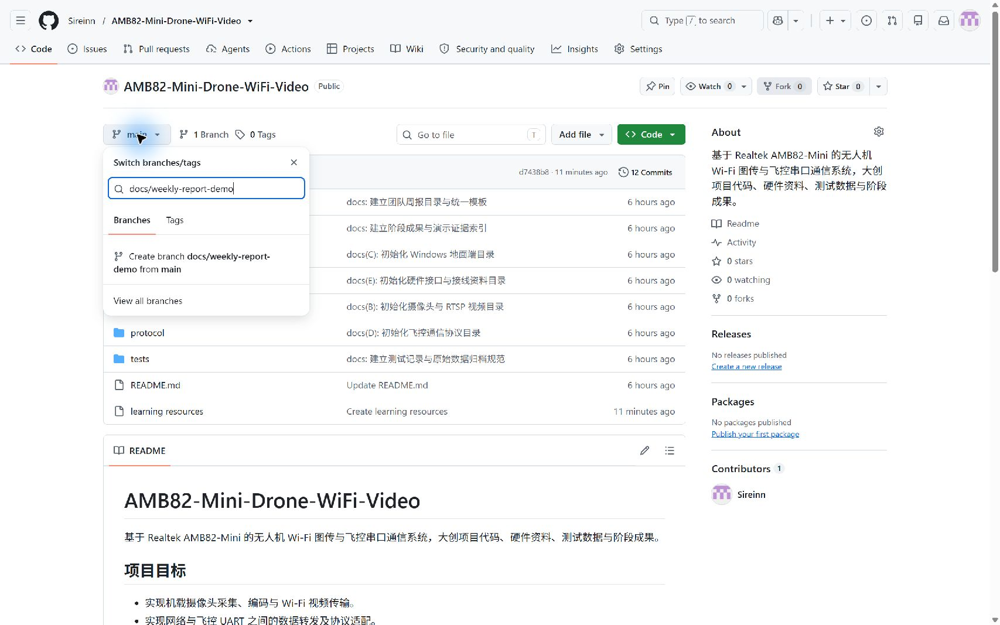

**照着点**：① 点左上角 `main ▼` → ② 输入 `docs/weekly-report-demo` → ③ 点下方 `Create branch … from main`。名称按任务修改。图中停在确认创建之前。


**Merge / 合并**：把一条分支的修改整合进另一条。  
**Conflict / 冲突**：修改无法自动整合，例如两个人改了同一段内容；需要人工确认最终保留的内容，再完成合并。

参考：[分支简介](https://git-scm.com/book/zh/v2/Git-分支-分支简介)、[分支的新建与合并](https://git-scm.com/book/zh/v2/Git-分支-分支的新建与合并)。

## 4 页面速查：截图里的入口


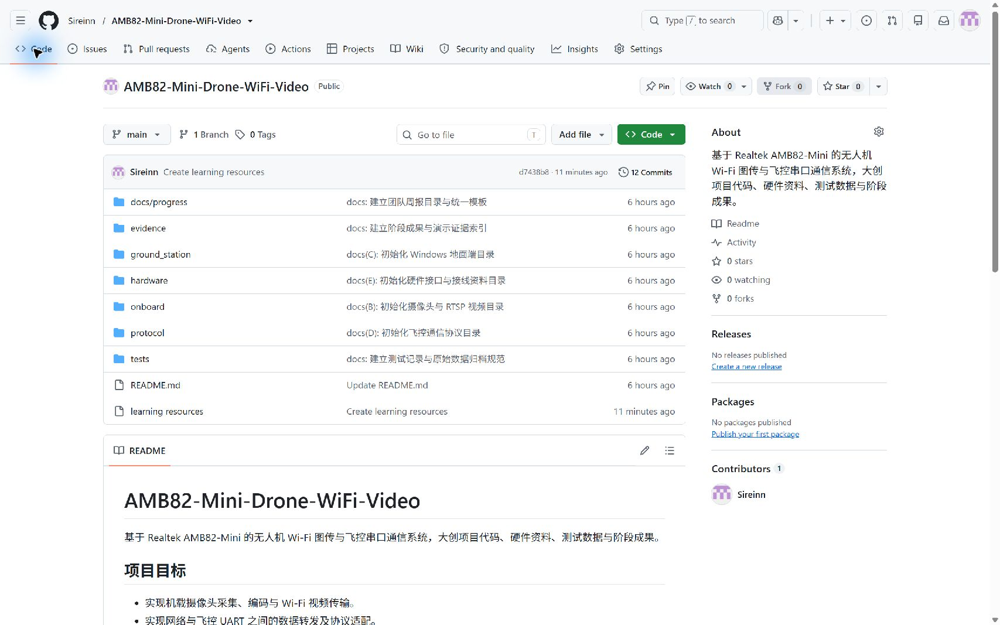

**先找这四处**：顶部 `Issues` 管任务，`Pull requests` 管合并；文件列表上方 `main ▼` 管分支，绿色 `Code` 菜单获取仓库。


### 顶部导航

| 入口 | 是干什么的 | 本项目怎么用 |
| --- | --- | --- |
| **Code** | 查看文件、分支和提交历史 | 找 `onboard/` 代码、读 README |
| **Issues** | 记录任务、问题和需求 | “图传断线后不能恢复” |
| **Pull requests** | 提出、讨论和审查合并请求 | 请队友检查串口解析修改 |
| **Agents** | 发起、查看和管理 AI 编程代理任务 | 辅助写测试、改文档；产出仍需检查 |
| **Actions** | 按事件运行自动化流程 | 提交后运行协议解析测试 |
| **Projects** | 用表格、看板、路线图管理任务 | 待办 → 进行中 → 待验收 → 完成 |
| **Wiki** | 写多页项目说明文档 | 硬件选型和操作手册 |
| **Security and quality** | 集中查看安全与质量相关分析和告警 | 检查依赖漏洞、代码扫描结果 |
| **Insights** | 查看贡献、提交和活动等统计 | 了解项目近期变化 |
| **Settings** | 配置仓库、访问权限和规则 | 邀请队员、设置分支保护 |

Agents 和部分分析功能能否使用，取决于账号、仓库设置及服务支持。Actions 的流程也需要配置后才会执行。

**先学 Code、Issues、Pull requests；用 Projects 看进度。** Wiki、Agents、Actions 可以按需要逐步引入。自动化通过，只说明对应检查通过；无人机硬件联调还需要实际测试。

依据：[Issues](https://docs.github.com/en/issues/tracking-your-work-with-issues/learning-about-issues/about-issues)、[Projects](https://docs.github.com/en/issues/planning-and-tracking-with-projects/learning-about-projects/about-projects)、[Actions](https://docs.github.com/en/actions/get-started/understand-github-actions)、[Agents](https://docs.github.com/en/copilot/concepts/agent-capabilities/choosing-and-delegating-agent-work/agent-management)、[安全与分析设置](https://docs.github.com/en/repositories/managing-your-repositorys-settings-and-features/enabling-features-for-your-repository/managing-security-and-analysis-settings-for-your-repository)。

### Code 页面上的按钮

| 按钮或区域 | 含义 |
| --- | --- |
| `main ▼` | 切换或新建分支；文件列表显示的是当前所选分支 |
| Branches | 查看分支列表 |
| Tags | 给某个版本打标记，例如 `v0.1.0` |
| Go to file | 按文件名快速寻找文件 |
| Add file | 新建文件或上传文件；完成提交后才会记录进仓库 |
| 绿色 Code 按钮 | 获取克隆地址、打开 Desktop 或下载 ZIP |
| HTTPS / SSH | 两种连接仓库的方式；SSH 需要配置密钥 |
| GitHub CLI | 使用 `gh` 命令行工具操作 GitHub |
| Local / Codespaces | 选择本地工具或云端开发环境 |
| Open with GitHub Desktop | 用桌面客户端克隆和管理仓库 |
| Download ZIP | 下载当前版本文件，压缩包不包含 Git 提交历史 |

**Clone 与 ZIP**：要持续开发、同步和提交，用 Clone；只想快速看文件，可以下载 ZIP。


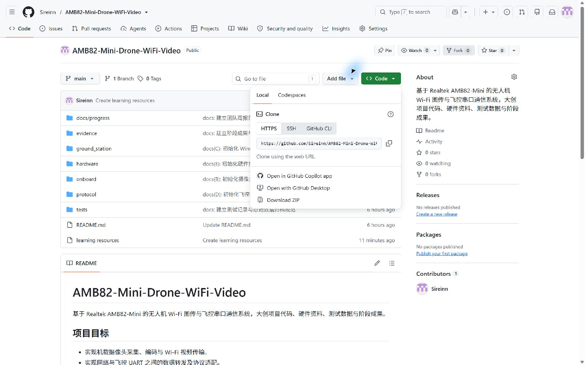

**照着点**：① 点绿色 `Code` → ② 选择 `HTTPS` → ③ 点地址右侧复制图标。使用 Desktop 则点 `Open with GitHub Desktop`；只下载文件则点 `Download ZIP`。

### 右上角和右侧栏

| 名称 | 含义 | 对团队的用途 |
| --- | --- | --- |
| Pin | 固定仓库，便于在个人主页展示等 | 方便找到项目 |
| Star | 收藏、表达关注 | 不会因此获得写权限 |
| Watch | 设置更新通知 | 按需关注 Issue、PR 等变化 |
| Fork | 在自己账号下创建派生仓库 | 外部贡献者可在自己的仓库修改后提 PR |
| About | 项目简介、链接和主题 | 一眼看懂项目做什么 |
| Releases | 基于标签整理发布版本和附件 | 发布中期演示固件及版本说明 |
| Packages | 托管软件包、容器镜像等 | 普通项目资料不必放这里 |
| Contributors | 展示贡献者 | 可辅助了解代码贡献 |

**Fork 与 Clone**：Fork 是在 GitHub 上派生一个仓库；Clone 是复制到电脑。你们已经有协作者权限时，可以直接在原仓库建分支。

**Tag 与 Release**：Tag 标记历史中的一个版本；Release 在标签基础上补充发布说明和可下载附件。

参考：[Clone 与 Fork](https://docs.github.com/en/desktop/adding-and-cloning-repositories/cloning-and-forking-repositories-from-github-desktop)、[Releases](https://docs.github.com/en/repositories/releasing-projects-on-github/about-releases)。

## 5 Issues：把任务说清楚

**一个 Issue 管一件可以跟进的事。** 它可以是缺陷、功能、实验或文档任务。


### 操作图：新建并填写 Issue

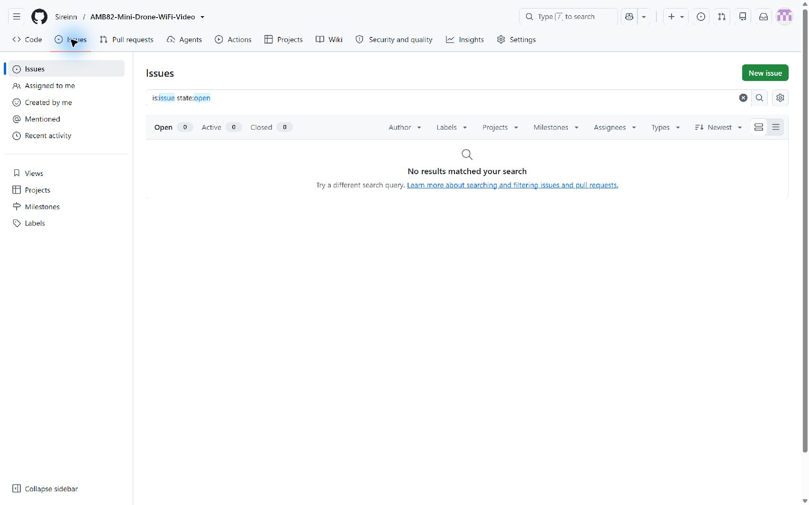

**入口**：① 点顶部 `Issues` → ② 点右上角绿色 `New issue`。

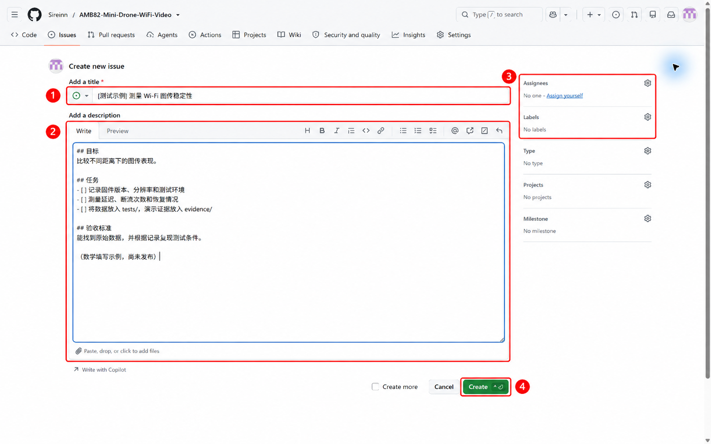

**按红色编号填写**：

1. **标题**：一句话说清任务，如“测量 Wi-Fi 图传稳定性”。
2. **描述**：写目标、执行步骤、验收标准和交付位置；支持 Markdown。
3. **负责人和标签**：点右侧齿轮，按需选择 Assignees、Labels。
4. **Create**：内容确认后点此按钮才会正式创建任务。

图中为未发布的教学填写示例。红框由生图模型在真实截图上辅助添加，可[对照原始截图](assets/github-guide/06-new-issue-example.jpg)。


建议写法：**做什么／出现什么问题 → 怎么复现或实施 → 怎样算完成 → 证据在哪里。**

示例：`[测试] 测量不同距离下的 Wi-Fi 图传稳定性`

```markdown
## 目标
比较不同距离下的图传表现，为后续参数选择提供依据。

## 任务
- [ ] 记录固件版本、分辨率和测试环境
- [ ] 在约定的几个距离分别测试
- [ ] 记录延迟、断流次数和恢复情况
- [ ] 提交原始数据和结论

## 验收标准
能从记录中复现测试条件，并找到原始数据与结果说明。

## 交付位置
tests/ 下的测试记录与数据；必要的演示证据放 evidence/。
```

| 字段 | 含义 | 例子 |
| --- | --- | --- |
| Assignees | 负责人 | 由负责测试的队员跟进 |
| Labels | 分类标签 | `bug`、`documentation`，也可自建 `hardware` |
| Milestone | 阶段目标 | “中期检查” |
| Projects | 所属进度看板 | “无人机项目任务板” |
| Comments | 留下讨论与进展 | 说明卡点、数据位置和下一步 |
| Open / Closed | 未关闭／已关闭 | 关闭原因可能是完成，也可能是不再做 |

**Issue 负责记录任务；实验数据和交付文件放进对应目录，再把链接贴回来。**

依据：[About issues](https://docs.github.com/en/issues/tracking-your-work-with-issues/learning-about-issues/about-issues)。

## 6 Pull Requests：把成果合进来

**Pull Request，简称 PR：请团队检查并合并某条分支上的修改。** 文档、接线图和测试记录同样可以走 PR。

例如：你在 `fix/serial-parser` 修复串口解析，然后创建合到 `main` 的 PR。

| PR 中的词 | 含义 |
| --- | --- |
| Base | 修改要合入的目标分支，例如 `main` |
| Compare / Head | 提供修改的来源分支，例如 `fix/serial-parser` |
| Files changed | 本次修改了哪些文件、具体改了什么 |
| Reviewers | 请谁来检查 |
| Approve | 审查者表示认可 |
| Request changes | 审查者要求修改 |
| Checks | 自动化检查结果 |
| Draft | 草稿，仍在进行中 |
| Merge | 把修改合入目标分支 |
| Close without merge | 关闭请求，暂不合入 |


### 操作图：找到 PR 入口，选对两条分支

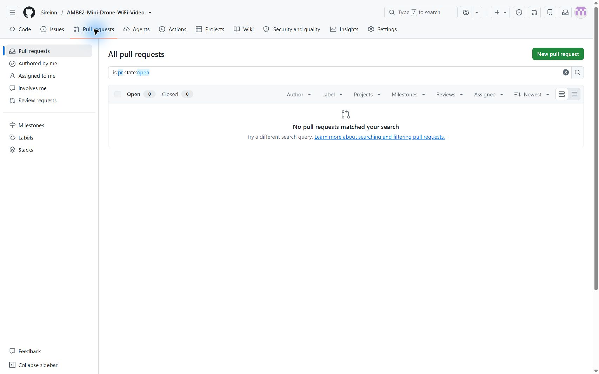

**入口**：① 点顶部 `Pull requests` → ② 点右上角 `New pull request`。

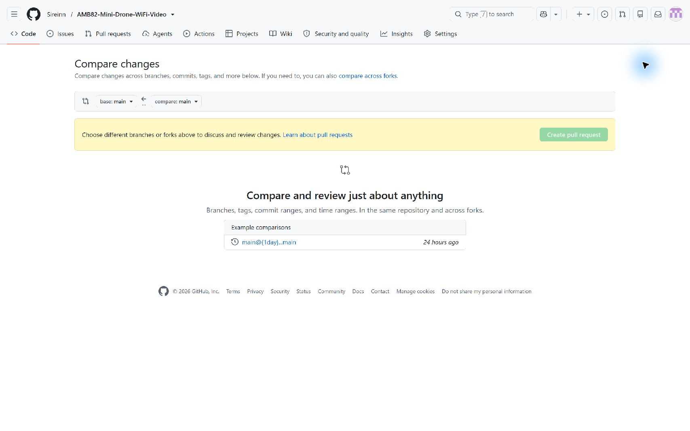

**照着选**：左边 `base` 选 `main`；右边 `compare` 选你已提交修改的任务分支。确认下面的文件差异后，再点 `Create pull request`，填写 PR 标题、说明并提交。

> [!NOTE]
> **为什么图中的创建按钮是灰色？**
> 图中 `base` 和 `compare` 都是 `main`，没有可提交的差异。先在任务分支完成修改并提交／Push，再选择该分支进行比较。只创建分支但没有新提交，也可能没有差异。

PR 描述写三件事：**改了什么、为什么改、怎么验证。**

```markdown
## 修改
补充串口帧长度检查。

## 原因
异常数据可能导致解析失败。

## 验证
说明实际执行的测试、输入数据及结果；未完成的硬件测试也写明。

Closes #12
```

假设 `#12` 是对应 Issue，且 PR 合入仓库默认分支，`Closes #12` 可以让该 Issue 随合并自动关闭。这里的编号需要换成真实任务编号。

> [!TIP]
> **三个词分开记**
> **Commit** 记录修改；**Push** 把提交上传；**PR** 让团队审查并讨论合并。

依据：[GitHub flow](https://docs.github.com/en/get-started/using-github/github-flow)、[关联 PR 与 Issue](https://docs.github.com/en/issues/tracking-your-work-with-issues/using-issues/linking-a-pull-request-to-an-issue)。

## 7 实操：队员从加入到交付

### 第一次加入

1. 仓库所有者在 **Settings → Collaborators → Add people** 发出邀请。
2. 队员登录被邀请的账号，打开邀请链接并接受。
3. 所有者刷新页面，确认 `Pending Invite` 已变为正式协作者。
4. 阅读 README，确定自己的任务和交付目录。


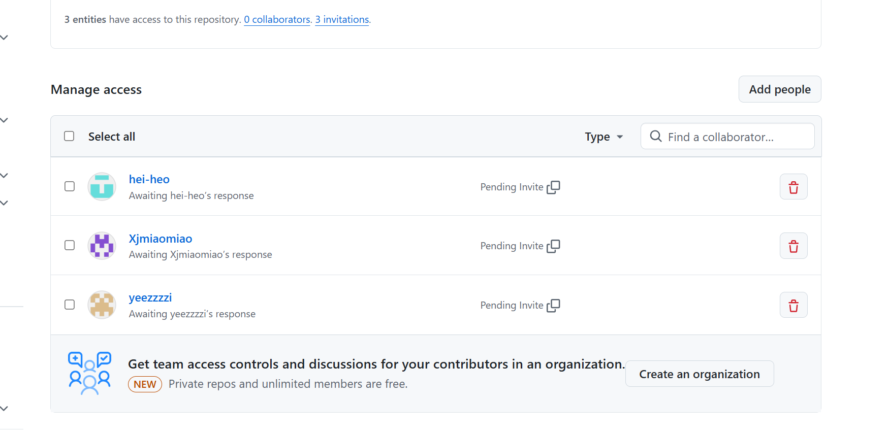

**看这里**：右上角 `Add people` 用于发出邀请；`Pending Invite` 表示还没接受；其旁边的双框复制图标用于取得邀请链接。看到 `3 invitations` 不代表已有 3 位正式协作者。

**邀请页 404**：先确认当前浏览器登录了正确账号；微信内置浏览器与外部浏览器可能不共用登录状态。再用对应邀请行的复制按钮取得链接重试。

公开仓库的“能查看”与“已加入协作”是两件事。接受邀请后才获得协作者访问权限。

依据：[邀请协作者](https://docs.github.com/en/repositories/managing-your-repositorys-settings-and-features/repository-access-and-collaboration/inviting-collaborators-to-a-personal-repository)。


### 方式 A：先用网页交一份周报

1. 在 Issues 新建或认领“提交本周测试记录”任务。
2. 回到 Code 页，在 `main` 下点 **Add file → Create new file**。
3. 文件名填 `docs/progress/2026-11-27-你的名字.md`，写下完成事项、证据链接、问题和下周计划。
4. 点右上角 **Commit changes…**，打开提交弹窗。
5. 填写提交说明，选择 **Create a new branch for this commit and start a pull request**，分支名填 `docs/weekly-report-你的名字`。
6. 点 **Propose changes**，将修改提交到新分支；随后在跳转的页面填写并创建 PR。
7. 确认 PR 的 `base` 是 `main`、`compare` 是自己的分支，请队友检查；有相应权限的人确认后合并。

这里采用“编辑文件后，在提交时新建分支”的方式；也可以先按第 3 节创建任务分支，再在该分支上编辑和提交。日期、姓名和内容按实际填写。

#### 操作图 A：找到新建文件入口

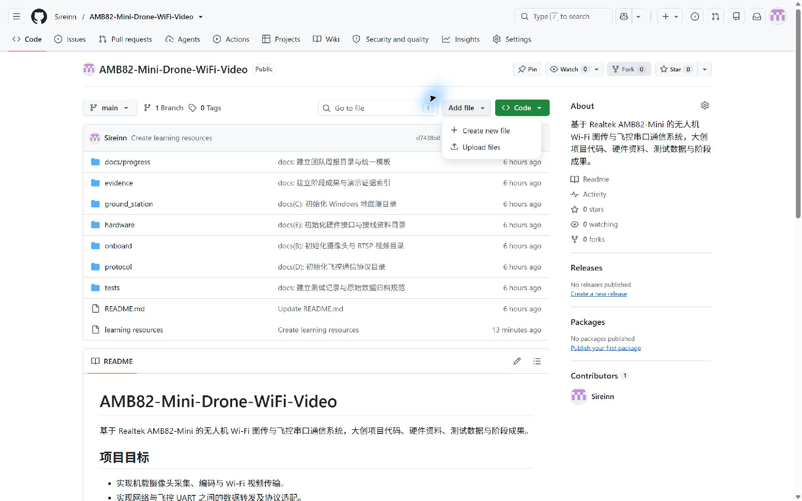

点 `Add file` 后选 **Create new file**；如果上传已有文件，选 **Upload files**。

#### 操作图 B：填写路径和正文

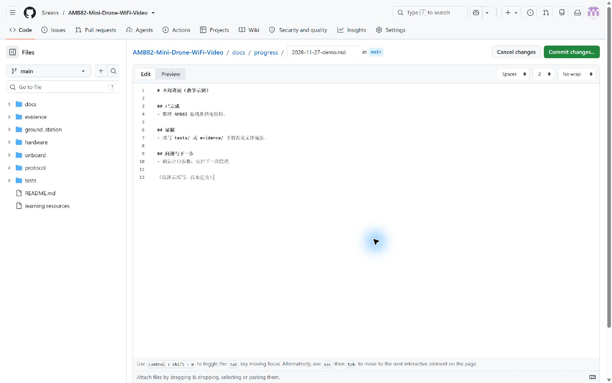

上方输入完整路径 `docs/progress/日期-姓名.md`，正文写在中间编辑区。确认后点右上角 **Commit changes…**。截图中的正文只是格式示例，需要换成实际进展。

#### 操作图 C：写提交说明，选择新建分支

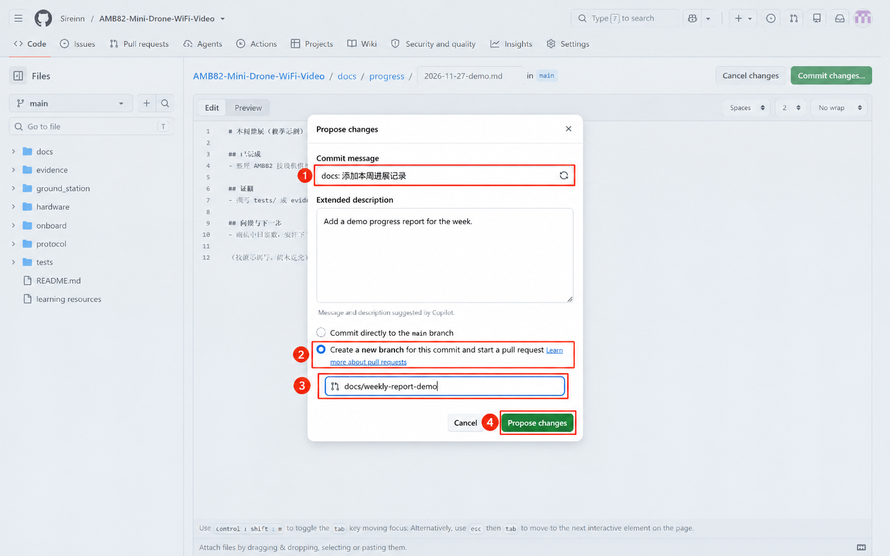

**按红色编号操作**：

1. **Commit message**：写本次做了什么，例如 `docs: 添加本周进展记录`。
2. 选择第二项 **Create a new branch…**，让这次提交进入新分支。
3. 填写分支名，例如 `docs/weekly-report-demo`。
4. 内容确认后点 **Propose changes**，提交到新分支，再继续创建 PR。

图中只演示填写，未实际点最终提交。红框由生图模型辅助添加，可[对照原始截图](assets/github-guide/09-propose-changes.jpg)。创建 PR 的入口与分支选择见 [6 Pull Requests：把成果合进来](#6-pull-requests把成果合进来)。

### 方式 B：用 GitHub Desktop 开发

1. 登录 GitHub Desktop，用 **File → Clone repository** 克隆项目。
2. 每次开始新任务前切到 `main`，点 **Fetch origin**；有更新时再 **Pull origin**。
3. 从最新的 `main` 新建任务分支，例如 `feat/video-reconnect`。
4. 在编辑器里修改、保存，并完成对应验证。
5. 回到 Desktop 查看 Diff，选择要提交的文件，填写说明并 Commit。
6. 分支尚未发布时点 **Publish branch**；后续提交用 **Push origin** 上传。
7. 创建 PR，写清验证结果并请求审查。
8. 合并后切回 `main`，拉取更新，再开始下一个任务。

切分支前先处理好未提交修改。首次练习建议用文档，熟悉流程后再改代码。

参考：[GitHub Desktop 克隆仓库](https://docs.github.com/en/desktop/adding-and-cloning-repositories/cloning-and-forking-repositories-from-github-desktop)、[GitHub flow](https://docs.github.com/en/get-started/using-github/github-flow)。

### 常见命令对照

先理解操作即可，需要终端时再查这张表。

| 命令 | 对应操作 |
| --- | --- |
| `git clone <仓库地址>` | 第一次克隆；尖括号部分替换为实际地址 |
| `git status` | 查看当前分支与文件状态 |
| `git diff` | 查看尚未暂存的修改 |
| `git switch -c <分支名>` | 新建并切换到任务分支 |
| `git add <文件路径>` | 暂存选定文件 |
| `git commit -m "说明"` | 在本地记录提交 |
| `git push -u origin <分支名>` | 首次推送分支，并建立跟踪关系 |
| `git pull` | 拉取并整合当前分支的远程更新 |

这些是操作对照，不能当作无需准备就能依次运行的脚本；终端提交前还需完成 Git 身份和认证配置。

## 8 项目资料怎么放

下表根据截图目录给出用途建议，团队可在 README 中确认约定。

| 目录 | 建议放什么 | 例子 |
| --- | --- | --- |
| `onboard/` | AMB82 板端代码与说明 | 摄像头采集、图传程序 |
| `ground_station/` | 地面站代码与说明 | 视频显示、连接状态界面 |
| `protocol/` | 通信协议定义与示例 | 帧头、长度、指令、校验规则 |
| `hardware/` | 硬件资料 | 接线、引脚表、供电说明 |
| `tests/` | 测试方法、记录和数据 | 延迟测试、串口异常输入 |
| `docs/progress/` | 周报与进展 | 本周完成、卡点、下周计划 |
| `evidence/` | 阶段成果证据 | 演示图片、测试截图 |
| `README.md` | 项目入口与索引 | 环境、运行方法、各目录链接 |

建议约定：**任务写 Issue，进展写周报，成果文件进对应目录，PR 说明如何验证。**

Obsidian 与仓库文档都能写 Markdown。个人学习笔记可用 `[[双向链接]]`；准备在 GitHub 展示的 README 和说明文档，优先用标准 Markdown 链接，避免双链无法正常跳转。

## 9 常见困惑速查

| 困惑 | 回答 |
| --- | --- |
| Issues 是不是只能报错？ | 也能安排任务、讨论需求和记录实验。 |
| Pull 和 Pull Request 是一回事吗？ | Pull 同步更新；PR 请求审查与合并修改。 |
| 点 Star 或 Fork 就加入团队了吗？ | 没有；协作者邀请需要接受。 |
| Commit 后队友为什么看不到？ | 本地提交可能还没有 Push。 |
| Push 后 main 为什么没变？ | 可能只上传到了任务分支，还没合并。 |
| PR 合并了，电脑上为什么还是旧版？ | 需要切到对应分支并拉取更新。 |
| main 一定是稳定的吗？ | 不保证；稳定性依赖团队流程和验证。 |
| 测试通过就能证明无人机可用吗？ | 只能证明已执行的检查通过，还要按实际范围联调。 |
| Obsidian 保存笔记等于同步到 GitHub 吗？ | 保存只改本地文件；进了 Git 仓库还需 Commit、Push。 |

## 10 参考书与阅读路线

### 首选：《Pro Git》第二版

作者：Scott Chacon、Ben Straub；Apress，2014。官方提供完整在线版及中文译文。

- [中文在线目录](https://git-scm.com/book/zh/v2)
- [出版社页面及开放获取版本](https://link.springer.com/book/10.1007/978-1-4842-0076-6)

| 参考章节 | 用自己的话提炼 | 对应本项目 |
| --- | --- | --- |
| 第 1 章：起步 | 先理解为什么需要版本管理 | 用历史追踪修改，减少版本混乱 |
| 第 2 章：Git 基础 | 获取仓库，记录修改，与远程同步 | Clone、Commit、Push、Pull |
| 第 3 章：Git 分支 | 在独立版本线上修改，再合并 | 图传、协议、文档任务分别开分支 |
| 第 5 章：分布式 Git | 理解多人如何贡献和维护 | 确认谁提交、谁检查、谁合并 |
| 第 6 章：GitHub | 把 Git 放进在线协作流程 | PR、项目贡献与仓库维护 |

**建议顺序**：第 2 章 → 第 3 章 → 第 6 章；遇到协作分工问题再读第 5 章。书里的旧界面与今天可能不同，按钮位置查官方文档。

### 补充：《Learning Git》

作者：Anna Skoulikari；O’Reilly，2023。完整书名为 *Learning Git: A Hands-On and Visual Guide to the Basics of Git*。

[出版社目录与阅读入口](https://www.oreilly.com/library/view/learning-git/9781098133900/)

该书采用循序渐进的实践方式讲 Git，适合先建立直观概念。可参考其“命令行 → 本地仓库 → Commit → 分支与合并 → 远程协作”的学习安排。完整阅读或购买以出版社页面为准。

本笔记参考其公开目录介绍，不逐章复述全书。

### 边做边学

- [ ] 接受邀请，阅读项目 README。
- [ ] 用网页提交一份周报 PR。
- [ ] 阅读《Pro Git》第 2 章，理解提交与同步。
- [ ] 阅读第 3 章，练习分支与合并。
- [ ] 在 Issue 中认领一个真实任务，提交成果并完成审查。

相关位置：[2 基础：一次修改怎样保存和同步](#2-基础一次修改怎样保存和同步) · [5 Issues：把任务说清楚](#5-issues把任务说清楚) · [7 实操：队员从加入到交付](#7-实操队员从加入到交付)
