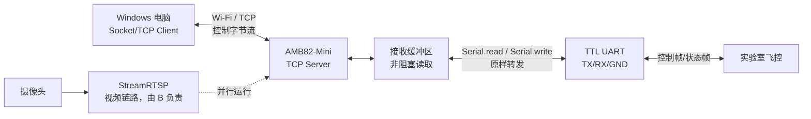
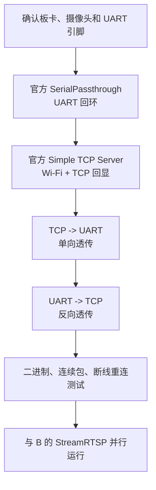

# 分工 A｜Wi-Fi 与 UART 双向数据转发

> [!abstract] 这份任务书要解决什么
> A 负责把电脑和实验室飞控之间的控制数据搬运起来：电脑通过 Wi-Fi/TCP 把字节发给 AMB82-Mini，AMB82-Mini 再通过 TTL UART 发给飞控；飞控返回的数据沿相反方向回到电脑。A 关注的是**字节是否正确、链路是否稳定、视频运行时是否仍能工作**，暂时不负责解释飞控命令含义，也不负责视频编码和 RTSP 服务。

## A 的任务边界

### 负责的部分

1. **UART 串口链路**：确认 AMB82-Mini 的串口引脚、电平、波特率和收发方式，完成电脑或飞控与开发板之间的串口收发。
2. **Wi-Fi/TCP 链路**：让电脑能够找到 AMB82-Mini、连接 TCP Server，并发送、接收控制数据。
3. **双向数据转发**：实现 TCP → UART 和 UART → TCP 两个方向的原样转发，保留二进制字节，不把数据误当成字符串处理。
4. **缓冲与调试**：处理串口和网络的暂存数据，记录十六进制日志，定位断线、丢字节和阻塞问题。
5. **系统集成**：在 B 的 RTSP 视频流运行时，验证控制链路仍能双向工作。

### 不负责的部分

- 不负责 H.264/H.265 编码、ISP 图像处理、RTSP 服务端和摄像头驱动；这些属于视频链路，当前由 B 负责。
- 不负责飞控算法，也不要求一开始读懂每条飞控指令的业务含义。
- 不需要从零实现 Wi-Fi 驱动、TCP/IP 协议栈或 UART 底层驱动。

> [!important] A 的核心判断标准
> 如果电脑发送 `FD 09 00 00 01 01 00 ...`，AMB82-Mini 不需要知道这段数据表示什么命令；它只需要把收到的每个字节按原顺序转发到 UART。反方向也一样。A 的第一目标是**透明传输**，不是协议解析。

## 一张图看懂数据经过哪里



这条链路可以拆成四个可以单独验收的动作：先让 UART 回环，再让 TCP Server 回显，然后把两段 Demo 接起来，最后在视频并行时观察是否互相阻塞。

## 官方例程能不能直接复用？

原笔记已经找到 AMB82-Mini Arduino SDK 中与 A 最相关的例程。我在 2026-10-31 重新核对了官方文档：

- `Simple TCP Server` 页面明确写出：开发板连接 Wi-Fi 后作为 Server，电脑使用 Socket 工具作为 Client，连接开发板显示的 IP 和 **5000** 端口，发送字符串后服务器返回相同字符串。
- Arduino 内置示例表明确列出 `SerialPassthrough`，并注明可选择 `Serial`、`Serial1` 或 `Serial2`。
- 官方 `RTSP Streaming V7RC` 页面明确把 `StreamRTSP` 归为摄像头到手机端的 RTSP 视频示例，默认 RTSP 端口为 554；它属于 B 的视频链路，不是 A 的数据转发例程。

因此，官方已经给出了 A1 和 A2 的**可运行基础例程**，但没有给出一个把 TCP 和 UART 双向桥接起来的“一键完成”例程。

| 官方例程 | 已经提供的能力 | A 能否直接复用 | 复用时要改什么 |
|---|---|---|---|
| **SerialPassthrough** | 串口初始化、读取、发送和串口间转发 | **A1 可直接作为起点** | 选择实际使用的 `Serial`/`Serial1`/`Serial2`，核对引脚和波特率；USB 调试口与接飞控的外设 UART 要分开 |
| **Simple TCP Server** | 连接 Wi-Fi、创建 TCP Server、等待电脑连接、收发数据和回显 | **A2 可直接复现** | 改 SSID/密码；记录开发板 IP；最终将“回显”改为 TCP↔UART 转发，并补上断线、缓存和二进制数据处理 |
| **StreamRTSP** | 摄像头采集、H.264 配置、Wi-Fi 和 RTSP 输出 | **不是 A 的任务；由 B 复用** | A 只需要在 B 跑视频时验证控制链路不被阻塞 |
| A1+A2 组合 | TCP 接收后写 UART、UART 接收后写 TCP | **没有一个官方例程直接完成** | 这是 A 的主要自主开发部分，需要组合两个官方 Demo 并设计缓冲、非阻塞读取和双向任务循环 |

> [!success] 复用结论
> A 不需要从零写底层通信。**A1 的串口 API 和 A2 的 TCP Server 可以直接复用；A3、A4 的双向桥接逻辑需要 A 自己组合实现；StreamRTSP 只作为并行运行的集成条件。**

### 原笔记中的官方资料

- [Simple TCP Server｜Ameba Arduino SDK](https://ameba-doc-arduino-sdk.readthedocs-hosted.com/en/latest/ameba_pro2/amb82-mini/Example_Guides/WiFi/Simple%20TCP%20Server.html)
- [Arduino 内置串口示例｜Ameba Arduino SDK](https://ameba-doc-arduino-sdk.readthedocs-hosted.com/en/latest/ameba_pro2/amb82-mini/Example_Guides/Basic/Arduino-build-in%20example.html)
- [StreamRTSP｜Ameba Arduino 文档仓库](https://github.com/Ameba-AIoT/ameba-arduino-doc/blob/main/source/ameba_pro2/amb82-mini/Example_Guides/Multimedia/RTSP%20Streaming%20V7RC.rst)

## 分阶段任务与入手方式

### A1｜先跑通 UART 串口通信

**阶段目标**：用 USB-TTL 转接器让电脑和 AMB82-Mini 双向收发数据。

#### 入手顺序

1. 查 AMB82-Mini 的引脚表，确认实际使用哪一路 UART。原笔记记录的示例是：`Serial1` 的 TX 为 PA2（引脚 21），RX 为 PA3（引脚 22）；最终接线仍需结合板卡版本、原理图和已占用引脚复核。
2. 打开官方 **SerialPassthrough** 示例，先不改业务逻辑，只完成编译、烧录和串口监视。
3. 把 `Serial.begin()` 的波特率改成与 USB-TTL 设备一致，确认 TX、RX、GND 接线正确。
4. 用短字符串验证方向，再用十六进制字节验证二进制数据不会被改写。
5. 记录使用的 UART 编号、引脚、波特率和测试日志，形成后续接飞控的固定配置。

#### 需要学习到什么程度

| 知识 | 学习要求 | 在本阶段要能做什么 |
|---|---|---|
| UART 通信 | 理解基本过程 | 知道 TX 发、RX 收，双方共地，并能说明串口是字节流 |
| TTL 电平 | 必须掌握 | 确认外设是否为 3.3V TTL，避免把不兼容电平直接接入开发板 |
| 波特率、数据位、停止位、校验位 | 必须掌握 | 让两端参数一致，并能根据乱码判断参数不匹配 |
| `Serial.begin()` | 会使用 | 初始化指定串口 |
| `Serial.available()` | 会使用 | 判断接收缓冲区是否有数据 |
| `Serial.read()` | 会使用 | 逐字节读取数据 |
| `Serial.write()` | 会使用 | 原样发送字节，不把二进制强转成字符串 |

> [!warning] 接线边界
> USB 调试串口和连接飞控的外设 UART 不是同一个概念。TX 要接对方 RX，RX 要接对方 TX，GND 必须共地；接入飞控前还要确认电平和供电方式。

#### A1 验收

- 电脑 → USB-TTL → AMB82-Mini：开发板能收到数据。
- AMB82-Mini → USB-TTL → 电脑：电脑能收到数据。
- 至少用一组二进制字节做回环测试，收发前后十六进制内容完全一致。

### A2｜再复现 Wi-Fi TCP 通信

**阶段目标**：电脑通过 Wi-Fi 连接 AMB82-Mini 的 TCP Server，并完成一次可观察的收发。

#### 入手顺序

1. 打开官方 **Simple TCP Server** 示例。
2. 只修改 Wi-Fi 名称和密码，先让官方代码原样运行。
3. 烧录开发板，观察串口日志并记下 AMB82-Mini 获取到的 IP 地址和端口；原笔记记录的默认端口为 5000，以实际日志和示例版本为准。
4. 电脑使用 Socket 调试工具连接开发板，发送一段普通字符串，确认官方回显成立。
5. 再发送十六进制数据，确认测试工具没有偷偷追加换行或改变编码。

#### 需要学习到什么程度

| 知识 | 学习要求 | 在本阶段要能做什么 |
|---|---|---|
| Wi-Fi 连接 | 会配置 | 填写 SSID/密码，判断是否连网成功 |
| IP 地址与端口 | 基础理解 | 用 IP+端口定位 TCP Server |
| TCP Server / Client | 会使用 | 知道开发板监听、电脑主动连接 |
| Socket | 基础使用 | 用工具建立连接、发送、接收和断开 |
| TCP 字节流 | 必须理解 | 知道 TCP 没有消息边界，不能假定一次 `read()` 就是一整帧 |
| `client.read()` / `client.write()` | 会使用 | 读取收到的字节并发送字节 |

> [!tip] 先不用写电脑端程序
> A2 的目标是验证网络链路，不是开发地面站。先用 Socket 调试工具完成官方示例的复现，链路稳定后再写 Python 或其他上位机程序。

#### A2 验收

- 电脑能连接 AMB82-Mini 的 TCP Server。
- 发送字符串后能收到回显。
- 发送一组二进制字节时，日志能证明字节内容未被改写。
- 记录 SSID、IP、端口和测试时间，保证别人能按记录复现。

### A3｜实现 TCP → UART 转发

**阶段目标**：电脑经 Wi-Fi 发出的每个字节，都从 AMB82-Mini 的 UART 原样输出。

这是 A 从“复现官方 Demo”进入“自主集成”的阶段。做法不是重写两个底层驱动，而是保留 A1、A2 的初始化代码，把 TCP 收到的数据写入 UART。

```text
电脑发送：       01 02 03 04 05 06
       ↓ TCP
AMB82-Mini：     读取 TCP 缓冲区
       ↓ UART
UART 输出：      01 02 03 04 05 06
```

#### 入手顺序

1. 先把 A2 中的“收到后回显”保留作日志，确认 TCP 仍然收到数据。
2. 将收到的字节逐个写入 A1 使用的 UART；不要调用只适合文本的字符串函数。
3. USB-TTL 的另一端接逻辑分析仪、串口工具或第二块串口设备，对比 TCP 发送日志和 UART 输出日志。
4. 测试短包、连续包和包含 `00` 的二进制数据，检查是否出现截断、补零或换行。

#### A3 验收

- 电脑通过 Wi-Fi 发送数据后，UART 能输出同样的字节序列。
- 至少验证 `01 02 03 04 05 06` 和包含 `00` 的二进制样例。
- 测试结果包含发送端十六进制记录、UART 接收端十六进制记录和结论。

### A4｜实现 UART → TCP 数据返回

**阶段目标**：UART 收到的数据能经 TCP 返回到电脑，形成反向链路。

#### 入手顺序

1. 在 A3 的程序中增加 UART 接收检查：有数据时读取串口缓冲区。
2. 把读到的字节写入当前 TCP 客户端；连接尚未建立或已经断开时，不能继续无条件写入。
3. USB-TTL 发送测试数据，电脑端 Socket 工具观察收到的十六进制内容。
4. 与 A3 合并做双向交叉测试：电脑发一组数据，UART 回一组数据，分别记录两个方向的结果。

#### A4 验收

- USB-TTL 发送一段数据，电脑能够通过 TCP 收到。
- 反复进行多次发送，字节顺序和内容都一致。
- 至少记录一次“无 TCP 客户端”和“一次断线后重连”时的行为，确认程序不会卡死。

## A1–A4 合并后的最小程序骨架

下面是帮助理解的逻辑骨架，不是要求照抄的最终代码。具体 API 以官方示例和当前 SDK 版本为准。

```cpp
setup() {
  init_debug_serial();
  init_uart();          // 复用 SerialPassthrough 的初始化方式
  connect_wifi();       // 复用 Simple TCP Server 的连接方式
  start_tcp_server();
}

loop() {
  accept_or_check_client();

  // 方向一：TCP -> UART
  while (tcp_client_has_bytes()) {
    byte b = tcp_read_byte();
    uart_write_byte(b);
  }

  // 方向二：UART -> TCP
  while (uart_has_bytes() && tcp_client_is_connected()) {
    byte b = uart_read_byte();
    tcp_write_byte(b);
  }
}
```

第一版先让这两个方向跑通；出现数据量增加、视频并行或断线问题后，再把重点放到缓冲区、非阻塞读取、连接状态和任务之间的资源竞争。

## 统一学习清单

### 必须掌握：能用于开发和调试

- Arduino C++：`setup()`、`loop()`、变量、函数、条件和循环。
- UART：初始化、TX/RX/GND、TTL 电平、波特率、接收和发送。
- Wi-Fi：连接网络、查看 IP、判断连接状态。
- TCP Socket：Server/Client、连接、读取、发送、断开和重连。
- 缓冲区：暂存字节、分批读取、避免一边接收一边丢数据。
- 二进制调试：十六进制日志、长度统计、发送端与接收端逐字节对比。

### 需要理解：知道原理和边界

- TCP/IP 分层，以及 TCP 与 UDP 的基本区别。
- TCP 是连续字节流，不能把一次 `read()` 自动当作一帧。
- UART 数据帧的基本组成，以及波特率对传输速度的影响。
- 阻塞与非阻塞读取的区别。
- 为什么视频链路和控制链路需要分开缓冲、避免互相等待。

### 暂时不展开：先复用官方能力

- RTL8735B 寄存器级开发。
- Wi-Fi 射频、MAC 和 TCP/IP 协议栈源码。
- UART 驱动底层实现。
- H.264 编码算法、ISP 原理和 RTSP 服务端实现。
- 飞控飞行控制算法和飞控协议的业务语义。

## 推荐的首次动手顺序



每完成一个阶段都保存三样东西：**可复现步骤、十六进制日志、测试结论**。这样即使下一阶段失败，也能知道问题是在串口、网络还是桥接逻辑。

## 最终验收标准

> [!success] A 的交付结果
> 电脑与 UART 设备能够持续双向传输数据，收发字节无错误丢失；当 B 的 RTSP 视频正在运行时，控制链路仍能工作。

| 验收项 | 通过条件 | 证据 |
|---|---|---|
| UART 基础收发 | 电脑与 AMB82-Mini 双向收发成功 | 串口配置、接线图、十六进制日志 |
| TCP 连接 | 电脑能连上开发板并完成收发 | IP、端口、Socket 工具截图或日志 |
| TCP → UART | 发送字节与 UART 输出完全一致 | 两端十六进制对比 |
| UART → TCP | UART 输入与电脑收到的数据完全一致 | 两端十六进制对比 |
| 二进制数据 | 包含 `00` 等字节时仍不截断、不改写 | 原始数据和接收数据 |
| 断线处理 | TCP 断开后程序不死循环，能够重新连接 | 断线/重连日志 |
| 视频并行 | RTSP 播放时控制链路仍能收发 | 视频运行记录 + 控制链路日志 |

## 相关笔记

- [[分工A]]（原始笔记）
- [[无人机wifi图传项目]]
- [[无人机图传WiFi项目-知识笔记]]
- [[无人机图传项目-Obsidian笔记规范]]
