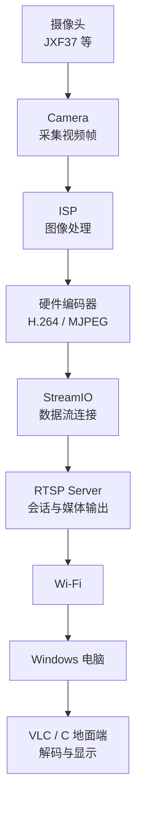
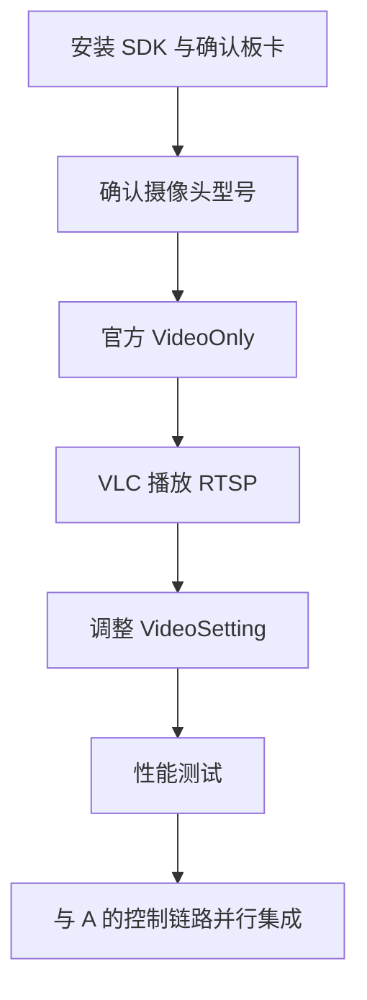

# 分工 B｜摄像头与 Wi-Fi 视频图传

> [!abstract] 这份任务书要解决什么
> B 负责让 AMB82-Mini 从摄像头采集画面，通过官方视频处理链路编码成 H.264，再以 RTSP 形式发送到 Windows 电脑。B 的主要工作是**复用官方 VideoOnly 示例、确认摄像头配置、调整视频参数、测量实际表现，并提供可供 A 集成的视频模块**。

## B 的任务边界

### 负责的部分

1. 确认实际摄像头型号，并在 Arduino IDE 中选择匹配的 Camera Options。
2. 跑通官方 `StreamRTSP/VideoOnly`，让 VLC 能够持续播放画面。
3. 使用 `VideoSetting` 调整分辨率、帧率、编码格式和码率。
4. 测量实际 FPS、延迟、卡顿、断流和重连表现。
5. 将视频初始化和 RTSP 启动部分整理成独立模块，配合 A 集成到最终固件。

### 不负责的部分

- 不从零编写 H.264 编码器、ISP 算法、摄像头底层驱动或 RTSP 服务端。
- 不负责 Windows 地面端软件；C 负责播放器窗口、状态显示和控制界面。
- 不负责 TCP ↔ UART 控制转发；A 负责通信固件。
- 不把“官方示例能播放”直接当成项目性能达标，实际指标需要通过测试得到。

> [!important] B 的核心判断标准
> 官方示例解决了“视频能不能跑起来”，B 自己要解决的是“在本项目条件下，使用什么参数能稳定、低延迟地跑起来，以及如何和控制链路并行运行”。

## 视频链路如何工作



B 需要看懂这条数据流，但不需要实现其中的底层模块。摄像头输出的是原始图像，编码器把连续画面压缩成视频码流，RTSP 负责让播放器建立会话并取得视频。分辨率、帧率和码率会共同影响画质、带宽、延迟和卡顿，不能只看其中一个参数。

## 官方例程能不能直接复用？

| 官方资料 | 已经提供的能力 | B 能否直接复用 | 复用边界 |
|---|---|---|---|
| **StreamRTSP / VideoOnly** | 摄像头初始化、视频通道配置、H.264/MJPEG、Wi-Fi、RTSP 输出和 StreamIO 连接 | **可以，作为主工程起点** | 先只改 SSID、密码和摄像头选项；后续再修改参数，不要一开始重写数据流 |
| **VideoStream / VideoSetting API** | 设置分辨率、帧率、编码格式、码率和图像参数 | **可以直接调用** | 参数是否稳定要由实测确认，配置值不等于实际 FPS |
| **RTSP Streaming / V7RC** | 给手机遥控应用播放 RTSP 的完整示例，默认 RTSP 端口通常为 554 | **用于理解和排查** | Windows 第一版优先 VideoOnly；V7RC 的 720×480 配置不能直接当作项目最终参数 |
| **VLC** | 打开 RTSP 地址并显示视频 | **可以直接作为验收工具** | VLC 播放成功只证明接收链路可用，不能代替延迟、FPS 和稳定性测试 |

> [!success] 复用结论
> B 不需要从零开发视频系统。**VideoOnly 可以直接烧录和改参数；VideoSetting 可以直接调用；VLC 可以直接做第一轮接收验证。B 的自主工作集中在摄像头匹配、参数选择、性能测量和最终集成。**

### 官方资料

- [VideoOnly 完整源码](https://github.com/Ameba-AIoT/ameba-arduino-pro2/blob/dev/Arduino_package/hardware/libraries/Multimedia/examples/StreamRTSP/VideoOnly/VideoOnly.ino)
- [VideoStream API](https://ameba-doc-arduino-sdk.readthedocs-hosted.com/en/latest/ameba_pro2/amb82-mini/API_Documents/Multimedia/Class%20VideoStream.html)
- [RTSP Streaming V7RC 教程](https://github.com/Ameba-AIoT/ameba-arduino-doc/blob/main/source/ameba_pro2/amb82-mini/Example_Guides/Multimedia/RTSP%20Streaming%20V7RC.rst)
- [VLC 官方网站](https://www.videolan.org/vlc/)

## 分阶段任务与入手方式

### B1｜确认摄像头与开发环境

**阶段目标**：开发板能够正确识别摄像头，并产生有效图像。

#### 入手顺序

1. 安装 AMB82-Mini Arduino SDK，确认开发板可以编译、烧录和输出串口日志。
2. 查看手上摄像头的实际型号，不要只按外观猜测。
3. 在 Arduino IDE 的 Camera Options 中选择对应型号。
4. 编译官方视频示例，观察摄像头初始化日志。
5. 如果出现 `sensor ID error`、`VOE not init` 或没有有效画面，先检查型号、排线和供电，再调整程序。

#### 需要学习到什么程度

| 知识 | 学习要求 | 在本阶段要能做什么 |
|---|---|---|
| 摄像头传感器型号 | 基础了解 | 说清楚板上实际装的型号及其对应配置 |
| Camera Options | 必须掌握 | 选择与硬件匹配的传感器配置 |
| Camera 初始化 | 会使用官方 API | 根据串口日志判断初始化成功或失败 |
| ISP | 了解作用 | 知道它位于传感器和编码器之间，负责图像处理 |
| 图像采集流程 | 理解基本路径 | 能说明“摄像头 → 图像帧 → 编码器”的变化 |

> [!warning] 摄像头型号是前置条件
> AMB82-Mini 支持的传感器配置不是互相通用的。实际摄像头型号没有确认前，不要直接承诺分辨率、帧率或画质结果。

#### B1 验收

- 摄像头型号、Camera Options 和 SDK 版本有记录。
- 开发板初始化成功，串口日志没有传感器识别错误。
- 能够获得稳定的视频帧，后续可以交给 RTSP 示例。

### B2｜直接复现官方 RTSP 视频示例

**阶段目标**：Windows 电脑用 VLC 播放 AMB82-Mini 摄像头画面。

#### 入手顺序

1. 打开 `File → Examples → AmebaMultimedia → StreamRTSP → VideoOnly`。
2. 只修改 Wi-Fi 名称、密码和必要的摄像头选项。
3. 编译并烧录开发板。
4. 观察串口监视器输出的 IP 地址和 RTSP 端口。
5. 让 Windows 电脑与开发板处于同一网络。
6. 在 VLC 中打开 `rtsp://<IP>:<port>`。

```text
示例地址：rtsp://192.168.1.100:554
实际地址：以开发板串口日志输出为准
```

#### B2 验收

- VLC 能打开视频并持续播放。
- 至少连续播放 10 分钟，记录是否断流、卡顿或自动恢复。
- 保存固件版本、摄像头型号、IP、RTSP 端口和 VLC 测试记录。

### B3｜理解并调整视频参数

**阶段目标**：能够有依据地改变视频配置，而不是盲目试参数。

原笔记建议先以 1280×720、H.264、30 FPS、约 2 Mbps 作为测试起点。官方示例中 Channel 1 的 1280×720 H.264 配置可作为初始参考；2 Mbps 是团队的起始测试值，不是已经验证的最终指标。

```cpp
#define CHANNEL 1
VideoSetting config(CHANNEL);
config.setBitrate(2 * 1024 * 1024);
```

需要理解的关系：分辨率影响每帧像素量，帧率影响单位时间内的帧数，码率影响压缩质量和无线带宽占用，GOP 和播放器缓存会影响丢包后的恢复与显示延迟。

#### B3 验收

- 能独立修改分辨率、编码格式、帧率和码率并成功编译运行。
- 每次实验记录完整参数，不用“画面清晰”“延迟低”等无法比较的描述代替数据。
- 能区分“配置 FPS”和“实测 FPS”。

### B4｜视频性能测试与优化

**阶段目标**：用重复测试选择一组稳定配置。

建议固定摄像头、网络、距离和 VLC 设置，依次测试：

1. 720p / 30 FPS / 2 Mbps 基线；
2. 改变码率，记录画质、卡顿和延迟；
3. 如果链路拥塞，再降低帧率或分辨率；
4. 对比不同 VLC 缓存设置，不能只追求最低缓存；
5. 选择综合表现最好的配置，而不是单项最小延迟。

| 指标 | 测量方法 |
|---|---|
| 实际 FPS | 记录播放器或地面端连续播放时的实际帧率 |
| 端到端延迟 | 用毫秒计时器或 LED 闪烁同时拍摄源画面与接收画面，至少测 10 次 |
| 卡顿/断流 | 固定时长播放，记录发生次数和持续时间 |
| 距离与信号 | 固定分辨率、码率和频段，比较 1 m、5 m、10 m 等条件 |
| 重连 | 断开 Wi-Fi 后记录恢复时间和是否需要手动重启 |

> [!tip] 先测量，再优化
> 如果修改了码率、分辨率、VLC 缓存和路由器位置，就无法判断是哪一项造成变化。一次只改变一个主要变量，并保留原始记录。

#### B4 验收

- 至少有一份参数对比表。
- 报告中同时写出配置值和实测值。
- 给出第一版推荐参数及其测试条件。

### B5｜与 A 集成到同一固件

**阶段目标**：视频与 TCP ↔ UART 控制链路同时运行。

需要完成：

1. 把视频初始化、编码和 RTSP 启动部分整理为独立模块。
2. 与 A 约定由谁初始化 Wi-Fi、谁管理连接状态，避免重复初始化。
3. 接入 A 的 TCP 控制通信模块。
4. 同时播放 RTSP 视频并发送、接收控制数据。
5. 观察视频帧率、延迟和控制链路是否互相影响。

> [!important] 集成边界
> A、B 不能各自创建一套 Wi-Fi 管理和网络连接。最终固件需要统一连接管理，并为视频流和控制流分别安排缓冲和处理逻辑。

#### B5 验收

- Windows 能持续接收视频。
- 控制链路能够双向收发。
- 视频运行时，控制数据没有明显丢失或阻塞。
- 交付独立视频模块、配置说明和已知限制。

## B 需要学习什么

### 必须掌握：能用于开发

- AMB82-Mini Arduino SDK 的编译、烧录和串口日志。
- 摄像头型号与 Camera Options 的匹配。
- `StreamRTSP/VideoOnly` 的主要初始化流程。
- `VideoSetting` 的分辨率、帧率、编码格式和码率配置。
- RTSP 地址和 VLC 接收方法。
- FPS、码率、延迟、卡顿和断流的基本测量。

### 需要理解：知道边界

- ISP 在摄像头和编码器之间的作用。
- H.264 的基本帧间压缩思路。
- RTSP 负责会话控制，媒体数据还要经过相应的传输封装。
- Wi-Fi 带宽、信号强度和播放器缓存会影响实时表现。
- 配置参数不等于最终实测性能。

### 暂时不展开：直接复用官方能力

- H.264/H.265 编码器内部算法。
- ISP 算法和摄像头 MIPI 底层驱动。
- RTSP 服务端实现。
- Wi-Fi 射频和协议栈源码。
- 计算机视觉、目标检测和飞控算法。

## B 的交付物与第一周计划

| 编号 | 交付物 | 内容 |
|---|---|---|
| B1 | 摄像头采集记录 | 型号、配置、初始化日志和画面证据 |
| B2 | VideoOnly 图传 Demo | VLC 可持续播放的固件 |
| B3 | 视频参数配置 | 分辨率、FPS、编码格式、码率和 RTSP 地址 |
| B4 | 性能测试记录 | 实际 FPS、延迟、距离、卡顿和重连 |
| B5 | 独立视频模块 | 可供 A 集成的初始化与 RTSP 代码 |
| B6 | 运行说明 | 烧录、连接、播放和已知限制 |

第一周优先完成：安装 SDK → 确认摄像头 → 跑通 VideoOnly → VLC 播放 → 记录第一组参数。视频录像属于后续功能，不能挤占基础图传验证。



## 相关笔记

- [[分工B]]（原始笔记）
- [[分工A-整理版]]
- [[无人机图传WiFi项目-知识笔记]]
- [[无人机图传项目-Obsidian笔记规范]]
