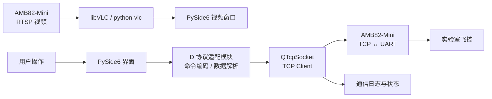
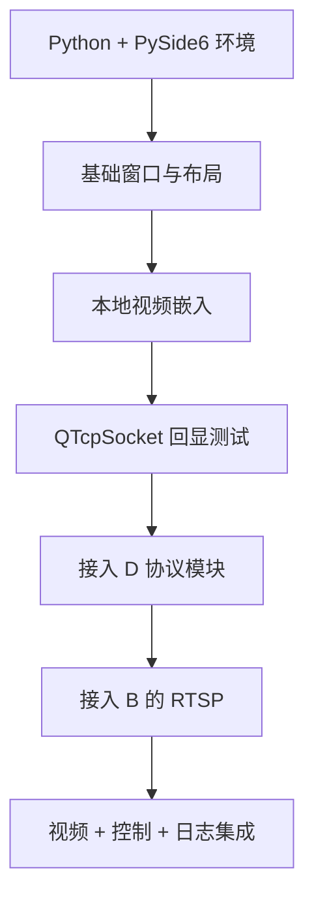

# 分工 C｜Windows 地面端软件

> [!abstract] 这份任务书要解决什么
> C 负责把视频显示、TCP 控制通信、飞控协议调用、状态提示和日志整合成一个 Windows 程序。推荐技术路线是 **Python + PySide6 + VLC/python-vlc + QTcpSocket**。C 不需要等 AMB82-Mini 和飞控全部到货才能开始，可以先用本地视频和 TCP 回显服务器完成界面与通信骨架。

## C 的任务边界

### 负责的部分

1. 搭建 Windows 地面端程序和基本界面。
2. 将 B 提供的 RTSP 视频流嵌入自己的窗口。
3. 使用 TCP 客户端连接 AMB82-Mini，显示连接状态并收发字节。
4. 调用 D 提供的协议模块，生成命令并解析返回数据。
5. 显示视频、网络、飞控状态和通信日志。
6. 处理断线、播放失败、网络错误和重新连接。

### 不负责的部分

- 不开发视频解码器、RTSP Server 或 TCP/IP 协议栈。
- 不负责 AMB82-Mini 的 TCP ↔ UART 固件；A 负责。
- 不负责飞控报文格式和 CRC 算法；D 负责。
- 不擅自设计飞控运动指令，也不把 UI 美化置于通信闭环之前。

> [!important] C 的核心判断标准
> C 的成果不是“能打开一个 VLC 窗口”，而是一个能同时显示视频、维持 TCP 控制连接、调用协议模块、反馈状态并保存日志的地面端程序。

## 地面端如何组织数据



视频和控制使用两条逻辑链路：视频由 RTSP 播放器负责，控制由 QTcpSocket 负责。两者都不能阻塞 Qt 的 GUI 主线程，否则播放窗口和按钮会一起卡住。

## 现成组件能不能直接复用？

| 组件 | 已经提供的能力 | C 能否直接复用 | C 自己要完成的部分 |
|---|---|---|---|
| **PySide6** | 窗口、控件、布局、信号与槽、事件循环 | **可以直接作为 UI 框架** | 组织界面、状态模型和交互逻辑 |
| **VLC + python-vlc** | RTSP 解码、播放和 Windows 窗口嵌入 | **可以直接复用播放器** | 安装 VLC 运行库、绑定 HWND、处理播放状态和重连 |
| **QTcpSocket** | TCP 连接、异步收发、状态信号和错误通知 | **可以直接复用** | 配置 IP/端口、把字节交给 D、显示日志 |
| **D 的协议模块** | 命令生成、返回数据解析 | **由 C 调用** | 不重复实现协议，只约定接口 |
| 地面站完整成品 | 与本项目协议和 UI 直接匹配的现成程序 | **不能直接假定存在** | 第一版仍需自己完成组合和项目界面 |

> [!success] 复用结论
> PySide6、VLC/python-vlc 和 QTcpSocket 都可以直接使用。C 的自主开发重点是**模块组合、异步状态管理、错误处理和可用的项目界面**，不是重写播放器或网络协议。

### 官方资料

- [Qt for Python / PySide6 官方介绍与安装](https://www.qt.io/development/qt-framework/python-bindings)
- [Qt for Python 的 QTcpSocket 文档](https://doc.qt.io/qtforpython-6.11/PySide6/QtNetwork/QTcpSocket.html)
- [VLC 官方网站](https://www.videolan.org/vlc/)
- [python-vlc 项目说明](https://pypi.org/project/python-vlc/)

## 推荐的最小项目结构

```text
GroundStation/
├── main.py                 # 程序入口
├── ui/
│   └── main_window.py      # 主窗口与布局
├── video/
│   └── video_player.py     # VLC/RTSP 播放
├── network/
│   └── tcp_client.py       # QTcpSocket 客户端
├── protocol/
│   └── adapter.py          # D 提供的协议接口
├── logs/
└── requirements.txt
```

目录可以调整，但视频播放、网络连接、协议调用和界面显示最好保持独立，便于分别调试。

## 分阶段任务与入手方式

### C1｜先搭建能运行的窗口

**阶段目标**：建立一个具有主窗口、按钮、输入框、视频区和日志区的 Windows 程序。

#### 入手顺序

1. 安装 Python，创建独立虚拟环境。
2. 安装 PySide6：`pip install pyside6`。
3. 创建主窗口和基本布局。
4. 加入 IP、端口、RTSP 地址输入框。
5. 加入连接、断开、播放和发送按钮。
6. 加入状态标签和滚动日志区。

#### 需要学习到什么程度

| 知识 | 学习要求 | 在本阶段要能做什么 |
|---|---|---|
| Python 基础 | 必须掌握 | 能拆分模块、调用函数和处理异常 |
| QWidget | 会使用 | 创建窗口和容器 |
| QPushButton / QLineEdit / QLabel | 会使用 | 完成按钮、输入框和状态显示 |
| QVBoxLayout / QHBoxLayout | 会使用 | 组织界面布局 |
| Signal / Slot | 理解并会用 | 让按钮触发动作、让状态变化更新界面 |
| Qt 事件循环 | 理解基本作用 | 知道 GUI 为什么不能被阻塞操作卡住 |

#### C1 验收

- Windows 可以运行程序。
- 输入框、按钮、视频区域和日志区域可见且能交互。
- 没有 AMB82-Mini 时也能用假数据更新状态。

### C2｜先用 VLC 验证 RTSP，再嵌入 PySide6

**阶段目标**：不打开独立 VLC 窗口，直接在自己的程序中显示视频。

#### 入手顺序

1. 等 B 跑通官方 RTSP 示例，先用 VLC 单独打开 `rtsp://<IP>:<port>`。
2. 确认 VLC 能持续播放，再安装 Windows VLC 和 `python-vlc`。
3. 在 PySide6 中创建视频显示控件。
4. 获取该控件的 Windows HWND。
5. 用 `set_hwnd()` 把 libVLC 输出绑定到控件。
6. 实现播放、停止、播放失败提示和重新连接。

```python
import vlc

instance = vlc.Instance()
player = instance.media_player_new()
player.set_hwnd(int(video_widget.winId()))
media = instance.media_new("rtsp://<IP>:554")
player.set_media(media)
player.play()
```

这是核心调用示意，实际程序还要处理窗口生命周期、播放器状态和异常。

#### C2 验收

- RTSP 视频显示在自己的 PySide6 窗口内。
- VLC 播放失败时，界面能显示原因或当前状态。
- 视频停止和重新连接不会让整个 GUI 卡死。

### C3｜用 QTcpSocket 完成地面端网络连接

**阶段目标**：地面端能够连接 A 的 TCP Server，发送并接收二进制数据。

#### 入手顺序

1. 创建 `QTcpSocket` 客户端。
2. 从界面读取 IP 和端口，调用 `connectToHost()`。
3. 连接 `connected`、`readyRead`、`disconnected` 和错误信号。
4. 用 `write()` 发送测试字节，用 `readAll()` 读取返回字节。
5. 在状态标签和日志区显示连接、发送、接收和断开事件。
6. 先用 A 的 TCP 回显 Demo，不必等待飞控到货。

```python
from PySide6.QtNetwork import QTcpSocket

self.socket = QTcpSocket(self)
self.socket.connected.connect(self.on_connected)
self.socket.readyRead.connect(self.on_ready_read)
self.socket.disconnected.connect(self.on_disconnected)
self.socket.connectToHost(host, port)
```

TCP 是字节流，`readyRead` 一次触发不一定对应一条完整飞控报文。C 负责收集收到的字节并交给 D，帧边界和协议解析由 D 负责。

#### C3 验收

- 能连接 A 的 TCP Server。
- 能发送二进制测试数据并收到回显。
- 能显示连接状态、断开状态和错误信息。
- 断线后可以手动重新连接。

### C4｜接入 D 的协议模块

**阶段目标**：用户从界面选择命令，C 调用 D 生成报文并发送，返回数据再交给 D 解析。

建议接口形式如下，具体名称由 C、D 共同确定：

```python
packet = protocol.encode_command("request_status")
self.socket.write(packet)

data = self.socket.readAll().data()
messages = protocol.feed_data(data)
```

C 需要完成：命令选择、参数输入、调用编码接口、发送 `bytes`、接收数据、调用解析接口、显示结果。协议报文不能先转成 UTF-8 字符串，否则可能破坏二进制数据。

#### C4 验收

- 地面端能调用 D 的模块生成一条非运动类命令。
- 命令能够通过 TCP 发到 AMB82-Mini。
- 返回数据能交给 D 并显示解析结果。
- 没有真实飞控时，至少用模拟报文验证调用链。

### C5｜视频、控制和日志的系统集成

**阶段目标**：一个窗口同时显示视频、维持控制链路并给出清晰状态。

最终需要有：

- 视频播放状态和 RTSP 地址；
- TCP 连接状态、IP、端口和重连按钮；
- 命令发送记录和接收数据记录；
- 飞控解析结果；
- 网络错误、视频错误和异常提示；
- 必要的日志保存。

> [!warning] GUI 线程不能阻塞
> 不要在 Qt 主线程里使用无限等待式网络读取。使用 QTcpSocket 的异步信号，或把耗时工作放到合适的线程；否则视频、按钮和状态显示会同时冻结。

#### C5 验收

- 视频播放时 TCP 仍能收发。
- 发送命令时界面保持响应。
- 网络断开时有提示，重连后状态恢复。
- 日志足以定位连接、发送和接收问题。

## C 需要学习什么

### 必须掌握

- Python 模块、函数、异常和 `bytes`。
- PySide6 窗口、布局、控件、信号与槽。
- VLC/python-vlc 播放 RTSP。
- QTcpSocket 连接、发送、接收和错误处理。
- TCP 字节流与基本日志记录。
- Windows HWND 的基本用途。

### 需要理解

- TCP 与 UDP 的差别。
- RTSP 视频流的基本流程。
- H.264 只需理解基本概念，不需要实现编码。
- Qt 事件循环、异步信号和线程边界。
- 一次网络读取不一定得到一整帧协议消息。

### 暂时不展开

- Qt C++ 底层实现。
- TCP/IP 协议栈。
- H.264 编码和视频解码算法。
- RTSP Server。
- 飞控协议内部实现和飞行控制算法。
- 复杂三维地图和航迹规划。

## C 的交付物与第一周计划

| 编号 | 交付物 | 内容 |
|---|---|---|
| C1 | 地面端基础界面 | 主窗口、视频区、连接区、日志区 |
| C2 | RTSP 播放模块 | 嵌入 AMB82-Mini 视频流 |
| C3 | TCP 客户端模块 | 与 A 双向收发字节 |
| C4 | 协议调用层 | 调用 D 的编码和解析接口 |
| C5 | 状态与日志模块 | 网络、视频、飞控状态和记录 |
| C6 | 完整地面端程序 | 所有模块可在一个窗口中运行 |

第一周不需要等待硬件：安装环境 → 完成窗口 → 嵌入本地视频 → 连接电脑 TCP 回显服务器 → 显示日志。视频录像属于后续改进，先完成播放和控制闭环。



## 相关笔记

- [[分工C]]（原始笔记）
- [[分工A-整理版]]
- [[分工B-整理版]]
- [[分工D-整理版]]
- [[无人机图传项目-Obsidian笔记规范]]
