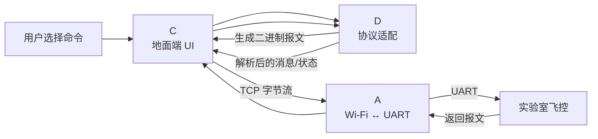
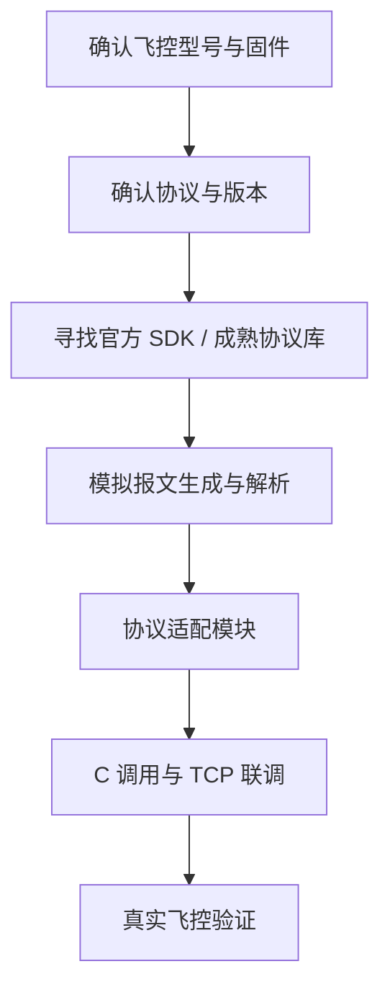

# 分工 D｜飞控通信协议适配

> [!abstract] 这份任务书要解决什么
> D 负责确定实验室飞控实际使用的通信协议，并把“命令名称、参数、收到的二进制数据”转换成 C 可以调用的软件接口。A 负责把字节通过 TCP ↔ UART 搬运，C 负责界面和网络收发，D 负责**报文应该怎样组织、怎样校验、怎样解析**。

## D 的任务边界

### 负责的部分

1. 确认飞控品牌、型号、固件、协议版本、接口和波特率。
2. 阅读实际协议文档，整理消息帧、命令、字段、校验和返回值。
3. 优先调用官方 SDK 或成熟协议库生成、序列化和解析报文。
4. 编写独立的协议适配模块，向 C 提供稳定接口。
5. 用模拟报文、错误数据和真实飞控进行分层验证。

### 不负责的部分

- 不负责 AMB82-Mini 的 Wi-Fi、TCP、UART 转发；A 负责。
- 不负责 Windows UI 和网络连接；C 负责。
- 不负责确认 TX/RX、电平和物理接线；E 负责。
- 不开发飞控固件、姿态解算、电机控制或无人机算法。

> [!warning] 不要先假定 MAVLink
> 飞控型号、固件和协议尚未确认时，不能因为项目是无人机就默认采用 MAVLink。MAVLink 只是候选路线；如果实验室使用厂商自定义协议，D 必须以实际文档为准。

## 三个人如何分工



A 解决“能不能传过去”，D 解决“传过去的字节是否符合协议”，C 解决“用户如何选择、发送和看到结果”。这三个问题不能混成一个岗位。

## 官方资料和成熟库能不能直接复用？

| 资料或工具 | 已经提供的能力 | D 能否直接复用 | D 仍需自己完成 |
|---|---|---|---|
| **MAVLink 官方协议文档** | 消息、命令、数据帧、版本和标准定义 | **如果飞控确认使用 MAVLink，可直接作为规范** | 选择飞控支持的消息、系统 ID、组件 ID 和命令 |
| **pymavlink** | Python 报文生成、序列化、解析和协议库调用 | **可以直接调用，不要重写 CRC** | 为本项目封装统一接口，并确认方言和版本 |
| **飞控厂商 SDK/协议库** | 具体厂商的消息与连接方式 | **优先复用** | 适配实际协议和未覆盖的业务字段 |
| **SITL/协议模拟工具** | 无硬件时的消息测试环境 | **可作为独立验证工具** | 选择与实际飞控匹配的消息并保存测试记录 |
| 自定义协议 | 取决于实验室文档 | **没有通用例程可直接套用** | 根据帧结构、校验和时序实现适配 |

> [!success] 复用结论
> D 的原则是**复用协议定义和成熟库，自己编写项目适配层**。如果最终确认 MAVLink，`pymavlink` 可以直接生成和解析报文；如果协议尚未确认，第一步只能做资料调研和通用二进制基础准备。

### 资料入口

- [MAVLink Python / Pymavlink 使用指南](https://mavlink.io/en/mavgen_python/)
- [ArduPilot pymavlink 仓库](https://github.com/ardupilot/pymavlink)
- [MAVLink Developer Guide](https://mavlink.io/en/)

## 分阶段任务与入手方式

### D1｜先拿到飞控型号和协议资料

**阶段目标**：形成一份不会依赖猜测的协议调研表。

#### 入手顺序

1. 联系老师或实验室，确认飞控品牌和具体型号。
2. 确认飞控固件，例如 PX4、ArduPilot 或厂商固件。
3. 确认通信协议是 MAVLink 还是自定义协议。
4. 确认接口类型、波特率、数据位、停止位和校验位。
5. 获取协议版本、消息定义、SDK 或开源库。
6. 整理首批要用的非运动类消息，例如心跳、状态查询和 ACK。

| 信息 | 必须记录的内容 |
|---|---|
| 飞控 | 品牌、型号、硬件版本 |
| 固件 | 名称与版本 |
| 协议 | 名称、版本、方言或自定义文档 |
| 串口 | 接口、波特率、数据位、停止位、校验 |
| 消息 | 命令 ID、字段、返回消息、超时 |
| 工具 | 官方 SDK、Python 库、仿真器 |

#### D1 验收

- 有飞控型号、固件和协议的证据。
- 有协议文档、串口参数和版本记录。
- 能说明第一条安全测试消息是什么。

### D2｜理解帧结构并调用成熟协议库

**阶段目标**：知道飞控如何识别一条报文，并能用库生成和解析测试数据。

如果使用 MAVLink，需要理解帧头、长度、序号、系统 ID、组件 ID、消息 ID、负载和 CRC；MAVLink 2 常见帧头为 `0xFD`。这些知识用于读日志和排查问题，不代表要从零重写协议。

```python
from pymavlink import mavutil

# 实际连接方式、方言和消息类型以飞控资料为准
connection = mavutil.mavlink_connection("udp:127.0.0.1:14550")
message = connection.recv_match(blocking=False)
if message:
    print(message.get_type(), message.to_dict())
```

上面只是库调用示意；真实项目应先确认连接方式和飞控配置，不要直接把 SITL 地址当成真实 UART 参数。

#### D2 需要学习到什么程度

| 知识 | 学习要求 | 在本阶段要能做什么 |
|---|---|---|
| 二进制与十六进制 | 必须掌握 | 阅读原始报文、打印 `bytes.hex()` |
| 数据帧结构 | 必须理解 | 找到帧头、长度、消息 ID 和校验字段 |
| CRC | 理解作用，会用库 | 判断报文是否被破坏，不重复发明算法 |
| 消息/命令 ID | 按实际协议学习 | 查出请求、返回和 ACK 的对应关系 |
| 协议库 | 必须会调用 | 生成、序列化、解析测试报文 |

#### D2 验收

- 能生成一条协议库支持的测试报文。
- 能把报文打印为十六进制并解释关键字段。
- 能把一条合法报文重新输入解析器并得到消息类型和字段。

### D3｜开发独立协议适配模块

**阶段目标**：让 C 不需要了解协议内部细节，也能发送命令和取得解析结果。

建议使用 Python，目录可以这样组织：

```text
protocol/
├── __init__.py
├── protocol_adapter.py   # 对外统一接口
├── command_encoder.py    # 命令生成
├── message_parser.py     # 返回数据解析
└── config.py             # 协议版本、系统 ID 等配置
```

建议接口（名称可由 C、D 共同调整）：

| 接口 | 作用 |
|---|---|
| `encode_command(name, **kwargs)` | 根据命令名和参数生成 `bytes` |
| `feed_data(data)` | 把 TCP 收到的字节交给解析缓冲区 |
| `parse_message()` | 取出已经完成的一条消息 |
| `get_status()` | 返回已解析的状态摘要 |

适配层内部可以调用 `pymavlink` 或厂商库，不要让 C 直接依赖一堆底层库对象。

#### D3 验收

- 输入命令和参数，输出符合协议的二进制报文。
- 输入返回报文，输出消息类型和字段。
- 处理半包、粘包、错误帧和未知消息时不会让程序崩溃。
- C 可以通过稳定接口导入并调用。

### D4｜协议模拟与独立测试

**阶段目标**：没有真实飞控时，也能验证协议代码。

建议按这个顺序测试：

1. 选择心跳、状态查询或其他非运动类消息。
2. 用成熟库生成报文。
3. 转换成十六进制并保存样例。
4. 把完整报文重新输入解析器，检查结果是否一致。
5. 分段输入，测试半包和多包连续输入。
6. 修改长度、CRC 或消息 ID，测试错误处理。
7. 输出一份测试记录。

> [!warning] 初期不要测试运动控制
> 在协议和物理链路尚未完全验证前，不测试解锁、电机输出、起飞、降落等可能改变飞行状态的命令。先使用只读状态和 ACK 类消息。

#### D4 验收

- 有可重复运行的协议测试脚本。
- 能识别合法帧、半帧、粘包和错误帧。
- 有原始输入、解析结果和异常结果记录。

### D5｜与 C、A 和真实飞控联调

**阶段目标**：验证协议链路与传输链路都成立。

按三层进行：

1. **协议层**：D 独立生成和解析报文。
2. **软件层**：C 调用 D，C 通过 TCP 发送，D 解析回包。
3. **真实链路**：电脑 → C → D → TCP → A → UART → 飞控，再沿反方向返回。

#### D5 验收

- 至少完成一种非运动类命令发送。
- 飞控能够识别命令并返回数据，或有明确的失败原因。
- 能区分“UART 输出正确”和“飞控真正识别并响应”这两个结论。

## D 需要学习什么

### 必须掌握

- Python 基础、模块和函数。
- `bytes`、十六进制和缓冲区处理。
- 实际飞控协议及其消息定义。
- 官方 SDK 或协议库的安装与调用。
- 命令生成、返回解析和异常处理。
- 半包、粘包、超时和 ACK 的基本处理。

### 需要理解

- UART 与 TCP 字节流的边界。
- 波特率和协议参数的关系。
- 数据帧、CRC、系统 ID、组件 ID。
- 命令确认、超时和重试。
- SITL/模拟数据与真实飞控的差异。

### 暂时不展开

- 从零实现 MAVLink 或自定义协议栈。
- 协议库已经提供时手写 CRC。
- 飞控固件、姿态解算、电机控制和飞行算法。
- AMB82 UART 驱动和 Windows 地面端 UI。

## D 的交付物与第一周计划

| 编号 | 交付物 | 内容 |
|---|---|---|
| D1 | 协议调研表 | 型号、固件、协议、版本、串口参数 |
| D2 | 协议开发环境 | 官方 SDK 或成熟 Python 库 |
| D3 | 命令生成模块 | 生成符合协议的 `bytes` |
| D4 | 数据解析模块 | 解析返回消息和字段 |
| D5 | 协议测试程序 | 模拟合法、错误、半包和粘包数据 |
| D6 | 协议适配包 | 提供给 C 调用的稳定接口 |
| D7 | 联调记录 | C、A 与真实飞控的验证结果 |

第一周优先完成：确认飞控 → 确认协议 → 获取文档 → 找到库 → 生成一条安全测试消息。飞控型号未确认时，不编写针对某个协议的最终实现。



## 相关笔记

- [[分工D]]（原始笔记）
- [[分工A-整理版]]
- [[分工C-整理版]]
- [[分工E-整理版]]
- [[无人机图传项目-Obsidian笔记规范]]
