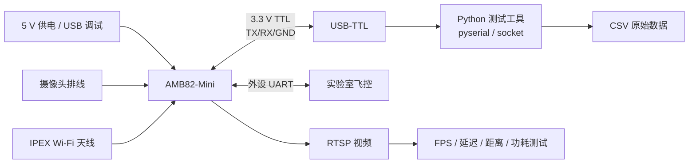
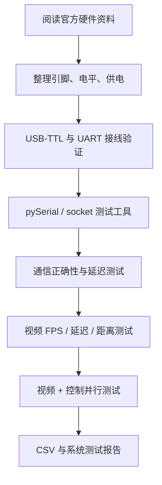

# 分工 E｜硬件接口与系统测试

> [!abstract] 这份任务书要解决什么
> E 负责把 AMB82-Mini、摄像头、Wi-Fi 天线、USB-TTL、实验室飞控和供电连接条件确认清楚，并建立一套可重复执行的测试流程。E 的核心成果不是“帮大家测一下”，而是**硬件接口说明、可靠接线、自动化通信测试、视频性能数据和最终系统测试报告**。

## E 的任务边界

### 负责的部分

1. 整理 AMB82-Mini 的接口、引脚、供电和 IO 电平。
2. 检查摄像头排线、IPEX 天线、USB 调试和外设 UART 的物理连接。
3. 确认 USB-TTL 与飞控接口的 TX/RX/GND、电平和供电条件。
4. 编写可重复运行的串口/TCP 测试工具，自动校验、计时并导出 CSV。
5. 设计并执行视频 FPS、延迟、距离、断流、功耗和并行运行测试。
6. 保存原始数据、测试条件和复现步骤，**形成最终报告。**

### 不负责的部分

- 不代替 A 编写 TCP ↔ UART 通信固件。
- 不代替 B 优化 H.264、码率或 RTSP 视频模块。
- 不代替 C 开发地面端 UI。
- 不代替 D 解析飞控协议。
- 不负责 PCB 设计、射频电路设计和飞控算法。

> [!important] E 的核心判断标准
> E 要让团队知道“系统为什么可以认为正常”：接线、电平、输入电压、测试条件、原始数据和结论都必须留下证据。

## 硬件与测试如何连接起来



E 负责的是接口和证据链：先证明电气连接正确，再证明 A 的通信数据正确，最后在 B 的视频运行时验证整个系统的表现。

## 官方资料能不能直接复用？

| 官方资料或工具 | 已经提供的内容 | E 能否直接复用 | E 还要自己完成什么 |
|---|---|---|---|
| **AMB82-Mini Getting Started** | 开发板介绍、引脚、外设映射、摄像头选项、烧录和供电入门 | **可以直接作为接口资料** | 对照手上板卡确认物理位置和版本 |
| **Hardware User Guide** | 供电、接口、天线、摄像头和硬件限制 | **可以作为硬件核对依据** | 把与本项目有关的内容整理成接线表；第三方镜像只作备用来源 |
| **Arduino SerialPassthrough** | 串口选择和基本收发示例 | **可作为 A 的软件验证参考** | E 负责接线、测量和记录，不重复写通信固件 |
| **pySerial** | Windows 串口访问、端口配置、读写和工具 | **可以直接用于测试程序** | 自己编写序号、校验、计时、CSV 报告逻辑 |
| 官方端到端测试报告 | 没有针对本项目条件的完整报告 | **不能直接复用为项目结论** | 设计固定条件并测出自己的数据 |

> [!success] 复用结论
> 官方硬件资料和 `SerialPassthrough` 解决“接口在哪里、串口如何工作”的基础问题；`pySerial` 可以直接用于 Windows 串口访问。**E 的自主成果是把这些基础能力变成可重复的测试环境和可审查的数据报告。**

### 资料入口

- [AMB82-Mini 官方 Getting Started](https://github.com/Ameba-AIoT/ameba-arduino-doc/blob/main/source/ameba_pro2/amb82-mini/Getting_Started/Getting%20Started%20with%20Ameba.rst)
- [AMB82-Mini 官方 Arduino 示例表](https://ameba-doc-arduino-sdk.readthedocs-hosted.com/en/latest/ameba_pro2/amb82-mini/Example_Guides/Basic/Arduino-build-in%20example.html)
- [pySerial 官方文档](https://pyserial.readthedocs.io/en/latest/)

## 分阶段任务与入手方式

### E1｜建立 AMB82-Mini 接口说明

**阶段目标**：明确项目实际使用哪些接口，以及每个接口的电气条件。

#### 入手顺序

1. 阅读官方 Getting Started 和硬件资料。
2. 对照手上板卡，标出 Micro USB、摄像头接口、IPEX 天线和外设 UART。
3. 整理 Serial1、Serial2、Serial3 的 TX/RX 映射；原笔记中的示例为 Serial1：PA2/TX、PA3/RX，最终以板卡资料和实际引出位置复核。
4. 确认 USB 调试口与外设 UART 的区别。
5. 记录供电电压、供电能力和 IO 电平。
6. 形成一张团队共用的接口表和接线图。

| 接口 | 用途 | E 要确认的内容 |
|---|---|---|
| Micro USB | 供电、烧录、调试 | COM 口、供电用途 |
| Camera Connector | 摄像头 | 排线方向、型号、安装 |
| IPEX | Wi-Fi 天线 | 天线是否接牢、安装方向 |
| Serial1/2/3 | 外设 UART | TX、RX、GND、物理引脚 |
| V_USB / GND | 外部供电 | 电压范围、供电能力、共地 |

#### 需要学习到什么程度

| 知识 | 学习要求 | 在本阶段要能做什么 |
|---|---|---|
| 开发板引脚图 | 必须掌握 | 在实物上找到项目所需引脚 |
| UART 引脚映射 | 必须掌握 | 区分 Serial1/2/3 与调试串口 |
| 3.3 V / 5 V 电平 | 必须掌握 | 判断转接器和飞控是否兼容 |
| 供电输入 | 必须掌握 | 选择合适电源并记录电流能力 |
| IPEX 和摄像头接口 | 会安装 | 正确连接天线和排线 |

#### E1 验收

- 有标注清楚的接口表、引脚表和接线图。
- 每个电气结论都有资料来源或实测记录。
- 能说明哪些条件尚未确认，避免把猜测当成接线依据。

### E2｜完成 UART 接线与电气验证

**阶段目标**：建立 AMB82-Mini 与电脑、USB-TTL、飞控之间安全可靠的物理连接。

#### USB-TTL 接线

假设 A 选择 Serial1：

| AMB82-Mini | USB-TTL |
|---|---|
| PA2 / TX | RX |
| PA3 / RX | TX |
| GND | GND |

TX 必须接对方 RX，RX 必须接对方 TX，双方必须共地。

> [!warning] 上电前检查
> USB-TTL 逻辑电平选择 3.3 V；不要把 5 V 接到 UART 信号脚；如果 AMB82-Mini 已经由独立 USB 供电，不要未经确认再连接 USB-TTL 的 VCC。飞控接口的电平和供电条件没有确认前，不得直接接线试验。

#### E2 操作顺序

1. 断电检查 TX、RX、GND 和电平选择。
2. 用万用表检查连通性和明显短路。
3. 打开串口调试工具，设置波特率、数据位、停止位和校验位。
4. 配合 A 运行 UART 回环或收发程序。
5. 记录发送字节、收到字节、串口参数和异常现象。
6. 等老师提供飞控型号后，单独整理飞控 UART 位置、电平、GND、供电和接口限制。

#### E2 验收

- AMB82-Mini 与电脑通过外设 UART 双向收发成功。
- 接线、电平和供电条件有记录。
- 飞控接口资料齐全后，能给 A、D 提供明确的物理连接条件。

### E3｜编写独立通信测试工具

**阶段目标**：不靠人工肉眼判断，自动判断数据是否正确、是否丢失以及延迟多少。

推荐技术：Python、`pyserial`、`socket`、`time` 和 `csv`。

```text
测试工具输入：串口或 TCP 端点、发送长度、发送频率、持续时间
测试工具输出：发送数、接收数、正确数、缺失数、重复数、校验错误、延迟和 CSV
```

每条测试消息至少包含序号和校验信息，例如：

```text
SEQ:000001 DATA:1234567890
SEQ:000002 DATA:ABCDEFGHIJ
SEQ:000003 DATA:0987654321
```

建议覆盖：1、16、64、256 字节；连续发送；双向发送；长时间发送。工具必须能保存原始时间、序号、长度、结果和错误原因。

#### E3 验收

- 可以独立启动测试程序。
- 能自动判断正确、缺失、重复和校验错误。
- 能记录发送时间、接收时间和延迟。
- 能导出 CSV，重复运行后可以比较 A 修改前后的结果。

### E4｜建立视频性能测试流程

**阶段目标**：使用固定条件独立测量 B 的视频表现。

B 负责修改视频参数，E 负责用同样的测试条件比较修改前后结果。每次测试要记录日期、板卡、摄像头、分辨率、配置 FPS、码率、Wi-Fi 频段、距离和播放器设置。

#### E4.1 分辨率与帧率

| 测试组 | 分辨率 | 配置帧率 |
|---|---|---|
| 1 | 640×480 | 30 FPS |
| 2 | 1280×720 | 15 FPS |
| 3 | 1280×720 | 30 FPS |

记录实际 FPS、卡顿、画面异常和带宽占用。表中的组合仅用于对比，是否支持要以当前摄像头和 SDK 为准。

#### E4.2 端到端延迟

1. 在源显示器上打开毫秒计时器或让 LED 周期闪烁。
2. 让摄像头同时拍到源画面。
3. 在另一台显示器用 VLC 或 C 的地面端播放。
4. 用手机同时拍摄源画面和接收画面。
5. 读取两个画面的时间差，至少重复 10 次。
6. 记录平均值、最大值和测试条件。

这个结果包含采集、编码、网络、解码和显示延迟，不能写成单独“网络延迟”。

#### E4.3 距离、连续运行和功耗

- 距离测试：建议 1 m、10 m、30 m，固定网络、分辨率和码率，记录信号、FPS、卡顿和断流。
- 连续运行：建议至少 30 分钟，记录重启、断流、长时间卡顿和自动重连。
- 功耗测试：分别测量空闲、摄像头+RTSP、视频+UART/TCP 并行三个状态。

功耗按 `P = U × I` 计算；记录的是整块开发板在该状态下的输入功耗，不是单独芯片功耗。

#### E4.4 并行运行

1. 启动 B 的 RTSP 视频。
2. 电脑持续接收视频。
3. 同时通过 C/A 发送通信测试数据。
4. 检查 UART 数据是否正确。
5. 对比并行前后的 FPS、延迟和控制链路错误。

#### E4 验收

- 有完整的测试条件表和原始 CSV。
- 能给出不同参数、距离和并行状态下的比较结论。
- 发现异常时能说明更可能属于硬件、电源、视频、网络还是控制链路。

## E 需要学习什么

### 必须掌握

- AMB82-Mini 引脚定义、UART 物理接口和 3.3 V/5 V 电气区别。
- USB-TTL、万用表和基本串口调试工具。
- 摄像头排线、IPEX 天线和安全上电。
- Python 基础、pySerial、socket、CSV 和时间记录。
- 测试条件控制、数据整理和结果复现。

### 需要理解

- UART 通信和波特率。
- Wi-Fi RSSI、视频 FPS、码率和端到端延迟。
- 输入电压、电流、功率的关系。
- TCP 可靠传输与缓存现象。
- 为什么测试必须固定变量并重复测量。

### 暂时不展开

- PCB 设计、射频电路和 RTL8735B 内部实现。
- H.264 编码、ISP 算法和飞控固件。
- 飞控协议解析和地面端 UI。
- 无人机飞行控制算法。

## E 的交付物与第一周计划

| 编号 | 交付物 | 内容 |
|---|---|---|
| E1 | 硬件接口说明 | 引脚、UART、供电、摄像头和天线 |
| E2 | 硬件连接图 | AMB82-Mini、USB-TTL、飞控连接 |
| E3 | 硬件验证记录 | 电平、供电、连通性和串口收发 |
| E4 | 通信测试程序 | 自动发送、接收、校验、计时和 CSV |
| E5 | 视频测试记录 | FPS、延迟、距离和稳定性 |
| E6 | 功耗记录 | 不同运行状态的输入功耗 |
| E7 | 系统测试报告 | 视频与控制并行运行的最终证据 |

第一周不必等待 A、B 完成代码：阅读资料 → 画接口表 → 确认工具 → 完成安全接线准备 → 设计测试表。硬件到货后再增加 UART 回环、摄像头/天线检查和功耗基线。



## E 与其他成员的工作边界

| 协作对象 | 分工 |
|---|---|
| A | A 写通信固件，E 提供物理接口和独立验证 |
| B | B 调整视频参数，E 固定条件测量并记录 |
| C | C 写地面端，E 用测试数据验证通信和状态 |
| D | D 负责协议，E 确认物理接口和串口条件 |
| 负责人 | 负责人组织集成，E 提供硬件与测试证据 |

例如延迟超过目标时，E 先提交可复现数据；B 分析视频编码、缓存和传输，A 检查控制链路影响，负责人协调修改和复测。

## 相关笔记

- [[分工E]]（原始笔记）
- [[分工A-整理版]]
- [[分工B-整理版]]
- [[分工C-整理版]]
- [[分工D-整理版]]
- [[无人机图传项目-Obsidian笔记规范]]
