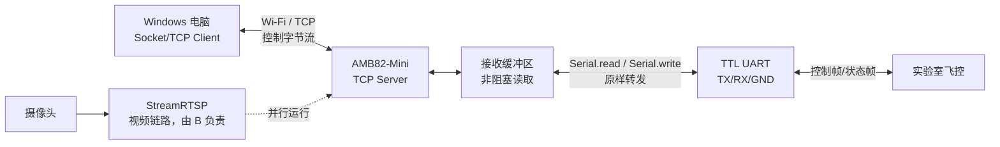
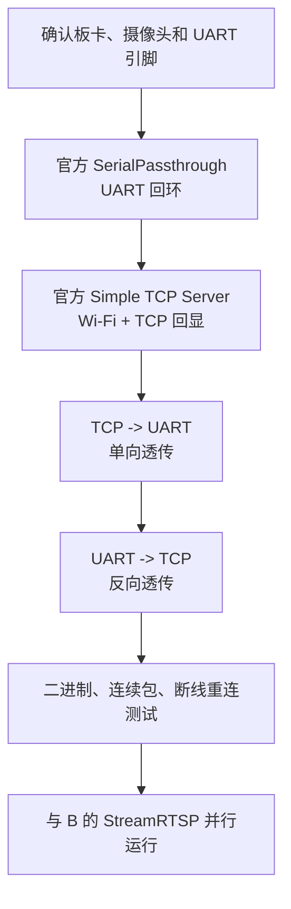
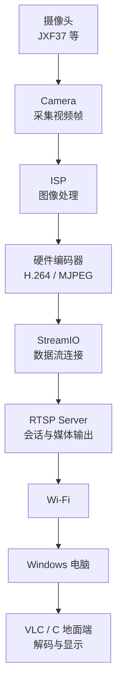
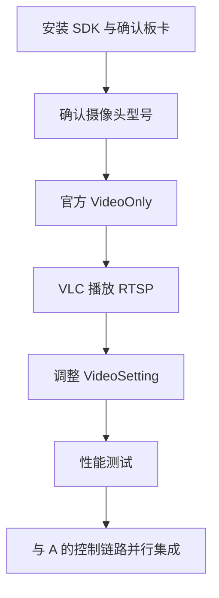
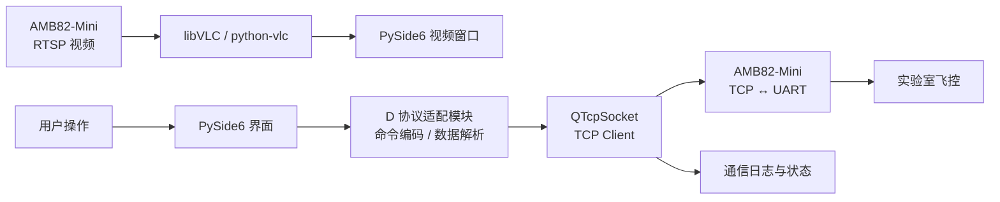
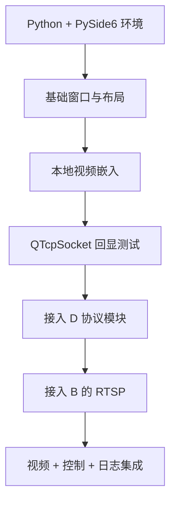
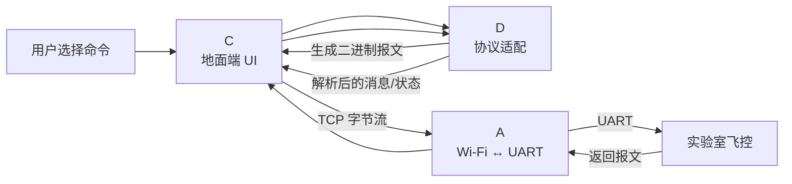
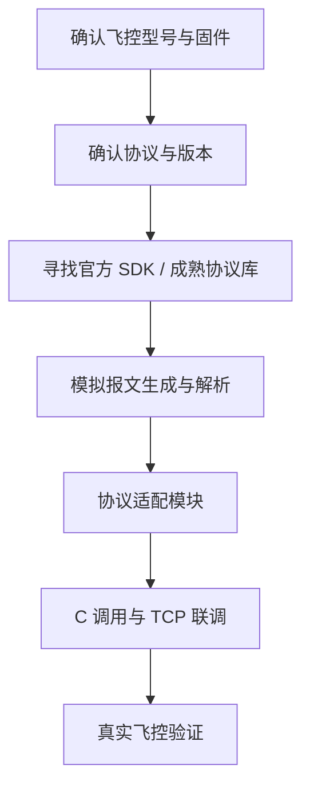
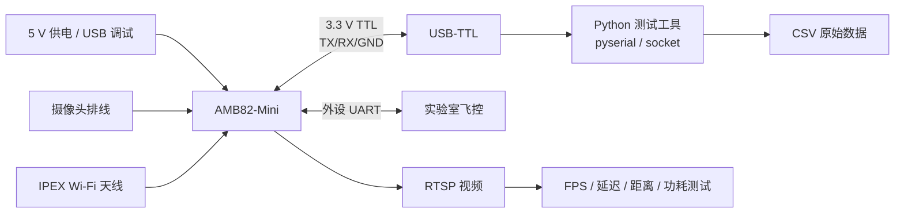
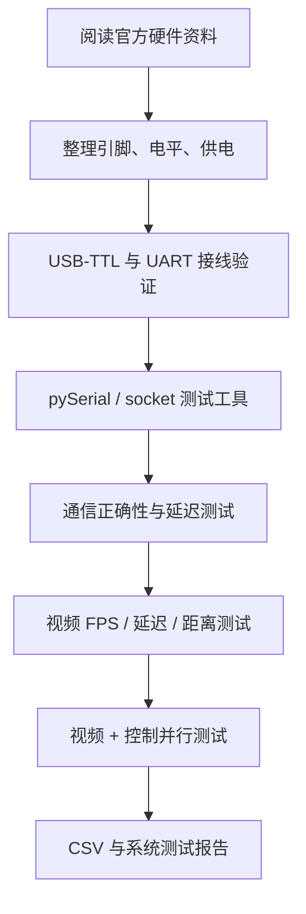

# 无人机 Wi-Fi 图传项目｜五人分工合集

**AMB82-Mini · Windows 地面端 · 飞控双向通信**

> [!abstract] 阅读说明
> 本笔记依次合并 A、B、C、D、E 五份整理版，保留各任务书正文、表格、代码、提示块与 Mermaid 流程图。项目按两周推进，每周计划与成果验收见[[无人机图传WiFi项目-总进度管理|总进度笔记]]和[[无人机图传WiFi项目-项目进度计划表|两周进度计划表]]。

## 总目录

- [[#分工 A｜Wi-Fi 与 UART 双向数据转发|分工 A｜Wi-Fi 与 UART 双向数据转发]]
- [[#分工 B｜摄像头与 Wi-Fi 视频图传|分工 B｜摄像头与 Wi-Fi 视频图传]]
- [[#分工 C｜Windows 地面端软件|分工 C｜Windows 地面端软件]]
- [[#分工 D｜飞控通信协议适配|分工 D｜飞控通信协议适配]]
- [[#分工 E｜硬件接口与系统测试|分工 E｜硬件接口与系统测试]]

# 分工 A｜Wi-Fi 与 UART 双向数据转发

> [!abstract] 这份任务书要解决什么
> A 负责把电脑和实验室飞控之间的控制数据搬运起来：电脑通过 Wi-Fi/TCP 把字节发给 AMB82-Mini，AMB82-Mini 再通过 TTL UART 发给飞控；飞控返回的数据沿相反方向回到电脑。A 关注的是**字节是否正确、链路是否稳定、视频运行时是否仍能工作**，暂时不负责解释飞控命令含义，也不负责视频编码和 RTSP 服务。

## A 的任务边界

### 负责的部分

1. **UART 串口链路**：确认 AMB82-Mini 的串口引脚、电平、波特率和收发方式，完成电脑或飞控与开发板之间的串口收发。
2. **Wi-Fi/TCP 链路**：让电脑能够找到 AMB82-Mini、连接 TCP Server，并发送、接收控制数据。
3. **双向数据转发**：实现 TCP → UART 和 UART → TCP 两个方向的原样转发，保留二进制字节，不把数据误当成字符串处理。
4. **缓冲与调试**：处理串口和网络的暂存数据，记录十六进制日志，定位断线、丢字节和阻塞问题。
5. **系统集成**：在 B 的 RTSP 视频流运行时，验证控制链路仍能双向工作。

### 不负责的部分

- 不负责 H.264/H.265 编码、ISP 图像处理、RTSP 服务端和摄像头驱动；这些属于视频链路，当前由 B 负责。
- 不负责飞控算法，也不要求一开始读懂每条飞控指令的业务含义。
- 不需要从零实现 Wi-Fi 驱动、TCP/IP 协议栈或 UART 底层驱动。

> [!important] A 的核心判断标准
> 如果电脑发送 `FD 09 00 00 01 01 00 ...`，AMB82-Mini 不需要知道这段数据表示什么命令；它只需要把收到的每个字节按原顺序转发到 UART。反方向也一样。A 的第一目标是**透明传输**，不是协议解析。

## 一张图看懂数据经过哪里



这条链路可以拆成四个可以单独验收的动作：先让 UART 回环，再让 TCP Server 回显，然后把两段 Demo 接起来，最后在视频并行时观察是否互相阻塞。

## 官方例程能不能直接复用？

原笔记已经找到 AMB82-Mini Arduino SDK 中与 A 最相关的例程。我在 2026-10-31 重新核对了官方文档：

- `Simple TCP Server` 页面明确写出：开发板连接 Wi-Fi 后作为 Server，电脑使用 Socket 工具作为 Client，连接开发板显示的 IP 和 **5000** 端口，发送字符串后服务器返回相同字符串。
- Arduino 内置示例表明确列出 `SerialPassthrough`，并注明可选择 `Serial`、`Serial1` 或 `Serial2`。
- 官方 `RTSP Streaming V7RC` 页面明确把 `StreamRTSP` 归为摄像头到手机端的 RTSP 视频示例，默认 RTSP 端口为 554；它属于 B 的视频链路，不是 A 的数据转发例程。

因此，官方已经给出了 A1 和 A2 的**可运行基础例程**，但没有给出一个把 TCP 和 UART 双向桥接起来的“一键完成”例程。

| 官方例程 | 已经提供的能力 | A 能否直接复用 | 复用时要改什么 |
|---|---|---|---|
| **SerialPassthrough** | 串口初始化、读取、发送和串口间转发 | **A1 可直接作为起点** | 选择实际使用的 `Serial`/`Serial1`/`Serial2`，核对引脚和波特率；USB 调试口与接飞控的外设 UART 要分开 |
| **Simple TCP Server** | 连接 Wi-Fi、创建 TCP Server、等待电脑连接、收发数据和回显 | **A2 可直接复现** | 改 SSID/密码；记录开发板 IP；最终将“回显”改为 TCP↔UART 转发，并补上断线、缓存和二进制数据处理 |
| **StreamRTSP** | 摄像头采集、H.264 配置、Wi-Fi 和 RTSP 输出 | **不是 A 的任务；由 B 复用** | A 只需要在 B 跑视频时验证控制链路不被阻塞 |
| A1+A2 组合 | TCP 接收后写 UART、UART 接收后写 TCP | **没有一个官方例程直接完成** | 这是 A 的主要自主开发部分，需要组合两个官方 Demo 并设计缓冲、非阻塞读取和双向任务循环 |

> [!success] 复用结论
> A 不需要从零写底层通信。**A1 的串口 API 和 A2 的 TCP Server 可以直接复用；A3、A4 的双向桥接逻辑需要 A 自己组合实现；StreamRTSP 只作为并行运行的集成条件。**

### 原笔记中的官方资料

- [Simple TCP Server｜Ameba Arduino SDK](https://ameba-doc-arduino-sdk.readthedocs-hosted.com/en/latest/ameba_pro2/amb82-mini/Example_Guides/WiFi/Simple%20TCP%20Server.html)
- [Arduino 内置串口示例｜Ameba Arduino SDK](https://ameba-doc-arduino-sdk.readthedocs-hosted.com/en/latest/ameba_pro2/amb82-mini/Example_Guides/Basic/Arduino-build-in%20example.html)
- [StreamRTSP｜Ameba Arduino 文档仓库](https://github.com/Ameba-AIoT/ameba-arduino-doc/blob/main/source/ameba_pro2/amb82-mini/Example_Guides/Multimedia/RTSP%20Streaming%20V7RC.rst)

## 分阶段任务与入手方式

### A1｜先跑通 UART 串口通信

**阶段目标**：用 USB-TTL 转接器让电脑和 AMB82-Mini 双向收发数据。

#### 入手顺序

1. 查 AMB82-Mini 的引脚表，确认实际使用哪一路 UART。原笔记记录的示例是：`Serial1` 的 TX 为 PA2（引脚 21），RX 为 PA3（引脚 22）；最终接线仍需结合板卡版本、原理图和已占用引脚复核。
2. 打开官方 **SerialPassthrough** 示例，先不改业务逻辑，只完成编译、烧录和串口监视。
3. 把 `Serial.begin()` 的波特率改成与 USB-TTL 设备一致，确认 TX、RX、GND 接线正确。
4. 用短字符串验证方向，再用十六进制字节验证二进制数据不会被改写。
5. 记录使用的 UART 编号、引脚、波特率和测试日志，形成后续接飞控的固定配置。

#### 需要学习到什么程度

| 知识 | 学习要求 | 在本阶段要能做什么 |
|---|---|---|
| UART 通信 | 理解基本过程 | 知道 TX 发、RX 收，双方共地，并能说明串口是字节流 |
| TTL 电平 | 必须掌握 | 确认外设是否为 3.3V TTL，避免把不兼容电平直接接入开发板 |
| 波特率、数据位、停止位、校验位 | 必须掌握 | 让两端参数一致，并能根据乱码判断参数不匹配 |
| `Serial.begin()` | 会使用 | 初始化指定串口 |
| `Serial.available()` | 会使用 | 判断接收缓冲区是否有数据 |
| `Serial.read()` | 会使用 | 逐字节读取数据 |
| `Serial.write()` | 会使用 | 原样发送字节，不把二进制强转成字符串 |

> [!warning] 接线边界
> USB 调试串口和连接飞控的外设 UART 不是同一个概念。TX 要接对方 RX，RX 要接对方 TX，GND 必须共地；接入飞控前还要确认电平和供电方式。

#### A1 验收

- 电脑 → USB-TTL → AMB82-Mini：开发板能收到数据。
- AMB82-Mini → USB-TTL → 电脑：电脑能收到数据。
- 至少用一组二进制字节做回环测试，收发前后十六进制内容完全一致。

### A2｜再复现 Wi-Fi TCP 通信

**阶段目标**：电脑通过 Wi-Fi 连接 AMB82-Mini 的 TCP Server，并完成一次可观察的收发。

#### 入手顺序

1. 打开官方 **Simple TCP Server** 示例。
2. 只修改 Wi-Fi 名称和密码，先让官方代码原样运行。
3. 烧录开发板，观察串口日志并记下 AMB82-Mini 获取到的 IP 地址和端口；原笔记记录的默认端口为 5000，以实际日志和示例版本为准。
4. 电脑使用 Socket 调试工具连接开发板，发送一段普通字符串，确认官方回显成立。
5. 再发送十六进制数据，确认测试工具没有偷偷追加换行或改变编码。

#### 需要学习到什么程度

| 知识 | 学习要求 | 在本阶段要能做什么 |
|---|---|---|
| Wi-Fi 连接 | 会配置 | 填写 SSID/密码，判断是否连网成功 |
| IP 地址与端口 | 基础理解 | 用 IP+端口定位 TCP Server |
| TCP Server / Client | 会使用 | 知道开发板监听、电脑主动连接 |
| Socket | 基础使用 | 用工具建立连接、发送、接收和断开 |
| TCP 字节流 | 必须理解 | 知道 TCP 没有消息边界，不能假定一次 `read()` 就是一整帧 |
| `client.read()` / `client.write()` | 会使用 | 读取收到的字节并发送字节 |

> [!tip] 先不用写电脑端程序
> A2 的目标是验证网络链路，不是开发地面站。先用 Socket 调试工具完成官方示例的复现，链路稳定后再写 Python 或其他上位机程序。

#### A2 验收

- 电脑能连接 AMB82-Mini 的 TCP Server。
- 发送字符串后能收到回显。
- 发送一组二进制字节时，日志能证明字节内容未被改写。
- 记录 SSID、IP、端口和测试时间，保证别人能按记录复现。

### A3｜实现 TCP → UART 转发

**阶段目标**：电脑经 Wi-Fi 发出的每个字节，都从 AMB82-Mini 的 UART 原样输出。

这是 A 从“复现官方 Demo”进入“自主集成”的阶段。做法不是重写两个底层驱动，而是保留 A1、A2 的初始化代码，把 TCP 收到的数据写入 UART。

```text
电脑发送：       01 02 03 04 05 06
       ↓ TCP
AMB82-Mini：     读取 TCP 缓冲区
       ↓ UART
UART 输出：      01 02 03 04 05 06
```

#### 入手顺序

1. 先把 A2 中的“收到后回显”保留作日志，确认 TCP 仍然收到数据。
2. 将收到的字节逐个写入 A1 使用的 UART；不要调用只适合文本的字符串函数。
3. USB-TTL 的另一端接逻辑分析仪、串口工具或第二块串口设备，对比 TCP 发送日志和 UART 输出日志。
4. 测试短包、连续包和包含 `00` 的二进制数据，检查是否出现截断、补零或换行。

#### A3 验收

- 电脑通过 Wi-Fi 发送数据后，UART 能输出同样的字节序列。
- 至少验证 `01 02 03 04 05 06` 和包含 `00` 的二进制样例。
- 测试结果包含发送端十六进制记录、UART 接收端十六进制记录和结论。

### A4｜实现 UART → TCP 数据返回

**阶段目标**：UART 收到的数据能经 TCP 返回到电脑，形成反向链路。

#### 入手顺序

1. 在 A3 的程序中增加 UART 接收检查：有数据时读取串口缓冲区。
2. 把读到的字节写入当前 TCP 客户端；连接尚未建立或已经断开时，不能继续无条件写入。
3. USB-TTL 发送测试数据，电脑端 Socket 工具观察收到的十六进制内容。
4. 与 A3 合并做双向交叉测试：电脑发一组数据，UART 回一组数据，分别记录两个方向的结果。

#### A4 验收

- USB-TTL 发送一段数据，电脑能够通过 TCP 收到。
- 反复进行多次发送，字节顺序和内容都一致。
- 至少记录一次“无 TCP 客户端”和“一次断线后重连”时的行为，确认程序不会卡死。

## A1–A4 合并后的最小程序骨架

下面是帮助理解的逻辑骨架，不是要求照抄的最终代码。具体 API 以官方示例和当前 SDK 版本为准。

```cpp
setup() {
  init_debug_serial();
  init_uart();          // 复用 SerialPassthrough 的初始化方式
  connect_wifi();       // 复用 Simple TCP Server 的连接方式
  start_tcp_server();
}

loop() {
  accept_or_check_client();

  // 方向一：TCP -> UART
  while (tcp_client_has_bytes()) {
    byte b = tcp_read_byte();
    uart_write_byte(b);
  }

  // 方向二：UART -> TCP
  while (uart_has_bytes() && tcp_client_is_connected()) {
    byte b = uart_read_byte();
    tcp_write_byte(b);
  }
}
```

第一版先让这两个方向跑通；出现数据量增加、视频并行或断线问题后，再把重点放到缓冲区、非阻塞读取、连接状态和任务之间的资源竞争。

## 统一学习清单

### 必须掌握：能用于开发和调试

- Arduino C++：`setup()`、`loop()`、变量、函数、条件和循环。
- UART：初始化、TX/RX/GND、TTL 电平、波特率、接收和发送。
- Wi-Fi：连接网络、查看 IP、判断连接状态。
- TCP Socket：Server/Client、连接、读取、发送、断开和重连。
- 缓冲区：暂存字节、分批读取、避免一边接收一边丢数据。
- 二进制调试：十六进制日志、长度统计、发送端与接收端逐字节对比。

### 需要理解：知道原理和边界

- TCP/IP 分层，以及 TCP 与 UDP 的基本区别。
- TCP 是连续字节流，不能把一次 `read()` 自动当作一帧。
- UART 数据帧的基本组成，以及波特率对传输速度的影响。
- 阻塞与非阻塞读取的区别。
- 为什么视频链路和控制链路需要分开缓冲、避免互相等待。

### 暂时不展开：先复用官方能力

- RTL8735B 寄存器级开发。
- Wi-Fi 射频、MAC 和 TCP/IP 协议栈源码。
- UART 驱动底层实现。
- H.264 编码算法、ISP 原理和 RTSP 服务端实现。
- 飞控飞行控制算法和飞控协议的业务语义。

## 推荐的首次动手顺序



每完成一个阶段都保存三样东西：**可复现步骤、十六进制日志、测试结论**。这样即使下一阶段失败，也能知道问题是在串口、网络还是桥接逻辑。

## 最终验收标准

> [!success] A 的交付结果
> 电脑与 UART 设备能够持续双向传输数据，收发字节无错误丢失；当 B 的 RTSP 视频正在运行时，控制链路仍能工作。

| 验收项 | 通过条件 | 证据 |
|---|---|---|
| UART 基础收发 | 电脑与 AMB82-Mini 双向收发成功 | 串口配置、接线图、十六进制日志 |
| TCP 连接 | 电脑能连上开发板并完成收发 | IP、端口、Socket 工具截图或日志 |
| TCP → UART | 发送字节与 UART 输出完全一致 | 两端十六进制对比 |
| UART → TCP | UART 输入与电脑收到的数据完全一致 | 两端十六进制对比 |
| 二进制数据 | 包含 `00` 等字节时仍不截断、不改写 | 原始数据和接收数据 |
| 断线处理 | TCP 断开后程序不死循环，能够重新连接 | 断线/重连日志 |
| 视频并行 | RTSP 播放时控制链路仍能收发 | 视频运行记录 + 控制链路日志 |

## 相关笔记

- [[分工A]]（原始笔记）
- [[无人机wifi图传项目]]
- [[无人机图传WiFi项目-知识笔记]]
- [[无人机图传项目-Obsidian笔记规范]]

---

# 分工 B｜摄像头与 Wi-Fi 视频图传

> [!abstract] 这份任务书要解决什么
> B 负责让 AMB82-Mini 从摄像头采集画面，通过官方视频处理链路编码成 H.264，再以 RTSP 形式发送到 Windows 电脑。B 的主要工作是**复用官方 VideoOnly 示例、确认摄像头配置、调整视频参数、测量实际表现，并提供可供 A 集成的视频模块**。

## B 的任务边界

### 负责的部分

1. 确认实际摄像头型号，并在 Arduino IDE 中选择匹配的 Camera Options。
2. 跑通官方 `StreamRTSP/VideoOnly`，让 VLC 能够持续播放画面。
3. 使用 `VideoSetting` 调整分辨率、帧率、编码格式和码率。
4. 测量实际 FPS、延迟、卡顿、断流和重连表现。
5. 将视频初始化和 RTSP 启动部分整理成独立模块，配合 A 集成到最终固件。

### 不负责的部分

- 不从零编写 H.264 编码器、ISP 算法、摄像头底层驱动或 RTSP 服务端。
- 不负责 Windows 地面端软件；C 负责播放器窗口、状态显示和控制界面。
- 不负责 TCP ↔ UART 控制转发；A 负责通信固件。
- 不把“官方示例能播放”直接当成项目性能达标，实际指标需要通过测试得到。

> [!important] B 的核心判断标准
> 官方示例解决了“视频能不能跑起来”，B 自己要解决的是“在本项目条件下，使用什么参数能稳定、低延迟地跑起来，以及如何和控制链路并行运行”。

## 视频链路如何工作



B 需要看懂这条数据流，但不需要实现其中的底层模块。摄像头输出的是原始图像，编码器把连续画面压缩成视频码流，RTSP 负责让播放器建立会话并取得视频。分辨率、帧率和码率会共同影响画质、带宽、延迟和卡顿，不能只看其中一个参数。

## 官方例程能不能直接复用？

| 官方资料 | 已经提供的能力 | B 能否直接复用 | 复用边界 |
|---|---|---|---|
| **StreamRTSP / VideoOnly** | 摄像头初始化、视频通道配置、H.264/MJPEG、Wi-Fi、RTSP 输出和 StreamIO 连接 | **可以，作为主工程起点** | 先只改 SSID、密码和摄像头选项；后续再修改参数，不要一开始重写数据流 |
| **VideoStream / VideoSetting API** | 设置分辨率、帧率、编码格式、码率和图像参数 | **可以直接调用** | 参数是否稳定要由实测确认，配置值不等于实际 FPS |
| **RTSP Streaming / V7RC** | 给手机遥控应用播放 RTSP 的完整示例，默认 RTSP 端口通常为 554 | **用于理解和排查** | Windows 第一版优先 VideoOnly；V7RC 的 720×480 配置不能直接当作项目最终参数 |
| **VLC** | 打开 RTSP 地址并显示视频 | **可以直接作为验收工具** | VLC 播放成功只证明接收链路可用，不能代替延迟、FPS 和稳定性测试 |

> [!success] 复用结论
> B 不需要从零开发视频系统。**VideoOnly 可以直接烧录和改参数；VideoSetting 可以直接调用；VLC 可以直接做第一轮接收验证。B 的自主工作集中在摄像头匹配、参数选择、性能测量和最终集成。**

### 官方资料

- [VideoOnly 完整源码](https://github.com/Ameba-AIoT/ameba-arduino-pro2/blob/dev/Arduino_package/hardware/libraries/Multimedia/examples/StreamRTSP/VideoOnly/VideoOnly.ino)
- [VideoStream API](https://ameba-doc-arduino-sdk.readthedocs-hosted.com/en/latest/ameba_pro2/amb82-mini/API_Documents/Multimedia/Class%20VideoStream.html)
- [RTSP Streaming V7RC 教程](https://github.com/Ameba-AIoT/ameba-arduino-doc/blob/main/source/ameba_pro2/amb82-mini/Example_Guides/Multimedia/RTSP%20Streaming%20V7RC.rst)
- [VLC 官方网站](https://www.videolan.org/vlc/)

## 分阶段任务与入手方式

### B1｜确认摄像头与开发环境

**阶段目标**：开发板能够正确识别摄像头，并产生有效图像。

#### 入手顺序

1. 安装 AMB82-Mini Arduino SDK，确认开发板可以编译、烧录和输出串口日志。
2. 查看手上摄像头的实际型号，不要只按外观猜测。
3. 在 Arduino IDE 的 Camera Options 中选择对应型号。
4. 编译官方视频示例，观察摄像头初始化日志。
5. 如果出现 `sensor ID error`、`VOE not init` 或没有有效画面，先检查型号、排线和供电，再调整程序。

#### 需要学习到什么程度

| 知识 | 学习要求 | 在本阶段要能做什么 |
|---|---|---|
| 摄像头传感器型号 | 基础了解 | 说清楚板上实际装的型号及其对应配置 |
| Camera Options | 必须掌握 | 选择与硬件匹配的传感器配置 |
| Camera 初始化 | 会使用官方 API | 根据串口日志判断初始化成功或失败 |
| ISP | 了解作用 | 知道它位于传感器和编码器之间，负责图像处理 |
| 图像采集流程 | 理解基本路径 | 能说明“摄像头 → 图像帧 → 编码器”的变化 |

> [!warning] 摄像头型号是前置条件
> AMB82-Mini 支持的传感器配置不是互相通用的。实际摄像头型号没有确认前，不要直接承诺分辨率、帧率或画质结果。

#### B1 验收

- 摄像头型号、Camera Options 和 SDK 版本有记录。
- 开发板初始化成功，串口日志没有传感器识别错误。
- 能够获得稳定的视频帧，后续可以交给 RTSP 示例。

### B2｜直接复现官方 RTSP 视频示例

**阶段目标**：Windows 电脑用 VLC 播放 AMB82-Mini 摄像头画面。

#### 入手顺序

1. 打开 `File → Examples → AmebaMultimedia → StreamRTSP → VideoOnly`。
2. 只修改 Wi-Fi 名称、密码和必要的摄像头选项。
3. 编译并烧录开发板。
4. 观察串口监视器输出的 IP 地址和 RTSP 端口。
5. 让 Windows 电脑与开发板处于同一网络。
6. 在 VLC 中打开 `rtsp://<IP>:<port>`。

```text
示例地址：rtsp://192.168.1.100:554
实际地址：以开发板串口日志输出为准
```

#### B2 验收

- VLC 能打开视频并持续播放。
- 至少连续播放 10 分钟，记录是否断流、卡顿或自动恢复。
- 保存固件版本、摄像头型号、IP、RTSP 端口和 VLC 测试记录。

### B3｜理解并调整视频参数

**阶段目标**：能够有依据地改变视频配置，而不是盲目试参数。

原笔记建议先以 1280×720、H.264、30 FPS、约 2 Mbps 作为测试起点。官方示例中 Channel 1 的 1280×720 H.264 配置可作为初始参考；2 Mbps 是团队的起始测试值，不是已经验证的最终指标。

```cpp
#define CHANNEL 1
VideoSetting config(CHANNEL);
config.setBitrate(2 * 1024 * 1024);
```

需要理解的关系：分辨率影响每帧像素量，帧率影响单位时间内的帧数，码率影响压缩质量和无线带宽占用，GOP 和播放器缓存会影响丢包后的恢复与显示延迟。

#### B3 验收

- 能独立修改分辨率、编码格式、帧率和码率并成功编译运行。
- 每次实验记录完整参数，不用“画面清晰”“延迟低”等无法比较的描述代替数据。
- 能区分“配置 FPS”和“实测 FPS”。

### B4｜视频性能测试与优化

**阶段目标**：用重复测试选择一组稳定配置。

建议固定摄像头、网络、距离和 VLC 设置，依次测试：

1. 720p / 30 FPS / 2 Mbps 基线；
2. 改变码率，记录画质、卡顿和延迟；
3. 如果链路拥塞，再降低帧率或分辨率；
4. 对比不同 VLC 缓存设置，不能只追求最低缓存；
5. 选择综合表现最好的配置，而不是单项最小延迟。

| 指标 | 测量方法 |
|---|---|
| 实际 FPS | 记录播放器或地面端连续播放时的实际帧率 |
| 端到端延迟 | 用毫秒计时器或 LED 闪烁同时拍摄源画面与接收画面，至少测 10 次 |
| 卡顿/断流 | 固定时长播放，记录发生次数和持续时间 |
| 距离与信号 | 固定分辨率、码率和频段，比较 1 m、5 m、10 m 等条件 |
| 重连 | 断开 Wi-Fi 后记录恢复时间和是否需要手动重启 |

> [!tip] 先测量，再优化
> 如果修改了码率、分辨率、VLC 缓存和路由器位置，就无法判断是哪一项造成变化。一次只改变一个主要变量，并保留原始记录。

#### B4 验收

- 至少有一份参数对比表。
- 报告中同时写出配置值和实测值。
- 给出第一版推荐参数及其测试条件。

### B5｜与 A 集成到同一固件

**阶段目标**：视频与 TCP ↔ UART 控制链路同时运行。

需要完成：

1. 把视频初始化、编码和 RTSP 启动部分整理为独立模块。
2. 与 A 约定由谁初始化 Wi-Fi、谁管理连接状态，避免重复初始化。
3. 接入 A 的 TCP 控制通信模块。
4. 同时播放 RTSP 视频并发送、接收控制数据。
5. 观察视频帧率、延迟和控制链路是否互相影响。

> [!important] 集成边界
> A、B 不能各自创建一套 Wi-Fi 管理和网络连接。最终固件需要统一连接管理，并为视频流和控制流分别安排缓冲和处理逻辑。

#### B5 验收

- Windows 能持续接收视频。
- 控制链路能够双向收发。
- 视频运行时，控制数据没有明显丢失或阻塞。
- 交付独立视频模块、配置说明和已知限制。

## B 需要学习什么

### 必须掌握：能用于开发

- AMB82-Mini Arduino SDK 的编译、烧录和串口日志。
- 摄像头型号与 Camera Options 的匹配。
- `StreamRTSP/VideoOnly` 的主要初始化流程。
- `VideoSetting` 的分辨率、帧率、编码格式和码率配置。
- RTSP 地址和 VLC 接收方法。
- FPS、码率、延迟、卡顿和断流的基本测量。

### 需要理解：知道边界

- ISP 在摄像头和编码器之间的作用。
- H.264 的基本帧间压缩思路。
- RTSP 负责会话控制，媒体数据还要经过相应的传输封装。
- Wi-Fi 带宽、信号强度和播放器缓存会影响实时表现。
- 配置参数不等于最终实测性能。

### 暂时不展开：直接复用官方能力

- H.264/H.265 编码器内部算法。
- ISP 算法和摄像头 MIPI 底层驱动。
- RTSP 服务端实现。
- Wi-Fi 射频和协议栈源码。
- 计算机视觉、目标检测和飞控算法。

## B 的交付物与第一周计划

| 编号 | 交付物 | 内容 |
|---|---|---|
| B1 | 摄像头采集记录 | 型号、配置、初始化日志和画面证据 |
| B2 | VideoOnly 图传 Demo | VLC 可持续播放的固件 |
| B3 | 视频参数配置 | 分辨率、FPS、编码格式、码率和 RTSP 地址 |
| B4 | 性能测试记录 | 实际 FPS、延迟、距离、卡顿和重连 |
| B5 | 独立视频模块 | 可供 A 集成的初始化与 RTSP 代码 |
| B6 | 运行说明 | 烧录、连接、播放和已知限制 |

第一周优先完成：安装 SDK → 确认摄像头 → 跑通 VideoOnly → VLC 播放 → 记录第一组参数。视频录像属于后续功能，不能挤占基础图传验证。



## 相关笔记

- [[分工B]]（原始笔记）
- [[分工A-整理版]]
- [[无人机图传WiFi项目-知识笔记]]
- [[无人机图传项目-Obsidian笔记规范]]

---

# 分工 C｜Windows 地面端软件

> [!abstract] 这份任务书要解决什么
> C 负责把视频显示、TCP 控制通信、飞控协议调用、状态提示和日志整合成一个 Windows 程序。推荐技术路线是 **Python + PySide6 + VLC/python-vlc + QTcpSocket**。C 不需要等 AMB82-Mini 和飞控全部到货才能开始，可以先用本地视频和 TCP 回显服务器完成界面与通信骨架。

## C 的任务边界

### 负责的部分

1. 搭建 Windows 地面端程序和基本界面。
2. 将 B 提供的 RTSP 视频流嵌入自己的窗口。
3. 使用 TCP 客户端连接 AMB82-Mini，显示连接状态并收发字节。
4. 调用 D 提供的协议模块，生成命令并解析返回数据。
5. 显示视频、网络、飞控状态和通信日志。
6. 处理断线、播放失败、网络错误和重新连接。

### 不负责的部分

- 不开发视频解码器、RTSP Server 或 TCP/IP 协议栈。
- 不负责 AMB82-Mini 的 TCP ↔ UART 固件；A 负责。
- 不负责飞控报文格式和 CRC 算法；D 负责。
- 不擅自设计飞控运动指令，也不把 UI 美化置于通信闭环之前。

> [!important] C 的核心判断标准
> C 的成果不是“能打开一个 VLC 窗口”，而是一个能同时显示视频、维持 TCP 控制连接、调用协议模块、反馈状态并保存日志的地面端程序。

## 地面端如何组织数据



视频和控制使用两条逻辑链路：视频由 RTSP 播放器负责，控制由 QTcpSocket 负责。两者都不能阻塞 Qt 的 GUI 主线程，否则播放窗口和按钮会一起卡住。

## 现成组件能不能直接复用？

| 组件 | 已经提供的能力 | C 能否直接复用 | C 自己要完成的部分 |
|---|---|---|---|
| **PySide6** | 窗口、控件、布局、信号与槽、事件循环 | **可以直接作为 UI 框架** | 组织界面、状态模型和交互逻辑 |
| **VLC + python-vlc** | RTSP 解码、播放和 Windows 窗口嵌入 | **可以直接复用播放器** | 安装 VLC 运行库、绑定 HWND、处理播放状态和重连 |
| **QTcpSocket** | TCP 连接、异步收发、状态信号和错误通知 | **可以直接复用** | 配置 IP/端口、把字节交给 D、显示日志 |
| **D 的协议模块** | 命令生成、返回数据解析 | **由 C 调用** | 不重复实现协议，只约定接口 |
| 地面站完整成品 | 与本项目协议和 UI 直接匹配的现成程序 | **不能直接假定存在** | 第一版仍需自己完成组合和项目界面 |

> [!success] 复用结论
> PySide6、VLC/python-vlc 和 QTcpSocket 都可以直接使用。C 的自主开发重点是**模块组合、异步状态管理、错误处理和可用的项目界面**，不是重写播放器或网络协议。

### 官方资料

- [Qt for Python / PySide6 官方介绍与安装](https://www.qt.io/development/qt-framework/python-bindings)
- [Qt for Python 的 QTcpSocket 文档](https://doc.qt.io/qtforpython-6.11/PySide6/QtNetwork/QTcpSocket.html)
- [VLC 官方网站](https://www.videolan.org/vlc/)
- [python-vlc 项目说明](https://pypi.org/project/python-vlc/)

## 推荐的最小项目结构

```text
GroundStation/
├── main.py                 # 程序入口
├── ui/
│   └── main_window.py      # 主窗口与布局
├── video/
│   └── video_player.py     # VLC/RTSP 播放
├── network/
│   └── tcp_client.py       # QTcpSocket 客户端
├── protocol/
│   └── adapter.py          # D 提供的协议接口
├── logs/
└── requirements.txt
```

目录可以调整，但视频播放、网络连接、协议调用和界面显示最好保持独立，便于分别调试。

## 分阶段任务与入手方式

### C1｜先搭建能运行的窗口

**阶段目标**：建立一个具有主窗口、按钮、输入框、视频区和日志区的 Windows 程序。

#### 入手顺序

1. 安装 Python，创建独立虚拟环境。
2. 安装 PySide6：`pip install pyside6`。
3. 创建主窗口和基本布局。
4. 加入 IP、端口、RTSP 地址输入框。
5. 加入连接、断开、播放和发送按钮。
6. 加入状态标签和滚动日志区。

#### 需要学习到什么程度

| 知识 | 学习要求 | 在本阶段要能做什么 |
|---|---|---|
| Python 基础 | 必须掌握 | 能拆分模块、调用函数和处理异常 |
| QWidget | 会使用 | 创建窗口和容器 |
| QPushButton / QLineEdit / QLabel | 会使用 | 完成按钮、输入框和状态显示 |
| QVBoxLayout / QHBoxLayout | 会使用 | 组织界面布局 |
| Signal / Slot | 理解并会用 | 让按钮触发动作、让状态变化更新界面 |
| Qt 事件循环 | 理解基本作用 | 知道 GUI 为什么不能被阻塞操作卡住 |

#### C1 验收

- Windows 可以运行程序。
- 输入框、按钮、视频区域和日志区域可见且能交互。
- 没有 AMB82-Mini 时也能用假数据更新状态。

### C2｜先用 VLC 验证 RTSP，再嵌入 PySide6

**阶段目标**：不打开独立 VLC 窗口，直接在自己的程序中显示视频。

#### 入手顺序

1. 等 B 跑通官方 RTSP 示例，先用 VLC 单独打开 `rtsp://<IP>:<port>`。
2. 确认 VLC 能持续播放，再安装 Windows VLC 和 `python-vlc`。
3. 在 PySide6 中创建视频显示控件。
4. 获取该控件的 Windows HWND。
5. 用 `set_hwnd()` 把 libVLC 输出绑定到控件。
6. 实现播放、停止、播放失败提示和重新连接。

```python
import vlc

instance = vlc.Instance()
player = instance.media_player_new()
player.set_hwnd(int(video_widget.winId()))
media = instance.media_new("rtsp://<IP>:554")
player.set_media(media)
player.play()
```

这是核心调用示意，实际程序还要处理窗口生命周期、播放器状态和异常。

#### C2 验收

- RTSP 视频显示在自己的 PySide6 窗口内。
- VLC 播放失败时，界面能显示原因或当前状态。
- 视频停止和重新连接不会让整个 GUI 卡死。

### C3｜用 QTcpSocket 完成地面端网络连接

**阶段目标**：地面端能够连接 A 的 TCP Server，发送并接收二进制数据。

#### 入手顺序

1. 创建 `QTcpSocket` 客户端。
2. 从界面读取 IP 和端口，调用 `connectToHost()`。
3. 连接 `connected`、`readyRead`、`disconnected` 和错误信号。
4. 用 `write()` 发送测试字节，用 `readAll()` 读取返回字节。
5. 在状态标签和日志区显示连接、发送、接收和断开事件。
6. 先用 A 的 TCP 回显 Demo，不必等待飞控到货。

```python
from PySide6.QtNetwork import QTcpSocket

self.socket = QTcpSocket(self)
self.socket.connected.connect(self.on_connected)
self.socket.readyRead.connect(self.on_ready_read)
self.socket.disconnected.connect(self.on_disconnected)
self.socket.connectToHost(host, port)
```

TCP 是字节流，`readyRead` 一次触发不一定对应一条完整飞控报文。C 负责收集收到的字节并交给 D，帧边界和协议解析由 D 负责。

#### C3 验收

- 能连接 A 的 TCP Server。
- 能发送二进制测试数据并收到回显。
- 能显示连接状态、断开状态和错误信息。
- 断线后可以手动重新连接。

### C4｜接入 D 的协议模块

**阶段目标**：用户从界面选择命令，C 调用 D 生成报文并发送，返回数据再交给 D 解析。

建议接口形式如下，具体名称由 C、D 共同确定：

```python
packet = protocol.encode_command("request_status")
self.socket.write(packet)

data = self.socket.readAll().data()
messages = protocol.feed_data(data)
```

C 需要完成：命令选择、参数输入、调用编码接口、发送 `bytes`、接收数据、调用解析接口、显示结果。协议报文不能先转成 UTF-8 字符串，否则可能破坏二进制数据。

#### C4 验收

- 地面端能调用 D 的模块生成一条非运动类命令。
- 命令能够通过 TCP 发到 AMB82-Mini。
- 返回数据能交给 D 并显示解析结果。
- 没有真实飞控时，至少用模拟报文验证调用链。

### C5｜视频、控制和日志的系统集成

**阶段目标**：一个窗口同时显示视频、维持控制链路并给出清晰状态。

最终需要有：

- 视频播放状态和 RTSP 地址；
- TCP 连接状态、IP、端口和重连按钮；
- 命令发送记录和接收数据记录；
- 飞控解析结果；
- 网络错误、视频错误和异常提示；
- 必要的日志保存。

> [!warning] GUI 线程不能阻塞
> 不要在 Qt 主线程里使用无限等待式网络读取。使用 QTcpSocket 的异步信号，或把耗时工作放到合适的线程；否则视频、按钮和状态显示会同时冻结。

#### C5 验收

- 视频播放时 TCP 仍能收发。
- 发送命令时界面保持响应。
- 网络断开时有提示，重连后状态恢复。
- 日志足以定位连接、发送和接收问题。

## C 需要学习什么

### 必须掌握

- Python 模块、函数、异常和 `bytes`。
- PySide6 窗口、布局、控件、信号与槽。
- VLC/python-vlc 播放 RTSP。
- QTcpSocket 连接、发送、接收和错误处理。
- TCP 字节流与基本日志记录。
- Windows HWND 的基本用途。

### 需要理解

- TCP 与 UDP 的差别。
- RTSP 视频流的基本流程。
- H.264 只需理解基本概念，不需要实现编码。
- Qt 事件循环、异步信号和线程边界。
- 一次网络读取不一定得到一整帧协议消息。

### 暂时不展开

- Qt C++ 底层实现。
- TCP/IP 协议栈。
- H.264 编码和视频解码算法。
- RTSP Server。
- 飞控协议内部实现和飞行控制算法。
- 复杂三维地图和航迹规划。

## C 的交付物与第一周计划

| 编号 | 交付物 | 内容 |
|---|---|---|
| C1 | 地面端基础界面 | 主窗口、视频区、连接区、日志区 |
| C2 | RTSP 播放模块 | 嵌入 AMB82-Mini 视频流 |
| C3 | TCP 客户端模块 | 与 A 双向收发字节 |
| C4 | 协议调用层 | 调用 D 的编码和解析接口 |
| C5 | 状态与日志模块 | 网络、视频、飞控状态和记录 |
| C6 | 完整地面端程序 | 所有模块可在一个窗口中运行 |

第一周不需要等待硬件：安装环境 → 完成窗口 → 嵌入本地视频 → 连接电脑 TCP 回显服务器 → 显示日志。视频录像属于后续改进，先完成播放和控制闭环。



## 相关笔记

- [[分工C]]（原始笔记）
- [[分工A-整理版]]
- [[分工B-整理版]]
- [[分工D-整理版]]
- [[无人机图传项目-Obsidian笔记规范]]

---

# 分工 D｜飞控通信协议适配

> [!abstract] 这份任务书要解决什么
> D 负责确定实验室飞控实际使用的通信协议，并把“命令名称、参数、收到的二进制数据”转换成 C 可以调用的软件接口。A 负责把字节通过 TCP ↔ UART 搬运，C 负责界面和网络收发，D 负责**报文应该怎样组织、怎样校验、怎样解析**。

## D 的任务边界

### 负责的部分

1. 确认飞控品牌、型号、固件、协议版本、接口和波特率。
2. 阅读实际协议文档，整理消息帧、命令、字段、校验和返回值。
3. 优先调用官方 SDK 或成熟协议库生成、序列化和解析报文。
4. 编写独立的协议适配模块，向 C 提供稳定接口。
5. 用模拟报文、错误数据和真实飞控进行分层验证。

### 不负责的部分

- 不负责 AMB82-Mini 的 Wi-Fi、TCP、UART 转发；A 负责。
- 不负责 Windows UI 和网络连接；C 负责。
- 不负责确认 TX/RX、电平和物理接线；E 负责。
- 不开发飞控固件、姿态解算、电机控制或无人机算法。

> [!warning] 不要先假定 MAVLink
> 飞控型号、固件和协议尚未确认时，不能因为项目是无人机就默认采用 MAVLink。MAVLink 只是候选路线；如果实验室使用厂商自定义协议，D 必须以实际文档为准。

## 三个人如何分工



A 解决“能不能传过去”，D 解决“传过去的字节是否符合协议”，C 解决“用户如何选择、发送和看到结果”。这三个问题不能混成一个岗位。

## 官方资料和成熟库能不能直接复用？

| 资料或工具 | 已经提供的能力 | D 能否直接复用 | D 仍需自己完成 |
|---|---|---|---|
| **MAVLink 官方协议文档** | 消息、命令、数据帧、版本和标准定义 | **如果飞控确认使用 MAVLink，可直接作为规范** | 选择飞控支持的消息、系统 ID、组件 ID 和命令 |
| **pymavlink** | Python 报文生成、序列化、解析和协议库调用 | **可以直接调用，不要重写 CRC** | 为本项目封装统一接口，并确认方言和版本 |
| **飞控厂商 SDK/协议库** | 具体厂商的消息与连接方式 | **优先复用** | 适配实际协议和未覆盖的业务字段 |
| **SITL/协议模拟工具** | 无硬件时的消息测试环境 | **可作为独立验证工具** | 选择与实际飞控匹配的消息并保存测试记录 |
| 自定义协议 | 取决于实验室文档 | **没有通用例程可直接套用** | 根据帧结构、校验和时序实现适配 |

> [!success] 复用结论
> D 的原则是**复用协议定义和成熟库，自己编写项目适配层**。如果最终确认 MAVLink，`pymavlink` 可以直接生成和解析报文；如果协议尚未确认，第一步只能做资料调研和通用二进制基础准备。

### 资料入口

- [MAVLink Python / Pymavlink 使用指南](https://mavlink.io/en/mavgen_python/)
- [ArduPilot pymavlink 仓库](https://github.com/ardupilot/pymavlink)
- [MAVLink Developer Guide](https://mavlink.io/en/)

## 分阶段任务与入手方式

### D1｜先拿到飞控型号和协议资料

**阶段目标**：形成一份不会依赖猜测的协议调研表。

#### 入手顺序

1. 联系老师或实验室，确认飞控品牌和具体型号。
2. 确认飞控固件，例如 PX4、ArduPilot 或厂商固件。
3. 确认通信协议是 MAVLink 还是自定义协议。
4. 确认接口类型、波特率、数据位、停止位和校验位。
5. 获取协议版本、消息定义、SDK 或开源库。
6. 整理首批要用的非运动类消息，例如心跳、状态查询和 ACK。

| 信息 | 必须记录的内容 |
|---|---|
| 飞控 | 品牌、型号、硬件版本 |
| 固件 | 名称与版本 |
| 协议 | 名称、版本、方言或自定义文档 |
| 串口 | 接口、波特率、数据位、停止位、校验 |
| 消息 | 命令 ID、字段、返回消息、超时 |
| 工具 | 官方 SDK、Python 库、仿真器 |

#### D1 验收

- 有飞控型号、固件和协议的证据。
- 有协议文档、串口参数和版本记录。
- 能说明第一条安全测试消息是什么。

### D2｜理解帧结构并调用成熟协议库

**阶段目标**：知道飞控如何识别一条报文，并能用库生成和解析测试数据。

如果使用 MAVLink，需要理解帧头、长度、序号、系统 ID、组件 ID、消息 ID、负载和 CRC；MAVLink 2 常见帧头为 `0xFD`。这些知识用于读日志和排查问题，不代表要从零重写协议。

```python
from pymavlink import mavutil

# 实际连接方式、方言和消息类型以飞控资料为准
connection = mavutil.mavlink_connection("udp:127.0.0.1:14550")
message = connection.recv_match(blocking=False)
if message:
    print(message.get_type(), message.to_dict())
```

上面只是库调用示意；真实项目应先确认连接方式和飞控配置，不要直接把 SITL 地址当成真实 UART 参数。

#### D2 需要学习到什么程度

| 知识 | 学习要求 | 在本阶段要能做什么 |
|---|---|---|
| 二进制与十六进制 | 必须掌握 | 阅读原始报文、打印 `bytes.hex()` |
| 数据帧结构 | 必须理解 | 找到帧头、长度、消息 ID 和校验字段 |
| CRC | 理解作用，会用库 | 判断报文是否被破坏，不重复发明算法 |
| 消息/命令 ID | 按实际协议学习 | 查出请求、返回和 ACK 的对应关系 |
| 协议库 | 必须会调用 | 生成、序列化、解析测试报文 |

#### D2 验收

- 能生成一条协议库支持的测试报文。
- 能把报文打印为十六进制并解释关键字段。
- 能把一条合法报文重新输入解析器并得到消息类型和字段。

### D3｜开发独立协议适配模块

**阶段目标**：让 C 不需要了解协议内部细节，也能发送命令和取得解析结果。

建议使用 Python，目录可以这样组织：

```text
protocol/
├── __init__.py
├── protocol_adapter.py   # 对外统一接口
├── command_encoder.py    # 命令生成
├── message_parser.py     # 返回数据解析
└── config.py             # 协议版本、系统 ID 等配置
```

建议接口（名称可由 C、D 共同调整）：

| 接口 | 作用 |
|---|---|
| `encode_command(name, **kwargs)` | 根据命令名和参数生成 `bytes` |
| `feed_data(data)` | 把 TCP 收到的字节交给解析缓冲区 |
| `parse_message()` | 取出已经完成的一条消息 |
| `get_status()` | 返回已解析的状态摘要 |

适配层内部可以调用 `pymavlink` 或厂商库，不要让 C 直接依赖一堆底层库对象。

#### D3 验收

- 输入命令和参数，输出符合协议的二进制报文。
- 输入返回报文，输出消息类型和字段。
- 处理半包、粘包、错误帧和未知消息时不会让程序崩溃。
- C 可以通过稳定接口导入并调用。

### D4｜协议模拟与独立测试

**阶段目标**：没有真实飞控时，也能验证协议代码。

建议按这个顺序测试：

1. 选择心跳、状态查询或其他非运动类消息。
2. 用成熟库生成报文。
3. 转换成十六进制并保存样例。
4. 把完整报文重新输入解析器，检查结果是否一致。
5. 分段输入，测试半包和多包连续输入。
6. 修改长度、CRC 或消息 ID，测试错误处理。
7. 输出一份测试记录。

> [!warning] 初期不要测试运动控制
> 在协议和物理链路尚未完全验证前，不测试解锁、电机输出、起飞、降落等可能改变飞行状态的命令。先使用只读状态和 ACK 类消息。

#### D4 验收

- 有可重复运行的协议测试脚本。
- 能识别合法帧、半帧、粘包和错误帧。
- 有原始输入、解析结果和异常结果记录。

### D5｜与 C、A 和真实飞控联调

**阶段目标**：验证协议链路与传输链路都成立。

按三层进行：

1. **协议层**：D 独立生成和解析报文。
2. **软件层**：C 调用 D，C 通过 TCP 发送，D 解析回包。
3. **真实链路**：电脑 → C → D → TCP → A → UART → 飞控，再沿反方向返回。

#### D5 验收

- 至少完成一种非运动类命令发送。
- 飞控能够识别命令并返回数据，或有明确的失败原因。
- 能区分“UART 输出正确”和“飞控真正识别并响应”这两个结论。

## D 需要学习什么

### 必须掌握

- Python 基础、模块和函数。
- `bytes`、十六进制和缓冲区处理。
- 实际飞控协议及其消息定义。
- 官方 SDK 或协议库的安装与调用。
- 命令生成、返回解析和异常处理。
- 半包、粘包、超时和 ACK 的基本处理。

### 需要理解

- UART 与 TCP 字节流的边界。
- 波特率和协议参数的关系。
- 数据帧、CRC、系统 ID、组件 ID。
- 命令确认、超时和重试。
- SITL/模拟数据与真实飞控的差异。

### 暂时不展开

- 从零实现 MAVLink 或自定义协议栈。
- 协议库已经提供时手写 CRC。
- 飞控固件、姿态解算、电机控制和飞行算法。
- AMB82 UART 驱动和 Windows 地面端 UI。

## D 的交付物与第一周计划

| 编号 | 交付物 | 内容 |
|---|---|---|
| D1 | 协议调研表 | 型号、固件、协议、版本、串口参数 |
| D2 | 协议开发环境 | 官方 SDK 或成熟 Python 库 |
| D3 | 命令生成模块 | 生成符合协议的 `bytes` |
| D4 | 数据解析模块 | 解析返回消息和字段 |
| D5 | 协议测试程序 | 模拟合法、错误、半包和粘包数据 |
| D6 | 协议适配包 | 提供给 C 调用的稳定接口 |
| D7 | 联调记录 | C、A 与真实飞控的验证结果 |

第一周优先完成：确认飞控 → 确认协议 → 获取文档 → 找到库 → 生成一条安全测试消息。飞控型号未确认时，不编写针对某个协议的最终实现。



## 相关笔记

- [[分工D]]（原始笔记）
- [[分工A-整理版]]
- [[分工C-整理版]]
- [[分工E-整理版]]
- [[无人机图传项目-Obsidian笔记规范]]

---

# 分工 E｜硬件接口与系统测试

> [!abstract] 这份任务书要解决什么
> E 负责把 AMB82-Mini、摄像头、Wi-Fi 天线、USB-TTL、实验室飞控和供电连接条件确认清楚，并建立一套可重复执行的测试流程。E 的核心成果不是“帮大家测一下”，而是**硬件接口说明、可靠接线、自动化通信测试、视频性能数据和最终系统测试报告**。

## E 的任务边界

### 负责的部分

1. 整理 AMB82-Mini 的接口、引脚、供电和 IO 电平。
2. 检查摄像头排线、IPEX 天线、USB 调试和外设 UART 的物理连接。
3. 确认 USB-TTL 与飞控接口的 TX/RX/GND、电平和供电条件。
4. 编写可重复运行的串口/TCP 测试工具，自动校验、计时并导出 CSV。
5. 设计并执行视频 FPS、延迟、距离、断流、功耗和并行运行测试。
6. 保存原始数据、测试条件和复现步骤，**形成最终报告。**

### 不负责的部分

- 不代替 A 编写 TCP ↔ UART 通信固件。
- 不代替 B 优化 H.264、码率或 RTSP 视频模块。
- 不代替 C 开发地面端 UI。
- 不代替 D 解析飞控协议。
- 不负责 PCB 设计、射频电路设计和飞控算法。

> [!important] E 的核心判断标准
> E 要让团队知道“系统为什么可以认为正常”：接线、电平、输入电压、测试条件、原始数据和结论都必须留下证据。

## 硬件与测试如何连接起来



E 负责的是接口和证据链：先证明电气连接正确，再证明 A 的通信数据正确，最后在 B 的视频运行时验证整个系统的表现。

## 官方资料能不能直接复用？

| 官方资料或工具 | 已经提供的内容 | E 能否直接复用 | E 还要自己完成什么 |
|---|---|---|---|
| **AMB82-Mini Getting Started** | 开发板介绍、引脚、外设映射、摄像头选项、烧录和供电入门 | **可以直接作为接口资料** | 对照手上板卡确认物理位置和版本 |
| **Hardware User Guide** | 供电、接口、天线、摄像头和硬件限制 | **可以作为硬件核对依据** | 把与本项目有关的内容整理成接线表；第三方镜像只作备用来源 |
| **Arduino SerialPassthrough** | 串口选择和基本收发示例 | **可作为 A 的软件验证参考** | E 负责接线、测量和记录，不重复写通信固件 |
| **pySerial** | Windows 串口访问、端口配置、读写和工具 | **可以直接用于测试程序** | 自己编写序号、校验、计时、CSV 报告逻辑 |
| 官方端到端测试报告 | 没有针对本项目条件的完整报告 | **不能直接复用为项目结论** | 设计固定条件并测出自己的数据 |

> [!success] 复用结论
> 官方硬件资料和 `SerialPassthrough` 解决“接口在哪里、串口如何工作”的基础问题；`pySerial` 可以直接用于 Windows 串口访问。**E 的自主成果是把这些基础能力变成可重复的测试环境和可审查的数据报告。**

### 资料入口

- [AMB82-Mini 官方 Getting Started](https://github.com/Ameba-AIoT/ameba-arduino-doc/blob/main/source/ameba_pro2/amb82-mini/Getting_Started/Getting%20Started%20with%20Ameba.rst)
- [AMB82-Mini 官方 Arduino 示例表](https://ameba-doc-arduino-sdk.readthedocs-hosted.com/en/latest/ameba_pro2/amb82-mini/Example_Guides/Basic/Arduino-build-in%20example.html)
- [pySerial 官方文档](https://pyserial.readthedocs.io/en/latest/)

## 分阶段任务与入手方式

### E1｜建立 AMB82-Mini 接口说明

**阶段目标**：明确项目实际使用哪些接口，以及每个接口的电气条件。

#### 入手顺序

1. 阅读官方 Getting Started 和硬件资料。
2. 对照手上板卡，标出 Micro USB、摄像头接口、IPEX 天线和外设 UART。
3. 整理 Serial1、Serial2、Serial3 的 TX/RX 映射；原笔记中的示例为 Serial1：PA2/TX、PA3/RX，最终以板卡资料和实际引出位置复核。
4. 确认 USB 调试口与外设 UART 的区别。
5. 记录供电电压、供电能力和 IO 电平。
6. 形成一张团队共用的接口表和接线图。

| 接口 | 用途 | E 要确认的内容 |
|---|---|---|
| Micro USB | 供电、烧录、调试 | COM 口、供电用途 |
| Camera Connector | 摄像头 | 排线方向、型号、安装 |
| IPEX | Wi-Fi 天线 | 天线是否接牢、安装方向 |
| Serial1/2/3 | 外设 UART | TX、RX、GND、物理引脚 |
| V_USB / GND | 外部供电 | 电压范围、供电能力、共地 |

#### 需要学习到什么程度

| 知识 | 学习要求 | 在本阶段要能做什么 |
|---|---|---|
| 开发板引脚图 | 必须掌握 | 在实物上找到项目所需引脚 |
| UART 引脚映射 | 必须掌握 | 区分 Serial1/2/3 与调试串口 |
| 3.3 V / 5 V 电平 | 必须掌握 | 判断转接器和飞控是否兼容 |
| 供电输入 | 必须掌握 | 选择合适电源并记录电流能力 |
| IPEX 和摄像头接口 | 会安装 | 正确连接天线和排线 |

#### E1 验收

- 有标注清楚的接口表、引脚表和接线图。
- 每个电气结论都有资料来源或实测记录。
- 能说明哪些条件尚未确认，避免把猜测当成接线依据。

### E2｜完成 UART 接线与电气验证

**阶段目标**：建立 AMB82-Mini 与电脑、USB-TTL、飞控之间安全可靠的物理连接。

#### USB-TTL 接线

假设 A 选择 Serial1：

| AMB82-Mini | USB-TTL |
|---|---|
| PA2 / TX | RX |
| PA3 / RX | TX |
| GND | GND |

TX 必须接对方 RX，RX 必须接对方 TX，双方必须共地。

> [!warning] 上电前检查
> USB-TTL 逻辑电平选择 3.3 V；不要把 5 V 接到 UART 信号脚；如果 AMB82-Mini 已经由独立 USB 供电，不要未经确认再连接 USB-TTL 的 VCC。飞控接口的电平和供电条件没有确认前，不得直接接线试验。

#### E2 操作顺序

1. 断电检查 TX、RX、GND 和电平选择。
2. 用万用表检查连通性和明显短路。
3. 打开串口调试工具，设置波特率、数据位、停止位和校验位。
4. 配合 A 运行 UART 回环或收发程序。
5. 记录发送字节、收到字节、串口参数和异常现象。
6. 等老师提供飞控型号后，单独整理飞控 UART 位置、电平、GND、供电和接口限制。

#### E2 验收

- AMB82-Mini 与电脑通过外设 UART 双向收发成功。
- 接线、电平和供电条件有记录。
- 飞控接口资料齐全后，能给 A、D 提供明确的物理连接条件。

### E3｜编写独立通信测试工具

**阶段目标**：不靠人工肉眼判断，自动判断数据是否正确、是否丢失以及延迟多少。

推荐技术：Python、`pyserial`、`socket`、`time` 和 `csv`。

```text
测试工具输入：串口或 TCP 端点、发送长度、发送频率、持续时间
测试工具输出：发送数、接收数、正确数、缺失数、重复数、校验错误、延迟和 CSV
```

每条测试消息至少包含序号和校验信息，例如：

```text
SEQ:000001 DATA:1234567890
SEQ:000002 DATA:ABCDEFGHIJ
SEQ:000003 DATA:0987654321
```

建议覆盖：1、16、64、256 字节；连续发送；双向发送；长时间发送。工具必须能保存原始时间、序号、长度、结果和错误原因。

#### E3 验收

- 可以独立启动测试程序。
- 能自动判断正确、缺失、重复和校验错误。
- 能记录发送时间、接收时间和延迟。
- 能导出 CSV，重复运行后可以比较 A 修改前后的结果。

### E4｜建立视频性能测试流程

**阶段目标**：使用固定条件独立测量 B 的视频表现。

B 负责修改视频参数，E 负责用同样的测试条件比较修改前后结果。每次测试要记录日期、板卡、摄像头、分辨率、配置 FPS、码率、Wi-Fi 频段、距离和播放器设置。

#### E4.1 分辨率与帧率

| 测试组 | 分辨率 | 配置帧率 |
|---|---|---|
| 1 | 640×480 | 30 FPS |
| 2 | 1280×720 | 15 FPS |
| 3 | 1280×720 | 30 FPS |

记录实际 FPS、卡顿、画面异常和带宽占用。表中的组合仅用于对比，是否支持要以当前摄像头和 SDK 为准。

#### E4.2 端到端延迟

1. 在源显示器上打开毫秒计时器或让 LED 周期闪烁。
2. 让摄像头同时拍到源画面。
3. 在另一台显示器用 VLC 或 C 的地面端播放。
4. 用手机同时拍摄源画面和接收画面。
5. 读取两个画面的时间差，至少重复 10 次。
6. 记录平均值、最大值和测试条件。

这个结果包含采集、编码、网络、解码和显示延迟，不能写成单独“网络延迟”。

#### E4.3 距离、连续运行和功耗

- 距离测试：建议 1 m、10 m、30 m，固定网络、分辨率和码率，记录信号、FPS、卡顿和断流。
- 连续运行：建议至少 30 分钟，记录重启、断流、长时间卡顿和自动重连。
- 功耗测试：分别测量空闲、摄像头+RTSP、视频+UART/TCP 并行三个状态。

功耗按 `P = U × I` 计算；记录的是整块开发板在该状态下的输入功耗，不是单独芯片功耗。

#### E4.4 并行运行

1. 启动 B 的 RTSP 视频。
2. 电脑持续接收视频。
3. 同时通过 C/A 发送通信测试数据。
4. 检查 UART 数据是否正确。
5. 对比并行前后的 FPS、延迟和控制链路错误。

#### E4 验收

- 有完整的测试条件表和原始 CSV。
- 能给出不同参数、距离和并行状态下的比较结论。
- 发现异常时能说明更可能属于硬件、电源、视频、网络还是控制链路。

## E 需要学习什么

### 必须掌握

- AMB82-Mini 引脚定义、UART 物理接口和 3.3 V/5 V 电气区别。
- USB-TTL、万用表和基本串口调试工具。
- 摄像头排线、IPEX 天线和安全上电。
- Python 基础、pySerial、socket、CSV 和时间记录。
- 测试条件控制、数据整理和结果复现。

### 需要理解

- UART 通信和波特率。
- Wi-Fi RSSI、视频 FPS、码率和端到端延迟。
- 输入电压、电流、功率的关系。
- TCP 可靠传输与缓存现象。
- 为什么测试必须固定变量并重复测量。

### 暂时不展开

- PCB 设计、射频电路和 RTL8735B 内部实现。
- H.264 编码、ISP 算法和飞控固件。
- 飞控协议解析和地面端 UI。
- 无人机飞行控制算法。

## E 的交付物与第一周计划

| 编号 | 交付物 | 内容 |
|---|---|---|
| E1 | 硬件接口说明 | 引脚、UART、供电、摄像头和天线 |
| E2 | 硬件连接图 | AMB82-Mini、USB-TTL、飞控连接 |
| E3 | 硬件验证记录 | 电平、供电、连通性和串口收发 |
| E4 | 通信测试程序 | 自动发送、接收、校验、计时和 CSV |
| E5 | 视频测试记录 | FPS、延迟、距离和稳定性 |
| E6 | 功耗记录 | 不同运行状态的输入功耗 |
| E7 | 系统测试报告 | 视频与控制并行运行的最终证据 |

第一周不必等待 A、B 完成代码：阅读资料 → 画接口表 → 确认工具 → 完成安全接线准备 → 设计测试表。硬件到货后再增加 UART 回环、摄像头/天线检查和功耗基线。



## E 与其他成员的工作边界

| 协作对象 | 分工 |
|---|---|
| A | A 写通信固件，E 提供物理接口和独立验证 |
| B | B 调整视频参数，E 固定条件测量并记录 |
| C | C 写地面端，E 用测试数据验证通信和状态 |
| D | D 负责协议，E 确认物理接口和串口条件 |
| 负责人 | 负责人组织集成，E 提供硬件与测试证据 |

例如延迟超过目标时，E 先提交可复现数据；B 分析视频编码、缓存和传输，A 检查控制链路影响，负责人协调修改和复测。

## 相关笔记

- [[分工E]]（原始笔记）
- [[分工A-整理版]]
- [[分工B-整理版]]
- [[分工C-整理版]]
- [[分工D-整理版]]
- [[无人机图传项目-Obsidian笔记规范]]
