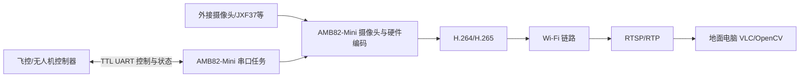

# 无人机图传 Wi‑Fi 模块开发：第一轮资料搜集

> 整理日期：2026-10-29  
> 范围：仅针对图片中间一行“无人机无线图传 WIFI 模块开发”。图片是项目需求背景，不是额外的聊天指令；本文件按你的请求整理资料、技术路线和周末前分工建议。

## 1. 从项目描述提炼出的任务边界

当前可以把项目拆成四个最小闭环：

1. **摄像头采集**：AMB82-Mini 连接板载或外接摄像头，确认传感器型号、供电、排线/转接板和图像格式。
2. **Wi‑Fi 图传**：通过 Wi‑Fi 把实时视频送到地面电脑；第一版优先采用官方 RTSP 示例，电脑端用 VLC 播放。
3. **机载串口通信**：预留 TTL UART，与飞控/无人机控制设备交换状态或控制数据；先完成回环和协议草案。
4. **性能验证**：测量端到端延迟、帧率、分辨率、码率、丢包/卡顿、有效距离、功耗和断线重连。

建议第一阶段目标定义为：**“单板 + 摄像头 + Wi‑Fi + PC 能稳定播放 RTSP 视频，并能通过 TTL 串口收发一条可校验的控制帧。”** 这比一开始做自研协议或 WebRTC 更适合本周末前定方案。

## 2. 最重要的官方资料

### A. AMB82-Mini Arduino 入门与硬件引脚

- [官方 Getting Started（GitHub 文档源文件）](https://github.com/Ameba-AIoT/ameba-arduino-doc/blob/main/source/ameba_pro2/amb82-mini/Getting_Started/Getting%20Started%20with%20Ameba.rst)
- [在线版 AMB82-Mini 文档](https://ameba-doc-arduino-sdk.readthedocs-hosted.com/en/latest/ameba_pro2/amb82-mini/index.html)

要点：

- AMB82-Mini 基于 RTL8735B/AmebaPro2，官方入门文档列出 Wi‑Fi、BLE、GPIO、I2C、UART、SPI、PWM、ADC，以及音视频编解码能力。
- 文档给出了引脚表：Serial1 为 PA2/PA3，Serial2 为 PD16/PD15，Serial3 为 PE2/PE1；LOG_TX/LOG_RX 在 PF4/PF3。实际接飞控前必须以手上的板卡版本和原理图复核，避免占用日志口或下载口。
- Arduino IDE 中选择 `AmebaPro2 ARM (32-bits) Boards -> AMB82-MINI`。官方文档说明支持 Windows 10+、Ubuntu 22+、macOS。
- 板卡没有完全自动下载流程时，需要按官方顺序进入下载模式：按住 UART_DOWNLOAD，再按/松 RESET，再松 UART_DOWNLOAD。

### B. 官方 Arduino SDK

- [Ameba-AIoT/ameba-arduino-pro2](https://github.com/Ameba-AIoT/ameba-arduino-pro2)

要点：

- 官方 AmebaPro2 Arduino SDK，仓库当前提供稳定 `main` 和早期 `dev` 分支；初次开发建议使用 `main`。
- Arduino IDE 的附加开发板 JSON（稳定版）：
  `https://github.com/Ameba-AIoT/ameba-arduino-pro2/raw/main/Arduino_package/package_realtek_amebapro2_index.json`
- 该仓库包含摄像头、Wi‑Fi、视频和示例代码；许可证为 MIT，但具体依赖和二进制工具仍应按仓库说明检查。

### C. 官方 RTSP 图传示例（本项目最优先）

- [官方中文 RTSP Streaming 教程](https://www.amebaiot.com.cn/cn/amebapro2-arduino-video-rtsp/)
- [官方英文 RTSP 示例文档](https://ameba-doc-arduino-sdk.readthedocs-hosted.com/en/latest/ameba_pro2/amb82-mini/example-guides/multimedia/rtsp-streaming.html)
- [官方 RTSP 示例视频](https://www.youtube.com/watch?v=sFYnj4_Xq7A)

官方流程：

1. Arduino IDE 打开 `File -> Examples -> AmebaMultimedia -> StreamRTSP`。
2. 填入 Wi‑Fi SSID 和密码，编译、上传。
3. 串口监视器读取板卡 IP 与 RTSP 端口。
4. PC 与开发板处于同一网络，在 VLC 中打开 `rtsp://<IP>:<port>`；默认端口通常为 554，双路流示例使用 554/555。
5. 官方示例包含 `VideoOnly`、`SingleVideoWithAudio`、`DoubleVideo`、`DoubleVideoWithAudio`。
6. 官方示例默认可配置三路视频：1920×1080@30 H.264、1280×720@30 H.264、1280×720@30 MJPEG；码率可按 Wi‑Fi 情况调整。无人机第一版建议从单路 720p/30fps 或 1080p/30fps 开始，记录实测延迟后再降码率。

### D. 硬件设计、数据手册和摄像头资料

- [AmebaPro2 硬件设计指南](https://ameba-doc-rtos-pro2-sdk.readthedocs-hosted.com/en/latest/hw_design/)
- [官方 AMB82-Mini 数据手册下载页](https://www.amebaiot.com.cn/en/datasheet-download-amb82-mini/)
- [官方 Camera Module Bring Up Guide](https://www.amebaiot.com.cn/en/camera-module-bring-up-guide/)
- [官方 AMB82-Mini 产品/开发资料总入口](https://www.amebaiot.com.cn/en/ameba-arduino-summary/)

硬件设计指南包含复位、启动/下载、供电、VDD33、UART 日志、Flash、SD 卡、图像传感器和 PCB 布局等章节。图传项目在接入无人机电源前，至少需要核对 5V 供电能力、3.3V 电平、天线/IPEX、摄像头转接板和 UART 电平。

## 3. FreeRTOS/标准 SDK：第二阶段再用

- [官方 ameba-rtos-pro2 SDK](https://github.com/Ameba-AIoT/ameba-rtos-pro2)
- [官方 SDK 文档仓库](https://github.com/Ameba-AIoT/ameba-rtos-pro2-doc)
- [SDK 架构说明](https://github.com/Ameba-AIoT/ameba-rtos-pro2-doc/blob/master/source/application_note/02_SDK.rst)
- [MMF 多媒体框架与视频示例](https://github.com/Ameba-AIoT/ameba-rtos-pro2-doc/blob/master/source/application_note/06_MMF.rst)
- [官方 AMB82-Mini 标准 SDK 入门](https://www.amebaiot.com/en/ameba-sdk-getting-started-amb82-mini/)

MMF 文档把视频链路分成 source（摄像头）、codec（H.264/H.265/JPEG）和 sink（RTSP 等），并列出 `mmf2_video_example_v1_init`、双路 RTSP、动态调整分辨率/码率、运动检测叠加等例程。若 Arduino 示例已经跑通、但后面需要精确控制缓冲、码率、断线重连或自定义协议，再转到 FreeRTOS/MMF。

## 4. 可参考的 GitHub 项目

### 直接参考图传链路

- [Dennis40816/ameba_stream_project](https://github.com/Dennis40816/ameba_stream_project)

这是一个面向最多 12 块 AMB82-Mini 的 RTSP 实验项目，包含：

- `RTSP.ino`：板端固件；
- Python/OpenCV 接收端；
- mDNS 发现；
- 多摄像头显示、抓帧和按帧保存；
- JXF37(P) 摄像头和手动刷写说明。

它适合参考“PC 地面端如何接收、显示、保存视频”和多设备管理，但仓库 star/fork 很少，属于实验项目，不能直接视为稳定产品代码。

### 图传 + 机载节点参考

- [NNavoda/AMB82-MINI-Vision-Hub](https://github.com/NNavoda/AMB82-MINI-Vision-Hub)

该项目把 AMB82-Mini 作为独立 Vision Hub，使用 RTSP/H.264，并把视频显示和其他控制节点分开。README 给出一个可运行的 AP 模式示例：连接 `RobotCar-Demo` 后用 VLC 打开 `rtsp://192.168.1.1:554/`。其视频参数示例为 640×480、20 fps、1 Mbps、GOP=10，并展示了低延迟配置思路。项目还集成 YOLOv4-Tiny 和 ESP-NOW，但这些部分对你当前的“图传模块”不是第一优先级，适合借鉴系统分层和低延迟参数。

### 进阶 WebRTC 参考（暂不作为第一版）

- [AMB82 Mini 本地 WebRTC H.264 实验](https://forum.amebaiot.com/t/working-poc-amb82-mini-local-webrtc-h-264-streaming-to-firefox-without-aws/5168)

该实验报告称在 AMB82 Mini 上实现本地 Firefox WebRTC，使用 `kvs_webrtc_v2_mmf`，测试中报告约 110–120 ms 端到端延迟。但它需要 FreeRTOS SDK 修改、本地信令服务器、ICE/DTLS 兼容处理，且作者明确说明仍是实验性 PoC，只有一个观看端、没有认证/HTTPS/STUN/TURN，适合了解进阶方向，暂不适合本周末拿来定第一版。

## 5. 推荐的系统切分

建议把视频面和控制面分开：

- **视频面**：摄像头 → H.264 → RTSP/RTP → PC；允许丢少量视频包，优先保持实时性。
- **控制面**：飞控 ↔ TTL UART；使用短帧、固定帧头、长度、命令字、序号、数据、CRC，和视频传输互不阻塞。
- **调试面**：USB 日志/串口监视器单独记录 Wi‑Fi 状态、IP、RTSP 状态、帧率和错误码。

## 6. 周末前可执行的分工

如果团队有 4 人，可以按下面分：

| 角色 | 周末交付物 | 首要资料 |
|---|---|---|
| 板端环境/摄像头 | Arduino 环境、板卡烧录、摄像头识别、Blink/串口日志 | Getting Started、Camera Bring Up |
| 图传链路 | 跑通 `StreamRTSP -> VideoOnly`，VLC 播放，记录分辨率/帧率/码率/延迟 | 官方 RTSP 教程、SDK 示例 |
| 地面端/测试 | VLC/OpenCV 接收，测延迟、丢帧、有效距离、断线重连 | `ameba_stream_project` |
| 串口/系统集成 | TTL 电平核对、UART 回环、控制帧格式、和视频任务并行验证 | 引脚表、UART 示例、硬件设计指南 |

负责人本人建议只抓三件事：确认手上硬件与摄像头型号、把验收指标写成表格、每天收集每个人的“可复现步骤 + 日志 + 视频证据”。

## 7. 周末前建议完成的最小验收表

- 能否稳定烧录并启动；
- Wi‑Fi 模式：连接现有 AP，还是 AMB82-Mini 自建 AP；
- PC 是否能连续播放 10 分钟；
- 分辨率、帧率、编码格式、码率；
- 端到端延迟（用同一画面中的秒表/LED闪烁估计，至少测 10 次并记平均/最大值）；
- 5 m、10 m、无遮挡/有遮挡时的丢帧和断流情况；
- Wi‑Fi 断开后是否自动重连；
- UART 电平是否为 3.3V TTL，波特率、校验位和帧格式；
- 视频流是否会阻塞 UART；
- 功耗和供电电流，尤其是接入无人机电池/电调电源时的峰值电流与稳压。

## 8. 本轮结论与下一步

第一轮最稳妥路线是：

1. 先按官方 Getting Started 配好 Arduino IDE 和 AMB82-Mini；
2. 直接运行官方 `StreamRTSP/VideoOnly`，让 VLC 播放；
3. 在此基础上增加一个独立 UART 回环/控制帧任务；
4. 再参考 `ameba_stream_project` 做 Python/OpenCV 地面端和记录；
5. 只有当 RTSP 的延迟、断线重连或多端播放不满足指标时，才进入 FreeRTOS/MMF、UDP/RTP 或 WebRTC 评估。

需要团队在周末会议上明确的三个问题：手上的 AMB82 具体版本与摄像头型号、无人机控制器 UART 的电平/协议、第一版允许的最大延迟与最低画质。没有这三项，无法可靠决定 AP/STA 模式、串口引脚和码率。

## 资料可信度说明

- **优先依据**：Realtek/Ameba 官方网站、官方 GitHub SDK/文档。
- **工程参考**：GitHub 社区仓库，只用于学习和验证思路，需自行检查提交时间、许可证和可复现性。
- **实验性资料**：WebRTC 论坛 PoC，已明确标注局限，不作为本项目第一版承诺。

## 9. 互联网上可参考的成品和完整样机

这一节只收集已经做成“可以安装、可以使用、可以展示”的模块或系统，重点看它们的外形、接口、地面端和参数怎么写。

### 9.1 最接近本项目的成品：Mlink-video 图传数传一体模组

- 产品页：[Fancinnov Mlink-video](https://www.fancinnov.com/Mlink-video)
- B站视频：[Mlink-video 图传数传一体模组使用方法](https://www.bilibili.com/video/av870401926/)

它和本项目最接近，原因是它把摄像头、无线图传、串口数传和手机端软件做成了一个完整模组。公开资料中给出的特点包括：

- 1080P 摄像头；
- 空旷无遮挡环境下最远约 150 m 实时图传；
- 双向串口透传，115200 波特率；
- 支持板载 microSD 卡；
- 配套 Android/iOS App；
- 可以拍照、录像、翻转和缩放；
- 供电、摄像头和串口接口都已经整理成可使用的产品形态。

这个项目最值得借鉴的不是“150 m”这个数字，而是它的交付形态：

> 摄像头、主板、天线、电源、串口和手机端软件一起组成一个可以直接使用的产品。

它可以作为我们最终成品的外形和功能参考。它公开的距离是产品宣传条件，不能直接当作第三方实验结论。

### 9.2 工业级图传数传一体设备：腾远智拓

- B站产品视频：[腾远智拓无人机图传数传电台系列](https://www.bilibili.com/video/BV1LaPGz9E2z/)

视频介绍的是面向无人机的图传、数传、遥测一体电台，公开宣传参数包括：

- 传输距离约 15–20 km；
- 图传、数传、遥测三合一；
- 接口较丰富；
- 兼容主流飞控；
- 面向工业和无人机应用。

它和我们当前的 AMB82-Mini Wi-Fi 方案不是同一档次，也不是同一无线技术路线，但适合参考一件事：真正的无人机通信产品不会只展示“画面能传”，还会把飞控接口、安装方式、距离、遥测和产品外壳一起交付。

### 9.3 5G 图传数传一体：GSLink 方案

- B站视频：[无人车无人机，5G 图传初体验，1080P](https://www.bilibili.com/video/BV1Tf4y1S7m6/)

这个案例使用 5G 图传设备和华为 5G 上网终端，接收端使用普通 Wi-Fi。它可以帮助我们理解：

- 机载端负责采集和上传；
- 地面端负责接收和显示；
- 视频链路和控制/数传链路可以作为一个系统交付；
- 1080P 只是画质指标，不能代替距离、延迟和稳定性指标。

它更适合参考“系统如何分成机载端和地面端”，不适合作为当前短距离 Wi-Fi 方案的直接实现。

### 9.4 个人 DIY 数字图传：WFBroadcast、ESP32-CAM-FPV

- B站视频：[个人 DIY 数字图传的几种方案介绍](https://www.bilibili.com/video/BV1K34y1W7ZB/)

视频整理了几类 DIY 数字图传方案，包括：

- WFBroadcast；
- ESP32-CAM-FPV；
- ESP32 无线功放；
- 机载端和地面端的配合方式。

它适合用来观察“一个完整 DIY 图传系统除了摄像头，还需要什么”，例如：

- 机载视频源；
- 无线发送端；
- 地面接收端；
- 视频解码和显示；
- 天线和供电；
- 传输距离与延迟测试。

这个案例更偏方案介绍，不能直接作为 AMB82-Mini 成品的外形参考。

### 9.5 ESP32S3 Wi-Fi 图传样机

- B站视频：[手把手教你实现 WIFI 图传：ESP32S3 IDF](https://www.bilibili.com/video/BV1ZxQcYvEkf/)

视频给出的样机能够：

- 使用摄像头采集视频；
- 建立设备热点；
- 通过 192.168.4.1 访问视频；
- 在电脑或手机端查看画面。

它适合参考低成本样机如何向用户展示，但它更接近“开发演示”，与本项目要求的 AMB82-Mini、RTSP、飞控 UART 和机载稳定性还有差距。

### 9.6 B站低成本成品和实测视频

可以继续观察这些视频，但要把它们归为“外形和效果参考”，不要直接拿宣传数字当指标：

- [100元制作高清数字图传](https://search.bilibili.com/all?keyword=100%E5%85%83%E5%88%B6%E4%BD%9C%E9%AB%98%E6%B8%85%E6%95%B0%E5%AD%97%E5%9B%BE%E4%BC%A0)
- [STM32 无线图传：2.4G Wi-Fi 远距 720P 低延迟视频传输](https://search.bilibili.com/all?keyword=STM32%20%E6%97%A0%E7%BA%BF%E5%9B%BE%E4%BC%A0%20720P)
- [给小飞机做个 8 克重支持 OpenIPC 的数字图传 AIO](https://search.bilibili.com/all?keyword=%E7%BB%99%E5%B0%8F%E9%A3%9E%E6%9C%BA%E5%81%9A%E4%B8%AA8%E5%85%8B%E9%87%8D%E6%94%AF%E6%8C%81OpenIPC%E7%9A%84%E6%95%B0%E5%AD%97%E5%9B%BE%E4%BC%A0AIO)
- [十几块的 Wi-Fi 图传](https://search.bilibili.com/all?keyword=%E5%8D%81%E5%87%A0%E5%9D%97%E7%9A%84%20WIFI%20%E5%9B%BE%E4%BC%A0)

其中“8 克重 AIO”适合参考小型化目标；“STM32 720P”适合参考低成本视频链路；“100 元数字图传”适合观察 DIY 项目如何做出可演示样机。但它们的芯片、协议和指标不一定适用于 AMB82-Mini。

### 9.7 开源完整系统：OpenHD 和 WFB-ng

- [OpenHD](https://github.com/OpenHD/OpenHD)
- [PX4 WFB-ng 图传说明](https://github.com/PX4/PX4-user_guide/blob/main/en/companion_computer/video_streaming_wfb_ng_wifi.md)

这两个项目已经把无人机视频、遥测和地面端作为完整系统来做。它们适合参考：

- 机载端和地面端如何配套；
- 视频和 MAVLink 遥测如何同时传输；
- 距离、带宽、天线、FEC 如何写进系统参数；
- 地面站如何显示视频和飞行数据。

它们需要树莓派、专用 Wi-Fi 适配器或更复杂的无线配置，不是 AMB82-Mini 第一版的直接实现路线。

## 10. 参考项目之间的关系

| 参考对象 | 更适合参考什么 | 与本项目的关系 |
|---|---|---|
| Mlink-video | 成品外形、接口、手机端、图传+串口 | 最接近 |
| 腾远智拓电台 | 工业产品、飞控接口、距离和遥测指标 | 远期产品形态 |
| GSLink 5G | 机载端/地面端系统分工 | 参考架构 |
| ESP32S3/ESP32-CAM | 低成本演示和地面端界面 | 参考样机 |
| OpenHD/WFB-ng | 视频+遥测系统、远距离链路 | 远期技术路线 |
| AMB82-Mini Vision Hub | AMB82-Mini 上的 RTSP 和节点分层 | 当前硬件参考 |

## 11. 对我们项目最有用的结论

现阶段最值得拿来对照的不是 DJI 这类完整商业系统，而是 Mlink-video 这类“摄像头 + 无线图传 + 串口透传 + 地面端软件”的成品。

因此，我们的第一版最终产品可以把目标描述为：

> 一个以 AMB82-Mini 为核心、带外接摄像头和 Wi-Fi 天线、支持 RTSP 视频输出和 TTL UART 通信、能够安装在无人机或模拟机架上的小型图传数传一体样机。

它至少要在外观和功能上接近 Mlink-video 的完整程度，再用自己的参数表证明：

- 视频能稳定传输；
- 延迟可以测量；
- UART 能和飞控通信；
- 模块可以固定和供电；
- 地面端能看到并记录结果。

GitHub 项目更适合参考代码和软件架构，B站和产品官网更适合参考成品外观、包装方式和实际演示。两类资料要分开使用。

