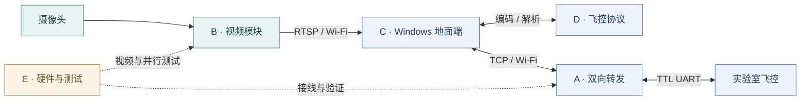

# 无人机 Wi-Fi 图传项目

**总进度看板** · 总工期两周 · 五人并行 · 桌面原型

> [!abstract] 最终要交付什么
> 基于 **AMB82-Mini**，让摄像头画面通过 Wi-Fi 传到 Windows 地面端；地面端按照实际飞控协议，经 TCP 与 UART 下发命令并接收返回数据。最终展示**视频与控制同时运行**的完整系统，并提交可复现的测试报告。

[[#01 · 项目总览|项目总览]] · [[#02 · 第一周工作重点|首周重点]] · [[#03 · 第二周任务清单|下周任务]] · [[#04 · 从 Demo 到完整系统|阶段里程碑]] · [[#05 · 跨成员接口约定|接口约定]] · [[#06 · 风险与待确认事项|风险跟踪]] · [[#07 · 项目验收指标表|验收指标]] · [[#08 · 最终交付|最终交付]]

**配套排期**：[[无人机图传WiFi项目-项目进度计划表|项目进度计划表]]，按周查看五人任务与阶段交付。

---

## 01 · 项目总览

### 当前状态

| 管理项 | 当前记录 |
| :--- | :--- |
| 项目负责人 | A：待填写姓名 |
| 团队成员 | B：待填 · C：待填 · D：待填 · E：待填 |
| 当前阶段 | 已有技术任务书，实际工程进度待首次核对 |
| 项目总工期 | 两周；具体开始日期待明确 |
| 本周周期 | 第 __ 周：____-__-__ → ____-__-__ |
| 推进主线 | 第一周完成基础与链路闭环，第二周完成并行集成、测试和交付 |

**状态约定**：待核对 · 未开始 · 进行中 · 待验收 · 已完成 · 阻塞。

“待核对”表示还没有取得成员的真实进度记录。任务有可运行成果后进入“待验收”，经指定人员复现并记录结论后，才勾选为“已完成”。

### 五条工作线，汇成一个系统

| 成员 | 核心交付 | 对最终验收的贡献 | 当前状态 |
| :--- | :--- | :--- | :--- |
| **A · 通信与集成** | TCP ↔ UART 双向转发固件 | 命令和返回数据能够到达两端 | 待核对 |
| **B · 视频图传** | 摄像头采集、编码、RTSP 模块 | Windows 持续接收到实时画面 | 待核对 |
| **C · Windows 地面端** | 视频、命令、状态与日志界面 | 在一个程序内完成操作和观察 | 待核对 |
| **D · 飞控协议** | 命令编码与流式解析模块 | 飞控能够识别命令，返回能够解析 | 待核对 |
| **E · 硬件与测试** | 接线方案、独立测试工具与报告 | 用数据证明完整系统的实际表现 | 待核对 |

任务书入口：[[分工A-整理版|A 通信]] · [[分工B-整理版|B 视频]] · [[分工C-整理版|C 地面端]] · [[分工D-整理版|D 协议]] · [[分工E-整理版|E 测试]]。



B 验证视频路径，A 验证字节传输，D 验证协议交互，C 将功能组合成可用程序，E 检查硬件与完整系统表现。独立 Demo 是阶段成果；最终还要验证它们组合后的并行运行。

---

## 02 · 第一周工作重点

**本周目标：完成基础模块与视频、控制链路闭环。** 各成员自行安排周内时间，以周末能够展示的成果验收。

| 成员 | 本周计划 | 周末验收成果 |
| :--- | :--- | :--- |
| **A** | 复现 UART/TCP，完成双向透传，配合飞控联调 | 两方向二进制数据正确传输，有收发对比日志 |
| **B** | 确认摄像头配置，跑通 VideoOnly，向 C 提供 RTSP | Windows 可播放实际摄像头画面，配置与参数明确 |
| **C** | 建立窗口，接入视频、TCP 和 D 的协议接口 | 地面端能显示视频、发送命令、显示返回和日志 |
| **D** | 确认实际协议，完成编码与解析，验证非运动类命令 | 合法命令经真实飞控验证，返回数据能够解析 |
| **E** | 核对接线与电气条件，建立工具并测试独立链路 | 接线图、测试脚本、字节校验和基础视频数据齐全 |

**第一周末成果**：电脑可显示真实视频；地面端可经 AMB82 向飞控发送合法命令并显示返回数据。此时两条链路分别成立，为第二周并行运行做准备。

---

## 03 · 第二周任务清单

> [!tip] 第二周目标
> 完成视频与控制并行集成、异常处理及测试复测。周末交付完整桌面原型、源代码、测试报告和演示材料；周内时间由成员自行安排。

### A · 集成固件与通信稳定性

- [ ] 与 B 统一 Wi-Fi 初始化和启动顺序，在同一固件中运行视频与 TCP↔UART。
- [ ] 处理双向缓冲、网络阻塞、断线重连，并验证并行时字节完整性。
- [ ] 修复测试发现的通信问题，整理固件版本、配置和烧录说明。

**完成标准**：视频播放时控制链路仍双向有效，固件能够按说明复现。

### B · 视频集成与参数验证

- [ ] 向集成固件交付摄像头和 RTSP 模块，配合统一网络管理。
- [ ] 与 E 对比视频独立运行和并行运行的 FPS、延迟、卡顿和断流。
- [ ] 根据测量结果调整参数，整理最终视频配置与测试结论。

**完成标准**：集成版本可持续接流，视频参数及实际表现有记录。

### C · 完整地面端

- [ ] 在一个窗口内同时显示视频、发送协议命令、解析返回并显示日志。
- [ ] 处理播放失败、网络断开、重连和错误提示，保持界面响应。
- [ ] 完成问题修复，整理可运行程序、依赖和使用说明。

**完成标准**：通过一个 Windows 程序完成视频与控制交互，支持完整演示。

### D · 并行条件下的协议验证

- [ ] 验证视频运行时的命令生成、返回解析、应答与超时处理。
- [ ] 与 A、C 约定断线、重复及过期命令的处理，完成异常交互复测。
- [ ] 回归真实飞控命令交互，整理协议接口、样例和验证说明。

**完成标准**：实际协议交互在集成系统内成立，返回结果及异常状态可解释。

### E · 系统测试与报告

- [ ] 测试并行运行、断线恢复、持续通信和突发负载。
- [ ] 测量实际 FPS、端到端延迟、距离表现、连续运行、功耗和重量。
- [ ] 对修复版本复测，整理原始数据、复现步骤和最终测试报告。

**完成标准**：交付版本有对应测试结果，功能与性能结论均带测试条件。

---

## 04 · 从 Demo 到完整系统

四个里程碑均安排在两周总工期内：第一周完成 M1、M2，第二周完成 M3、M4。每周计划与成果验收见[[无人机图传WiFi项目-项目进度计划表|项目进度计划表]]。

| 阶段 | 通过时应看到什么 | 牵头 / 协作 | 状态 |
| :--- | :--- | :--- | :--- |
| **M1 · 独立基础（第一周）** | 五个独立阶段成果及证据齐全 | 各成员并行推进 | 待核对 |
| **M2 · 链路闭环（第一周）** | TCP↔UART 双向正确；C 接入真实 RTSP；实际协议命令与飞控返回完成交互 | A、C、D / E | 待核对 |
| **M3 · 并行集成（第二周）** | 同一固件提供视频与控制，地面端同时播放、发送命令和显示返回 | A、B、C / D、E | 待核对 |
| **M4 · 测试交付（第二周）** | 完成性能、断线与连续运行测试，固定版本并交付文档和演示 | E、全员 / A 汇总 | 待核对 |

### M2—M4 验收卡

> [!example]- M2 · 链路闭环
> - [ ] TCP → UART：二进制内容、长度和顺序一致。
> - [ ] UART → TCP：返回数据内容、长度和顺序一致。
> - [ ] C 在程序内显示 B 提供的真实 RTSP 视频。
> - [ ] 地面端经 A 下发实际协议报文，飞控返回由 D 解析。
> - [ ] 分别记录字节送达、协议识别和命令结果的证据。
>
> **依赖**：M1、实际飞控、接口约定。  

> [!example]- M3 · 视频与控制并行
> - [ ] A、B 统一管理 Wi-Fi 初始化、启动顺序与运行资源。
> - [ ] 视频播放时，命令下发和数据返回仍能正常工作。
> - [ ] C 的播放、网络和界面交互持续响应。
> - [ ] 对比单独运行与并行运行的延迟、错误和卡顿。
> - [ ] 验证网络中断、重连、超时和积压数据处理。
>
> **依赖**：M2、集成固件与地面端版本。  

> [!example]- M4 · 测试与最终交付
> - [ ] 按确认后的验收指标完成测试，保留原始数据。
> - [ ] 未达目标项有原因、影响和后续处理结论。
> - [ ] 固定固件、地面端和协议模块版本。
> - [ ] 在该版本上复现完整演示，整理代码、文档和报告。
>
> **依赖**：M3、确认后的指标及测试条件。  

---

## 05 · 跨成员接口约定

开发过程中提前交付最小接口与样例。接收方运行样例后再确认交接，接口变化同步到相关成员。

| 接口 | 必须约定的内容 | 确认方式 | 状态 |
| :--- | :--- | :--- | :--- |
| **A ↔ B** | Wi-Fi 初始化负责人、启动顺序、RTSP/TCP 并行方式 | 同一固件同时运行并保存日志 | 待确认 |
| **A ↔ C** | 网络模式、IP、TCP 端口、字节格式、连接和重连行为 | C 连接 A，完成二进制双向收发 | 待确认 |
| **A ↔ D** | UART 参数、字节透传、协议边界、超时处理归属 | D 的样例报文通过 A 完整到达两端 | 待确认 |
| **C ↔ D** | Python 接口、输入输出、流式解析、异常与状态 | C 运行 D 的编码和解析样例 | 待确认 |
| **B ↔ C** | RTSP 地址、端口、视频格式、播放和重连方式 | VLC 验证后嵌入地面端 | 待确认 |
| **A / D ↔ E** | UART 引脚、电平、供电、接线与实际串口参数 | 接线核对并完成实物收发 | 待确认 |
| **A / B ↔ E** | 测试版本、条件、数据格式和指标定义 | E 独立执行，双方确认结果 | 待确认 |

> [!example]- C 与 D 的最小接口建议
> 下列名称来自评估意见，尚不是冻结的正式 API。C、D 确认输入输出后再采用。
>
> ```python
> packet = protocol.encode_command("request_status")  # 返回 bytes
> messages = protocol.feed_data(received_bytes)       # 返回解析消息列表
> ```
>
> 编码接口根据实际协议支持的命令和参数生成报文；解析接口持续接收字节，在多次调用之间保留未完成的数据。不能假设一次 TCP 读取就是完整协议帧。


---

## 06 · 风险与待确认事项

优先处理会改变技术路线或阻止实物联调的问题。下面的优先级来自评估意见；是否已经解决，需要成员核对。

| 优先级 | 待确认事项 | 负责 / 影响成员 | 关闭条件 |
| :--- | :--- | :--- | :--- |
| **P0 · 最高** | 飞控品牌、型号、固件与实际协议 | D 跟进；影响 A、C、D、E | 有实际设备信息和对应协议文档 |
| **P0 · 最高** | 飞控 UART 电平与波特率 | D、E 确认；影响 A、D、E | 电气条件、串口配置和接线得到核验 |
| **P1 · 高** | 摄像头具体型号与 SDK 配置 | B、E；影响 B、C | 实物型号、选项和采集结果一致 |
| **P1 · 高** | AMB82 实际 UART 引脚 | E、A；影响 A、E | 对照板卡核对，并完成串口验证 |
| **P1 · 高** | Wi-Fi 网络与连接方式 | A 牵头；影响 A、B、C | 明确 AP/STA、地址、端口与初始化归属 |
| **P1 · 高** | 量化指标与最终验收时间 | A 确认，E 整理；影响全员 | 要求、目标、日期分别记录并确认 |
| **P1 · 高** | 板卡、摄像头和飞控可用时间 | E 登记，A 协调；影响全员 | 到货/借用时间和联调安排明确 |

无硬件时，C 可继续本地视频与模拟 TCP；E 可继续脚本与测试表；D 可整理资料、明确接口，在实际协议确认后开展报文模拟。模拟成果在验收记录中注明验证范围。

---

## 07 · 项目验收指标表

> [!important] 功能要求与性能目标分别管理
> 依据本次评估文本，最终交付为**桌面环境的完整原型系统**，无需实际安装飞行。Windows 实时显示、飞控协议命令交互、视频与控制并行属于功能主线；720p、15/30 FPS、2 Mbps、300 ms 等属于团队建议、测试配置或待验证目标。当前未提供实测结果。

### 功能验收

| 验收项 | 通过时应展示什么 | 负责 / 测试 | 结果与证据 |
| :--- | :--- | :--- | :--- |
| 视频采集与传输 | Windows 持续显示实际摄像头画面 | B、C / E | 待填写 |
| 双向通信桥接 | TCP↔UART 两方向字节正确传输 | A / E | 待填写 |
| 飞控协议交互 | 至少一种非运动类命令交互，返回可解析 | D、A、C / E | 待填写 |
| 统一地面端 | 一个程序完成视频、控制、状态和日志功能 | C / A、E | 待填写 |
| 视频与控制并行 | 视频运行时命令和返回数据仍有效 | 全员 / E | 待填写 |
| 可复现测试与报告 | 条件、步骤、版本、数据和结论完整 | E / A 汇总 | 待填写 |

### 性能与优化目标

| 类别 | 当前建议 / 要确认的内容 | 记录方法 | 实测结果 |
| :--- | :--- | :--- | :--- |
| 团队初步目标 | 720p；实际帧率先验证 ≥15 FPS，再评估 30 FPS | 配置值与实测 FPS 分开记录 | 待测 |
| 视频测试配置 | 2 Mbps 可作起始码率配置，按表现调整 | 保存编码、码率及播放器缓存 | 待测 |
| 延迟优化目标 | ≤300 ms 为建议目标 | 记录端到端测量方法和多次样本 | 待测 |
| 连续运行探索 | 先尝试 30 分钟，最终时长待确认 | 记录断流、断线、重启和异常次数 | 待测 |
| 距离探索 | 近距离起步，再试 10 m、30 m 地面视距 | 固定环境，记录遮挡和视频表现 | 待测 |
| 通信可靠性 | 字节完整性、错误率、命令应答与超时 | 发送/接收对比、原始报文和日志 | 待测 |
| 并行影响 | 单独运行与视频/控制并行的差异 | 同条件比较延迟、错误与卡顿 | 待测 |
| 功耗与重量 | 暂无确认的量化门槛 | 记录测量点、模式、器件组成 | 待测 |
| 后续优化 | 更低延迟、更高帧率与更好画质 | 只在基础闭环成立后逐项对比 | 待安排 |

录像、更多遥测展示是否纳入本期交付，沿用已有资料中的建议性质，由 A 按最终任务要求确认。

每次测试保存 **版本与配置 → 测试步骤 → 原始数据 → 结论**。视频配置帧率与实际 FPS、通信往返耗时与单向延迟、媒体丢包与应用字节缺失，分别记录。

---

## 08 · 最终交付

### 最终交付清单

- [ ] **硬件**：AMB82-Mini 原型、器件清单、接线与供电方案。
- [ ] **固件**：视频和控制集成源代码、SDK 版本、编译烧录说明。
- [ ] **地面端**：可运行的 Windows 程序、依赖和启动步骤。
- [ ] **协议模块**：接口说明、实际协议依据、样例与飞控验证记录。
- [ ] **测试报告**：视频、通信、并行、断线和连续运行结果，附原始数据。
- [ ] **技术文档**：系统架构、配置、故障排查及已知限制。
- [ ] **演示视频**：启动 → 视频显示 → 命令下发 → 返回解析 → 并行运行。
- [ ] **交付版本**：代码、硬件配置、测试报告与演示对应同一版本。

### 资料入口与维护记录

**任务与验收**：[[项目目标]] · [[无人机图传WiFi项目-最终验收成果定义]]  
**成员分工**：[[分工A-整理版|A]] · [[分工B-整理版|B]] · [[分工C-整理版|C]] · [[分工D-整理版|D]] · [[分工E-整理版|E]]  
**技术参考**：[[无人机图传WiFi项目-知识笔记]] · [[无人机图传WiFi模块-第一轮资料搜集]] · [[1|可靠通信与并行运行讨论]]

| 日期 | 更新内容 |
| :--- | :--- |
| 2026-10-31 | 按评估全文重写，并依用户反馈精简：精简填写模板、重复信息栏和周会内容；新增配套项目进度计划表，并按两周总工期同步每周计划与成果验收，取消按天排期。 |

*总工期两周，按每周成果验收；成员自行安排周内时间，任务状态以实际成果为准。*